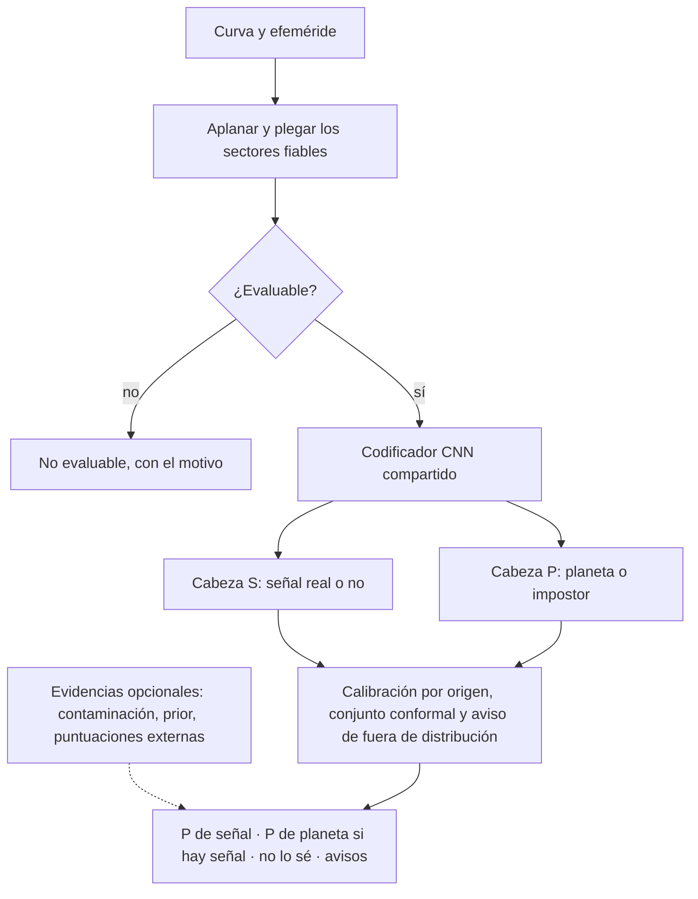
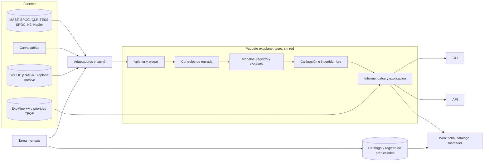

# Diseño futuro: modelos y aplicación

11 de noviembre de 2026 · Preparado por Claude para Jairo.

Se apoya en la [revisión detallada](auditoria-2026-11-11.md); las referencias M1–M6, I1–I12 y U1–U8 son sus hallazgos. Todo lo que aquí se propone es una propuesta: las decisiones de la sección 5 son tuyas.

**La idea en una frase:** convertir el modelo en *un primer filtro portable y honesto* (cualquier curva con su efeméride, de cualquier telescopio) que diga cuándo no puede decidir y qué información haría falta, y ponerlo al alcance de cualquiera con una ficha en español, un catálogo y un marcador público de aciertos.

## 1. Cinco principios

| Principio | Evidencia que lo motiva |
|---|---|
| **1. Separar las preguntas.** «¿Hay señal?», «¿planeta o impostor?» y «¿qué más se sabe?» se responden por separado | Con una sola salida de 3 clases, los negativos difíciles arreglaron una pregunta y estropearon la otra (M4) |
| **2. Invertir en información, no en arquitectura.** | Seis familias de modelos acaban entre 0,78 y 0,85. En TESS el ROC no sube ni con SNR > 80. Dos sectores sí dan +0,03 (M2, M3) |
| **3. Núcleo portable y evidencias opcionales.** El núcleo solo pide la curva; lo demás son módulos que pueden faltar | Los FP de TESS que se escapan son de contaminación, invisible en la curva (M2) |
| **4. Probabilidad solo donde está calibrada.** En un telescopio nuevo, una puntuación para ordenar y un «no lo sé» | La temperatura óptima sin ver la misión va de 0,89 a 1,68 y no se puede predecir (M5) |
| **5. Cada versión se congela.** Manifiesto, ficha del modelo y comprobación prospectiva | Ya se hizo con la v1; se convierte en norma |

## 2. Diseño de los modelos

### 2.1 Para qué sirve el modelo: las etapas del vetting

| Etapa | Pregunta | Quién la resuelve | Cómo va hoy |
|---|---|---|---|
| 0 | ¿Es una señal real con forma de tránsito, o ruido? | El modelo | Muy bien con efeméride de catálogo; mal con ruido realista (20–43 % pasa por planeta) |
| 1 | ¿Es una binaria evidente? | El modelo | Bien, y se transfiere: ROC sin ver la misión 0,955 (K2) y 0,897 (Kepler) |
| 2 | De lo que queda, ¿planeta o impostor sutil? | Píxeles y seguimiento | Débil: ROC 0,78–0,86 en TESS, cuyos FP son de esta etapa |

El modelo debe diseñarse, medirse y presentarse como herramienta de las etapas 0 y 1. Para la etapa 2 aporta una segunda opinión y, sobre todo, debe decir que la curva no basta.

### 2.2 La decisión factorizada



- **Cabeza S** aprende de todo: señales reales frente a ruido.
- **Cabeza P** aprende solo de las señales reales: su pérdida se anula en los ejemplos de ruido. Así el ruido difícil mejora S sin tocar P.
- La salida que se enseña sigue siendo la de la v1 congelada, P(planeta | señal), ahora con su propia cabeza.

### 2.3 Etiquetas v2

Se adopta la división habitual del campo: candidato a planeta (PC), falso positivo astrofísico (AFP) y fenómeno sin tránsito (NTP).

| Hoy | En la v2 | Cabeza S | Cabeza P |
|---|---|---|---|
| PLANET con etiqueta fuerte | PC | señal | planeta |
| FALSE_POSITIVE: binarias y contaminación (Kepler `ss`, `co`, `ec`; FP de TESS y K2) | AFP | señal | impostor |
| FALSE_POSITIVE de Kepler solo con `nt`; falsas alarmas de TESS | NTP | ruido | no participa |
| NO_SIGNAL fabricado; picos de ruido de BLS; falsas alarmas de Kepler DR25 | NTP | ruido | no participa |

Resuelve la decisión pendiente sobre los FP «no parece tránsito», que hoy van a «sin señal» un 22–24 % de las veces. La regla se versiona y se prueba como `STRENGTH` en `labels.py`.

### 2.4 Representación de la curva

Por orden de evidencia y de coste. Cada cambio se adopta solo si cumple un criterio fijado antes.

| # | Cambio | Motivo | Condición |
|---|---|---|---|
| 1 | Plegar todos los sectores fiables al predecir | M3: +0,03 de ROC con 2 sectores | Medirlo antes con el modelo final, pareado por estrella. Solo sectores con deriva de la efeméride ≤ 0,1 duraciones |
| 2 | Canal de apoyo: cuántos puntos hay detrás de cada bin | I6: con FFI de 30 min o pocos tránsitos, la red no sabe qué bins son fiables | Imprescindible para leer FFI |
| 3 | Normalización robusta (profundidad de varios bins) y canal en unidades de ruido | I4 y B3 | No empeorar LOMO |
| 4 | Vistas por sector combinables y **número de sectores sorteado al entrenar** | Permite entrenar con todos los sectores sin el atajo (el número de sectores delata la clase, AUC 0,71) | Test de atajo ≈ 0,5 |
| 5 | Secundario local, par/impar local y local de alta resolución (P2) | Ayudan en la etapa 1 | En TESS aportan poco hoy (AUC 0,53–0,58 por separado, M2). Primero la prueba con una logística |

Sobre el punto 4: se guarda, por sector, la suma y el número de puntos de cada bin. Cualquier subconjunto de sectores se combina con una media ponderada. Al entrenar, cada estrella aparece con un número de sectores sorteado de la misma distribución para todas las clases.

### 2.5 Arquitectura y entrenamiento

- **Mismo codificador** de dos ramas. No hay indicios de que la capacidad sea el límite.
- **Dos cabezas** y pérdida `L = L_S + λ·L_P`, con `L_P` solo en señales reales.
- **Se elimina la entrada de profundidad** (I5).
- **Lotes equilibrados por misión** y pesos de clase dentro de cada misión: hoy Kepler pone el 75 % de la pérdida (A4).
- **Selección con al menos 3 semillas** (A2), conjunto de 5 y predicción de referencia en CPU y fp32 (I11).
- **Prueba opcional:** sustituir la capa densa grande por un promedio global; hoy concentra el 43 % de los parámetros.

### 2.6 Datos nuevos

| Dato | Para qué | Coste | Estado |
|---|---|---|---|
| Picos de ruido de BLS como NTP | Cabeza S | Nulo | 5 415 vistas ya construidas |
| FP `nt` de Kepler y falsas alarmas de TESS como NTP | Cabeza S | Nulo | Solo reetiquetar |
| Falsas alarmas reales de Kepler DR25 (P7) | Cabeza S con ruido de verdad | Medio | Sin hacer |
| Catálogo de binarias eclipsantes de TESS (Prša et al. 2022; unas 4 500 con datos de 2 min, cifra por verificar) | Medir el primer filtro en TESS con binarias que no pasaron por la lista de TOIs; después, AFP de TESS para entrenar | Descarga (D11) | Nuevo |
| Etiquetas débiles de Kepler y K2 como blandas (P10) | Más datos | Bajo | Después |
| Binarias inyectadas (P6) | AFP sintéticos | Medio–alto | Solo si el catálogo real no basta |

Regla que ya sigue el proyecto y se mantiene: toda fuente nueva pasa el test de atajo antes de entrar en el entrenamiento. Los TOIs en estado PC siguen fuera.

### 2.7 Calibración, prior e incertidumbre

- **Misiones conocidas:** un calibrador propio para P(planeta | señal) por origen (isotónica o Platt, ajustado fuera de pliegue).
- **Telescopio u origen nuevo:** no se da probabilidad. Se da una puntuación para ordenar, su percentil frente a una población de referencia y el aviso «sin calibrar para este origen». Arreglo inmediato: dejar de aplicar la temperatura 0,80 a orígenes desconocidos (M5).
- **Calibración con pocas etiquetas:** medir con TESS cuántas hacen falta (25, 50, 100, 200) para calibrar un telescopio nuevo. Es un resultado útil por sí mismo.
- **«No lo sé»:** conjuntos conformales por origen con cobertura del 90 %. La respuesta puede ser {planeta}, {impostor} o {planeta, impostor}; cuántas veces sale la tercera es la medida honesta de lo que no se puede decidir.
- **Fuera de distribución:** distancia a los ejemplos de entrenamiento en la penúltima capa, más los controles de entrada (sección 3.6).
- **Prior de población:** se enseña de forma explícita (M1). Como investigación: entrenar con pesos que igualen las clases dentro de cada tramo de periodo y volver a aplicar el prior de cada telescopio al final.

### 2.8 Evidencias opcionales, fuera del núcleo

| Evidencia | Qué aporta | Cómo | Condición |
|---|---|---|---|
| Más sectores | Etapas 1 y 2 | Punto 1 de 2.4 | Medido |
| Contaminación, versión barata | Etapa 2 | `CROWDSAP` (fracción de la luz que es de la estrella; está en la cabecera de los FITS ya descargados) y vecinas de Gaia capaces de producir esa profundidad | Prueba de menos de un día. Criterio: AUC > 0,60 entre los que la red llama planeta, con el IC por encima de 0,5 |
| Contaminación con píxeles | Etapa 2 | Imagen de diferencia y desplazamiento del centroide con librerías que ya existen (tess-vetter, LEO-Vetter) | Solo si la versión barata aporta |
| Puntuaciones externas | Contexto | ExoMiner++ (1 y 2.0) y prioridad del TFOP | Se enseñan al lado; nunca se mezclan con la nuestra, para que la comparación prospectiva siga limpia |

Ninguna entra en el modelo portable. Viven en la aplicación (decisión D7).

### 2.9 Evaluación de las versiones nuevas

El test está gastado, así que hace falta un protocolo nuevo.

- **Desarrollo:** validación cruzada agrupada por estrella sobre train + val, más LOMO, con diferencias pareadas por semilla. Antes de cada experimento se calcula el efecto mínimo detectable: con el val de TESS (148 señales) el IC del ROC es ±0,08; con train + val (1 325), ±0,03.
- **Métricas por cabeza:** S, recall con un 1 % de falsas alarmas sobre ruido realista. P, ROC y PR-AUC de planeta frente a impostor por misión, separando impostores visibles (binarias) e invisibles (contaminación), y calibración de P(planeta | señal).
- **Conjuntos intactos:** TOIs resueltos que no están en el dataset (unos 885; sus ~280 FP solo tienen FFI, ahora con la puntuación de ExoMiner++ 2.0 como referencia); partición temporal por fecha de alerta (P17); catálogo de binarias de TESS; cohortes prospectivas.
- **Regla de promoción:** una versión sustituye a la anterior solo si cumple sus criterios en desarrollo y no empeora en los conjuntos intactos.

### 2.10 Línea de versiones

| Versión | Qué cambia | Reentrena | Esfuerzo | Criterio |
|---|---|---|---|---|
| **v1** | Congelada. Sigue disponible como referencia | — | — | — |
| **v1.1** | Referencia en CPU y fp32; todos los sectores fiables; calibrador de P(planeta \| señal); puntuación sin probabilidad para orígenes nuevos; conformal y fuera de distribución; controles de entrada | No | 3–4 días | Cada pieza mejora su métrica en val sin tocar los pesos |
| **v2** | Dos cabezas, etiquetas PC/AFP/NTP, ruido realista, lotes por misión, canal de apoyo, normalización robusta, sectores sorteados | Sí | 1–2 semanas | Igualar al modelo de negativos difíciles en ruido de BLS que pasa por planeta (7,7 % en Kepler y 22 % en TESS; hoy 20 % y 35 %) sin perder más de 0,01 de PR-AUC planeta/impostor con catálogo (aquel perdía 0,03–0,04 de macro-F1); LOMO no empeora |
| **v2.1** | Binarias reales de TESS; vistas de la etapa 1 si pasan su prueba | Sí | 1 semana | Mejora el primer filtro en TESS y el LOMO hacia TESS |
| **v3** (investigación) | Prior desacoplado, adaptación de dominio, preentrenamiento, detector por punto, PLATO simulado | Sí | Abierto | Cada línea con su prueba barata primero |

### 2.11 Lo que no haría ahora

- Cambiar a un Transformer o a una red mayor: nada indica que falte capacidad.
- Reabrir los tránsitos individuales (P1): dio +0,000.
- Construir más vistas de la curva para TESS antes de su prueba barata.
- Mezclar puntuaciones externas con la propia, o entrenar con los TOIs en PC.

## 3. Diseño de la aplicación

### 3.1 Usuarios y lo que necesitan

| Quién | Su pregunta | Pieza |
|---|---|---|
| Aficionado con telescopio (pro-am, TFOP SG1, DIPS Ojos) | «¿Qué es este candidato y merece una noche?» | Ficha de candidato |
| Astrónomo o estudiante con una lista de candidatos sin revisar | «Ordéname estos 500» | Catálogo, lote, API y CLI |
| Cualquiera que dude de un modelo | «¿Y esto acierta?» | Marcador prospectivo |

### 3.2 Las cuatro piezas

1. **Ficha de candidato:** por identificador de TOI o subiendo una curva con su efeméride.
2. **Catálogo priorizado** de los candidatos abiertos: nuestra puntuación, la de ExoMiner++ si existe, la prioridad del TFOP y los avisos.
3. **Marcador prospectivo:** cómo van las predicciones congeladas frente a las disposiciones nuevas.
4. **Lote, API y CLI** para quien trabaja con muchos candidatos.

Más adelante: integrador para aficionados (observabilidad y detectabilidad) y «Analiza tu observación».

**Fuera de alcance:** buscar planetas (como mucho, un modo experimental), validar planetas y sustituir a ExoMiner++ o al TFOP.

### 3.3 Decisiones de arquitectura

| # | Decisión | Por qué |
|---|---|---|
| DA1 | El núcleo son funciones puras: entran arrays, sale un diccionario. Sin red ni rutas fijas | `fold_views` ya es así; es lo que permite probarlo y usarlo en cualquier sitio (I1, I9) |
| DA2 | Inferencia en CPU y fp32, sin GPU | 14 ms por candidato y 26 MB de pesos (U7); es la única forma de que un tercero la reproduzca (I11) |
| DA3 | **Primero lo estático:** el catálogo se calcula en una tarea programada y se publica como archivos | Lo lento y frágil es MAST, no el modelo. Una web de archivos no se cae |
| DA4 | Registro de modelos con manifiesto; cada respuesta lleva versión de modelo, de calibración y de vistas, y la procedencia de los datos | I3, I8 y principio 5 |
| DA5 | Controles de entrada que fallan con explicación: «no evaluable» y el motivo, nunca un número dudoso | U6; la deriva de la efeméride ya enseñó por qué |
| DA6 | Integrar, no competir: se enseña lo que dicen otros y se enchufan sus comprobaciones como módulos opcionales | Sección 7 de la revisión; aísla las licencias GPL |
| DA7 | Español primero y reglas de redacción fijas: el modelo «prioriza», nunca «valida» ni «confirma» | Evita el mal uso |
| DA8 | Las curvas que sube un usuario no se guardan salvo permiso expreso | Privacidad y confianza |

### 3.4 Arquitectura



### 3.5 Contratos de datos

Tres objetos fijan la frontera entre las piezas. El esquema JSON de la salida se versiona.

```python
@dataclass(frozen=True)
class LightCurve:
    time: np.ndarray            # días
    flux: np.ndarray            # relativo, sin aplanar
    flux_err: np.ndarray | None
    source: str                 # "tess-spoc-2min", "tess-qlp", "kepler", "upload"...
    segments: tuple[str, ...]   # sectores, trimestres o campañas usados

@dataclass(frozen=True)
class Ephemeris:
    period: float               # días
    t0: float                   # mismo sistema de tiempo que la curva
    duration: float             # días
    sigma_period: float | None = None
    sigma_t0: float | None = None
    origin: str = "user"        # "exofop", "user", "bls"

@dataclass(frozen=True)
class Prediction:
    evaluable: bool
    reasons: tuple[str, ...]            # por qué no es evaluable, o avisos
    score: float | None                 # para ordenar; siempre que sea evaluable
    p_signal: float | None
    p_planet_given_signal: float | None # None si el origen no está calibrado
    conformal_set: tuple[str, ...]      # ("planeta",), ("impostor",) o los dos
    out_of_distribution: bool
    model_version: str
    calibration: str
    view_spec: str
```

Interfaces:
- Python: `classify(lightcurve, ephemeris) -> Prediction` y `report(...) -> dict`.
- CLI: `exovet toi 1234.01`, `exovet classify curva.csv --period 3.3 --t0 1.1 --duration-h 2.4`, `exovet batch lista.csv`.
- API: `POST /v1/classify`, `GET /v1/candidates/{toi}`, `POST /v1/batch`, `GET /v1/jobs/{id}`, `GET /v1/models`.

### 3.6 Flujo de una petición y controles de entrada

1. Resolver el identificador: efeméride y sus errores, de la copia fechada de ExoFOP.
2. Si la ficha está precalculada, devolverla. Si no, crear un trabajo con caché, reintentos y límite de tiempo.
3. Elegir sectores: todos los de deriva ≤ 0,1 duraciones; si no hay ninguno, el de menor deriva y un aviso.
4. Aplanar y plegar; guardar la procedencia.
5. Controles de entrada.
6. Conjunto de modelos, calibración por origen, conjunto conformal y aviso de fuera de distribución.
7. Diagnósticos físicos calibrados, contexto externo y explicación.
8. Componer la ficha.

| Control | Regla | ¿Existe ya? |
|---|---|---|
| Tránsitos observados | Al menos 2 | En parte |
| Duración | Al menos 2 cadencias | Sí |
| Bins vacíos | Como mucho el 10 % | Sí |
| Deriva de la efeméride | Como mucho 0,25 duraciones | Sí, para los TOIs |
| Curva plana o sin caída | Profundidad positiva y finita | No (I4) |
| Fuera de distribución | Distancia por encima del umbral de val | No |
| Origen sin calibrar | Puntuación sin probabilidad | No (M5) |

### 3.7 La ficha de candidato

1. **Resumen en una frase.** Por ejemplo: «Parece un tránsito real y su forma es compatible con un planeta, pero con la curva sola no se puede descartar que la señal venga de una estrella vecina».
2. **Lo que dice el modelo:** señal, planeta si hay señal, el conjunto conformal y la versión.
3. **Lo que se ha mirado:** sectores, número de tránsitos, calidad y deriva.
4. **La curva:** vistas global y local, con la zona que más pesa en la decisión (oclusión).
5. **Comprobaciones físicas** explicadas: par/impar, secundario, forma y profundidad, con su z calibrado (`transit_features`).
6. **Lo que dicen otros:** ExoMiner++, prioridad del TFOP y disposición actual.
7. **Lo que aquí no se puede ver:** contaminación, y qué observación la resolvería.
8. **Casos parecidos ya resueltos:** los vecinos más cercanos en la representación interna, con su curva y su veredicto. Enseña mucho y sirve además de control de fuera de distribución.
9. **Cómo citar, fecha y límites.**

Reglas de redacción: nunca «confirmado» ni «validado»; siempre con su incertidumbre; sin número cuando no es evaluable o no está calibrado.

### 3.8 El catálogo y el marcador prospectivo

Una tarea programada cada mes:

1. Descarga la tabla de ExoFOP y guarda una copia con fecha y SHA-256.
2. Cruza las disposiciones nuevas con las predicciones congeladas y actualiza el marcador: cuántos TOIs se han resuelto y, en los mismos, ROC y PR-AUC con su IC para nuestro modelo, ExoMiner++ y la prioridad del TFOP.
3. Predice los TOIs nuevos con la versión en servicio y los **añade a un registro que solo crece**, con su manifiesto. Cada mes es una cohorte prospectiva nueva: la validación deja de ser un experimento único y pasa a ser continua.
4. Publica los archivos (tabla y una ficha por TOI) y regenera el sitio.
5. Mide la salud del sistema: fracción no evaluable por origen, fracción fuera de distribución y cambios en la distribución de puntuaciones.

Es la tarea #92 convertida en producto, y cubre a la vez la monitorización (#82).

### 3.9 Despliegue y coste

| Pieza | Dónde | Coste |
|---|---|---|
| Código | GitHub, licencia MIT | 0 |
| Pesos y ficha del modelo | Hugging Face Hub, con DOI en Zenodo | 0 |
| Catálogo y marcador | Sitio estático generado por la tarea mensual | 0 |
| Ficha a demanda y subida de curvas | Hugging Face Space con CPU | 0 en el nivel gratuito |
| API | La misma imagen Docker | 0 o servidor propio |
| Tarea mensual | GitHub Actions programado | 0 en repositorios públicos |

### 3.10 Operación mínima

- **Registro de modelos:** un archivo con cada versión, sus pesos y huellas, la versión de las vistas, la calibración, el manifiesto de entrenamiento, la ficha y el DOI. Al cargar se comprueban las huellas.
- **Manifiesto de entrenamiento:** commit, lista de estrellas, huella de las vistas, configuración, semillas y métricas (I8).
- **CI en cuatro niveles:** (1) tests unitarios con datos de juguete, en menos de un minuto; (2) prueba dorada: 50 vistas congeladas dan la misma predicción en fp32 con tolerancia 1e-4; (3) contrato: la salida cumple el esquema; (4) semanal y con datos: plegado real.
- **Compatibilidad con la v1:** las mismas 50 vistas frente a `predictions_v1.csv`, con tolerancia 0,02 (la diferencia medida entre GPU y CPU es 0,014).

### 3.11 Estructura del código

No hace falta reorganizar el repositorio. Bastan seis movimientos, en este orden:

1. `src/exoplanet/inference.py`: `load_ensemble()` y `classify()`. Sustituye el código repetido en 7 scripts (I1).
2. `src/exoplanet/registry.py`: versiones, manifiestos y comprobación de huellas.
3. `src/exoplanet/calibration.py`: temperatura, ECE y calibradores, hoy repartidos en dos scripts.
4. `src/exoplanet/sample.py`: `star_files` y `stars`, hoy dentro de `build_bls_views.py` (I2).
5. `src/exoplanet/provenance.py`: qué archivos y sectores usó cada vista (I3).
6. Ruta de datos configurable y sin efectos al importar (I9).

Los adaptadores de datos, el informe y el servicio se añaden como módulos nuevos cuando llegue su fase.

### 3.12 Fases de construcción

| Fase | Qué entrega | Hecho cuando | Esfuerzo | Notion |
|---|---|---|---|---|
| **A0 Núcleo** | `classify()`, CLI, pesos publicados, CI, licencia | Una instalación limpia y un comando reproducen 50 TOIs de la v1 en CPU; CI en verde | 2–3 días | #78, #41 y nuevas |
| **A1 Ficha** | Ficha en español y demo pública: TOIs precalculados y subida de CSV | Dos o tres personas ajenas al proyecto entienden una ficha sin ayuda | 3–5 días | #96, #97, #98, #77, #79 |
| **A2 Catálogo y marcador** | Tabla de TOIs abiertos, marcador y tarea mensual | El sitio se actualiza solo y publica el primer cruce | 3–5 días | #92, #99, #102, #82 |
| **A3 Cobertura** | Lectura de QLP, TESS-SPOC FFI y CSV genérico; trabajos a demanda; lote por API | Se puntúa más del 85 % de los TOIs abiertos con periodo (hoy el 75 %); evaluación en FFI publicada | 1–2 semanas | #75, #76 |
| **A4 Aficionados** | Integrador y «Analiza tu observación» | Por definir con usuarios reales | Después | #88–#90, #104, #74 |

## 4. Hoja de ruta conjunta

| Orden | Paso | Qué | Esfuerzo |
|---|---|---|---|
| 1 | A0 | Núcleo de inferencia, licencia, pesos publicados y CI (R1–R5), registro de modelos (R25) y los movimientos de 3.11 (R26) | 2–3 días |
| 2 | v1.1 | Mejoras sin reentrenar: todos los sectores (R16), calibración y política para orígenes nuevos (R8, R23), «no lo sé» (R7) | 3–4 días |
| 3 | A1 | Ficha y demo (R12) y un primer usuario real (R13, recuperar #105) | 3–5 días |
| 4 | A2 | Catálogo, marcador y tarea mensual (R10, R24); cruce con ExoMiner++ 2.0 para medir el hueco (R17, R11) | 3–5 días |
| 5 | v2 | Modelo factorizado (R18–R21) con la evaluación de 2.9 | 1–2 semanas |
| 6 | A3 y v2.1 | Cobertura FFI (R6), binarias de TESS y prueba de contaminación (R22) | 2–3 semanas |
| 7 | v3 | Investigación (R27, #101, #103) y publicación (R15) | Abierto |

Los pasos 1 a 4 son unas tres semanas de trabajo y dejan algo público y útil antes de reentrenar nada. La lista completa de pasos R1–R27 está en el anexo.

## 5. Decisiones que te tocan

- **D1 · Objetivo.** «Primer filtro portable y honesto» en lugar de «toda la detección». Recomendado.
- **D2 · Orden.** Hacer los pasos 1 a 4 antes de seguir con la fase 7. Recomendado: todo lo demás se apoya en el núcleo, y cambia el orden de fases.
- **D3 · Licencia.** MIT para el código y CC-BY-4.0 para las predicciones. Recomendado.
- **D4 · Datos FFI.** Aprobar la descarga cuando llegue el paso 6; hay 42 GB usados de 100 y el tamaño se estima antes.
- **D5 · Modelo v2.** Abrir la línea con el diseño de 2.2–2.6, después de A1. Recomendado.
- **D6 · Notion.** Crear las tareas de los pasos que apruebes.
- **D7 · Evidencias fuera de la curva.** Admitirlas como módulos opcionales de la aplicación; el modelo portable sigue siendo solo curva. Recomendado.
- **D8 · Clases de la v2.** PC / AFP / NTP. Recomendado: cierra la frontera difusa que quedó pendiente.
- **D9 · Vistas del secundario (P2).** Pasan de segunda apuesta a «prueba barata primero». Recomendado, por M2.
- **D10 · Forma de la aplicación.** Catálogo estático y demo antes que una API. Recomendado, por DA3.
- **D11 · Dos descargas pequeñas para medir.** El catálogo de ExoMiner++ 2.0 y una muestra del catálogo de binarias de TESS. El tamaño se estima antes de pedirte permiso.

## 6. Riesgos

| Riesgo | Mitigación |
|---|---|
| El hueco frente a ExoMiner++ 2.0 resulta pequeño en los TOIs | Medirlo pronto (R17). El valor pasa entonces al marcador, a la ficha y a otros telescopios |
| MAST o ExoFOP cambian o fallan | Adaptadores aislados, copias fechadas, reintentos y tests con respuestas grabadas |
| Un solo mantenedor | Automatizar, alcance pequeño y primero lo estático |
| Mal uso («planeta validado por IA») | Reglas de redacción, ficha del modelo y umbrales conservadores |
| Licencias GPL de las librerías de píxeles | Módulos opcionales, fuera del núcleo |
| Etiquetas que cambian con el tiempo | Copias fechadas y reevaluación en cada tarea mensual |
| Volver a mirar demasiado el mismo val | Validación cruzada, criterios fijados antes y conjuntos intactos |

## Anexo: pasos R1–R27

| Paso | Qué |
|---|---|
| R1 | Función `classify()`: curva y efeméride → predicción y avisos |
| R2 | Inferencia en CPU y fp32, con prueba de regresión frente a la v1 |
| R3 | Publicar pesos, ficha del modelo y DOI |
| R4 | CI con GitHub Actions |
| R5 | Dependencias declaradas, versiones fijadas y CLI |
| R6 | Leer FFI (QLP, TESS-SPOC) y CSV genérico; evaluar en los TOIs que solo tienen FFI como «cuarto telescopio» |
| R7 | «No lo sé»: conjuntos conformales y aviso de fuera de distribución |
| R8 | Calibrador de P(planeta \| señal) y prueba de estrés de la efeméride |
| R9 | Búsqueda de periodo opcional y experimental (fuera de la ruta salvo que lo pidas) |
| R10 | Cruce mensual con el TFOP y validación pseudo-prospectiva por fecha de alerta |
| R11 | Desacuerdos con ExoMiner++ |
| R12 | Ficha, lote, demo, API y Docker |
| R13 | Primer usuario real (recuperar #105) |
| R14 | Mantenimiento: etiquetas fechadas, versiones y vigilancia (lo cubre la tarea mensual) |
| R15 | Publicación: nota corta y registro del código |
| R16 | Todos los sectores fiables al predecir: medirlo pareado con el modelo final y adoptarlo |
| R17 | Cruzar los TOIs abiertos con el catálogo de ExoMiner++ 2.0 para medir el hueco real |
| R18 | Dos cabezas y etiquetas PC / AFP / NTP |
| R19 | Ruido realista para la cabeza S: picos de BLS, Kepler DR25 y falsas alarmas |
| R20 | Representación v2: canal de apoyo y normalización robusta; vistas de la etapa 1 solo si pasan su prueba |
| R21 | Lotes equilibrados por misión y número de sectores sorteado |
| R22 | Evidencia de contaminación (`CROWDSAP` y Gaia; después, píxeles) y catálogo de binarias de TESS |
| R23 | Política para orígenes nuevos (puntuación sin probabilidad) y estudio de calibración con pocas etiquetas |
| R24 | Catálogo estático y registro de predicciones que solo crece |
| R25 | Registro de modelos y manifiesto de entrenamiento |
| R26 | Mover a `src/` la lógica compartida: inferencia, calibración, muestra y procedencia |
| R27 | Prior de población desacoplado (investigación) |
