# Técnicas de Machine Learning y Deep Learning para el descubrimiento de exoplanetas a través de tránsitos

**Proyecto:** `exoplanet-ml` · Clasificador de señales de tránsito en tres clases (PLANETA, FALSO POSITIVO, SIN SEÑAL) usando solo la curva de luz y portable entre telescopios (Kepler, K2 y TESS).

Este documento reúne, en orden, todo el trabajo del proyecto: el problema físico, los datos, el protocolo de evaluación, los modelos, la portabilidad entre telescopios, el modelo final, el análisis de errores, la búsqueda sin efeméride, la revisión de herramientas existentes, los intentos de mejora en TESS, la investigación de los tránsitos individuales y las predicciones congeladas sobre candidatos abiertos. El detalle de cada decisión está en [`research/`](../research/) y el índice de figuras en [`docs/figuras/README.md`](figuras/README.md).

---

## Índice

0. [Resumen](#0-resumen)
1. [El problema: exoplanetas y método de tránsito](#1-el-problema-exoplanetas-y-método-de-tránsito)
2. [Análisis exploratorio de los datos](#2-análisis-exploratorio-de-los-datos)
3. [Cómo se evalúa el modelo: protocolo LOMO y métricas](#3-cómo-se-evalúa-el-modelo-protocolo-lomo-y-métricas)
4. [Las etiquetas: qué es «planeta» y «falso positivo» en cada misión](#4-las-etiquetas-qué-es-planeta-y-falso-positivo-en-cada-misión)
5. [Los ejemplos «sin señal» y los atajos](#5-los-ejemplos-sin-señal-y-los-atajos)
6. [Modelos dentro de cada misión (fase 2)](#6-modelos-dentro-de-cada-misión-fase-2)
7. [Portabilidad entre telescopios (fase 3, LOMO)](#7-portabilidad-entre-telescopios-fase-3-lomo)
8. [Estado del arte](#8-estado-del-arte)
9. [Encontrar el tránsito sin catálogo (BLS)](#9-encontrar-el-tránsito-sin-catálogo-bls)
10. [El modelo final y su evaluación en test](#10-el-modelo-final-y-su-evaluación-en-test)
11. [Análisis de errores, negativos difíciles y triaje](#11-análisis-de-errores-negativos-difíciles-y-triaje)
12. [Un detector sin BLS](#12-un-detector-sin-bls)
13. [Herramientas que ya existen](#13-herramientas-que-ya-existen)
14. [Intentos de mejorar TESS (fase 6)](#14-intentos-de-mejorar-tess-fase-6)
15. [Tránsitos individuales: ¿se pierde información al plegar?](#15-tránsitos-individuales-se-pierde-información-al-plegar)
16. [Predicciones congeladas (v1) sobre los candidatos abiertos](#16-predicciones-congeladas-v1-sobre-los-candidatos-abiertos)
17. [Conclusiones, limitaciones y trabajo futuro](#17-conclusiones-limitaciones-y-trabajo-futuro)

- [Anexo A. Matrices de confusión de la fase 2](#anexo-a-matrices-de-confusión-de-la-fase-2)
- [Anexo B. Glosario](#anexo-b-glosario)
- [Anexo C. Reproducibilidad y código](#anexo-c-reproducibilidad-y-código)
- [Anexo D. Bibliografía](#anexo-d-bibliografía)

---

## 0. Resumen

- **Pregunta:** ¿puede un modelo que solo mira la curva de luz distinguir planetas, falsos positivos y ausencia de señal, y seguir funcionando en un telescopio que no ha visto nunca?
- **Datos:** 17 164 estrellas de Kepler, K2 y TESS descargadas de MAST y plegadas con el mismo código (~14 700 con vista válida). Etiquetas recuperadas del NASA Exoplanet Archive; solo se evalúa con etiquetas fuertes. Los negativos «sin señal» se fabricaron 1:1 con estrellas reales sin candidato, controlando los atajos.
- **Hallazgo de partida:** con el catálogo del dataset se podía «acertar» sin mirar la curva (macro-F1 0,687 solo con las columnas que faltan, frente a 0,384 del dummy). Por eso el modelo usa **solo la curva**.
- **Modelos:** seis familias (logística, kNN, boosting, MLP, CNN tipo AstroNet y MOMENT) acaban entre 0,78 y 0,85 de macro-F1 en validación: el límite está en la información de la curva, no en el modelo.
- **Modelo final:** CNN de dos ramas sin profundidad, tres misiones, 5 semillas. **Test: macro-F1 Kepler 0,886, K2 0,928, TESS 0,720.**
- **Portabilidad (LOMO en test):** PR-AUC 0,906 / 0,961 / 0,761 sin haber visto el telescopio evaluado. El modelo solo curva es portable; TESS es difícil por falta de información por estrella.
- **Alcance:** clasificador de señales ya detectadas. Con la efeméride de BLS el rendimiento cae a ~0,5; el mejor triaje sin efeméride recupera el 56 % de los candidatos con un 1 % de falsas alarmas.
- **Validación prospectiva:** 3 536 candidatos abiertos de TESS predichos y congelados (etiqueta `v1` en GitHub) para compararlos en el futuro con la resolución real, ExoMiner++ y el TFOP.

---

## 1. El problema: exoplanetas y método de tránsito

### 1.1 ¿Qué es un exoplaneta?

Los exoplanetas son planetas que orbitan alrededor de otras estrellas, fuera de nuestro sistema solar. Están ocultos por el resplandor de su estrella, así que los astrónomos usan técnicas indirectas para detectarlos.

Una de ellas es buscar **estrellas tambaleantes**: una estrella con planetas no está quieta, sino que gira alrededor del centro de masas del sistema, y ese pequeño vaivén se detecta en su luz. Con este método se han encontrado cientos de exoplanetas, pero los planetas pequeños como la Tierra producen oscilaciones diminutas y son muy difíciles de detectar.

El método más productivo es el **tránsito** (≈ 3/4 de los planetas conocidos), gracias a misiones espaciales como Kepler (lanzada por la NASA en 2009), K2 (su segunda etapa) y TESS, capaces de medir el brillo de una estrella con una precisión de decenas de partes por millón. Algunos de los planetas descubiertos son rocosos y están en la **zona habitable**, la distancia a su estrella en la que podría haber agua líquida. Este proyecto se basa en el método de tránsito.

### 1.2 El método de tránsito

Un tránsito ocurre cuando el planeta se interpone entre el telescopio y su estrella. La luz que recibimos baja un poco durante unas horas y vuelve a subir. Esa bajada permite conocer parámetros orbitales y características físicas del planeta que con otras técnicas serían inaccesibles:

- **Cuánto baja el brillo (profundidad)** indica el tamaño relativo del planeta frente a la estrella.
- **Cuánto dura** informa sobre la órbita (velocidad del planeta y geometría).
- **Cada cuánto se repite (periodo P)** da el año del planeta.

Para una estrella de radio R★ y un planeta de radio Rp, la profundidad del tránsito es aproximadamente:

$$\delta \approx \left(\frac{R_p}{R_\star}\right)^2$$

Un planeta como Júpiter delante de una estrella como el Sol produce una caída de ~1 %; uno como la Tierra, de ~0,01 %.

Un **candidato a tránsito** es una señal que se repite con periodo constante (normalmente se exigen al menos 2–3 tránsitos), con profundidad y duración consistentes entre eventos y con una forma compatible con un disco opaco pequeño cruzando un disco estelar con oscurecimiento del limbo.

### 1.3 La curva de luz

Una **curva de luz** es la serie temporal del brillo de una estrella. Los telescopios no ven el planeta, pero sí la caída de la luz total. La figura muestra la curva de la estrella WASP-10 cuando su planeta WASP-10b pasa por delante:

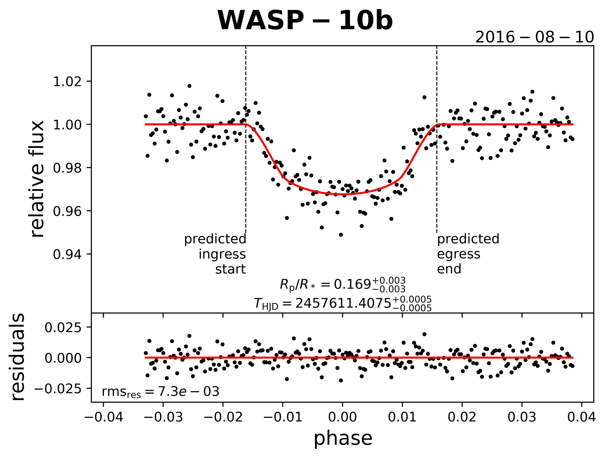

Los puntos no caen exactamente sobre la curva: eso es **ruido**. Y el ruido abre las preguntas que guían el proyecto: ¿qué parte de lo que vemos es señal física y qué parte ruido? ¿Qué pasa si un trozo de ruido se parece a un tránsito?

### 1.4 El problema central: los falsos positivos

Cualquier fenómeno que cambie la luz que nos llega puede imitar un tránsito. Las estrellas tienen ondas que recorren su superficie, manchas, actividad magnética y variabilidad propia; a corto o largo plazo, todo eso puede confundirse con un planeta. Además hay objetos que producen caídas reales que no son planetas:

- **Binarias eclipsantes:** dos estrellas que se eclipsan mutuamente. La caída suele ser más profunda que la de un planeta y con forma de **V** (un planeta da una forma de **U**, con fondo plano). Además puede haber dos caídas, el eclipse primario y el secundario, y eclipses alternos de distinta profundidad.
- **Contaminación:** la caída es real, pero procede de una estrella vecina que cae en el mismo píxel (una binaria de fondo). En la curva sola es indistinguible de un planeta.
- **No tránsitos:** artefactos instrumentales o variabilidad estelar.

Los astrónomos usan reglas clásicas para descartar falsos positivos: una caída mayor del ~2 % es sospechosa (demasiado grande para un planeta), el color del tránsito en distintos filtros delata a las binarias, la diferencia entre tránsitos pares e impares y la presencia de un eclipse secundario también. Pero estas reglas solo resuelven lo obvio. **Distinguir un planeta de todo lo demás, solo con la curva, es el problema que aborda este proyecto con Machine Learning.**

### 1.5 Preguntas que guían el proyecto

- ¿Cómo se procesa una curva de luz real antes de analizarla?
- ¿Qué tipos de ruido aparecen en los datos reales?
- ¿Cómo se distingue un tránsito de un falso positivo?
- ¿Cómo se detectan automáticamente los tránsitos y cómo se encuentran varios tránsitos de un mismo planeta?
- Y la pregunta propia del proyecto: **¿funciona el modelo en un telescopio que no ha visto?**

---

## 2. Análisis exploratorio de los datos

> **Idea central:** antes de entrenar se exploraron los datos y se descubrió que se podía «acertar» sin mirar la curva, solo con qué columnas faltan o de qué misión viene la estrella. Esto justifica la decisión más importante del proyecto: **usar solo la curva de luz**.

### 2.1 Por qué y cómo

Un modelo solo es tan bueno como los datos con los que aprende. El dataset de partida mezcla tres telescopios muy distintos, con etiquetas de distinto origen y muchas columnas del catálogo de la estrella. Antes de entrenar había que responder tres preguntas:

- ¿Están bien los datos, o hay errores que el modelo aprendería como si fueran ciertos?
- ¿Hay pistas falsas (atajos) que permitan acertar sin entender la física?
- ¿Qué información distingue de verdad un planeta de un falso positivo, y se comporta igual en las tres misiones?

Sin este paso, cualquier resultado posterior podría ser un espejismo: un modelo con buena nota que en realidad solo ha aprendido de qué telescopio viene cada estrella.

**Método.** Se exploró **solo el conjunto de entrenamiento** (18 853 estrellas); validación se usó únicamente para los tests de atajo y el test no se tocó, porque decidir mirando el test es usar información que en la realidad no se tendría. Primero se revisó la calidad; después se midió, variable a variable y misión a misión, cuánto separa cada una planetas de falsos positivos; se entrenaron modelos «tramposos» para cuantificar los atajos; y por último se probaron las reglas físicas clásicas y una PCA de la forma de las curvas.

### 2.2 De dónde vienen los datos

Se parte del dataset de Hugging Face [*exoplanet-transit-detection*](https://huggingface.co/datasets/bingbangboom/exoplanet-transit-detection), con señales de Kepler, K2 y TESS etiquetadas como planeta, falso positivo o sin señal. Una **señal** es una estrella junto con su **efeméride** (periodo, época y duración del tránsito). Las tres clases significan:

- **PLANET:** la señal es un planeta.
- **FALSE_POSITIVE:** hay una caída real, pero no es un planeta (binaria, contaminación, artefacto).
- **NO_SIGNAL:** en esa efeméride no hay tránsito.

La muestra está desequilibrada: Kepler domina y las clases no tienen el mismo peso en cada misión.

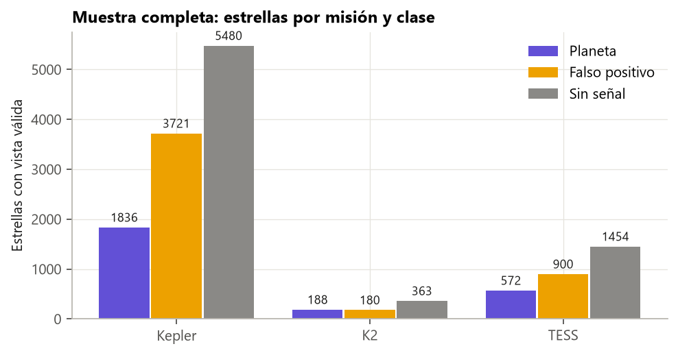

*Figura 1. Estrellas con vista válida por misión y clase (14 694 en total, ya con las curvas propias). NO_SIGNAL se fabricó 1:1 con los positivos (sección 5).*

### 2.3 Cómo se mide si una variable separa

Se usa el **AUC de Mann-Whitney**: la probabilidad de que un planeta elegido al azar tenga un valor mayor que un falso positivo elegido al azar. Un AUC de 0,5 significa que la variable no separa; cuanto más lejos de 0,5 (por arriba o por abajo), mejor. Por ejemplo, un AUC de 0,70 significa que en el 70 % de las parejas planeta–FP el planeta tiene el valor mayor. Se prefiere a la diferencia de medias porque no depende de la escala ni de los valores extremos, así que permite comparar variables distintas.

Todo se mide **por misión**: son telescopios distintos y mezclarlos engaña (efecto Simpson, apartado 2.6).

### 2.4 Problemas de calidad

De menos a más grave:

1. **Errores de catálogo puntuales:** duraciones ≤ 0 y profundidades > 100 %. Pocos casos.
2. **28 «planetas» con radio > 100 radios terrestres.** Júpiter mide ~11, así que es imposible: o la etiqueta está mal o el radio de la estrella está mal medido. Se limpian en la sección de etiquetas (umbral de 22 R⊕).
3. **Artefacto en los bordes de las vistas del dataset:** se llevaba el 67 % de la varianza en la PCA. Desapareció al rehacer el plegado con código propio.

La idea que transmiten los tres: **un modelo aprende los errores de los datos como si fueran física.**

### 2.5 El hallazgo principal: el atajo de los valores faltantes

**Observación.** Los valores faltantes no se reparten al azar: en TESS faltan siempre la masa, la metalicidad y el ruido de la estrella; en K2, el ruido. Además, la masa falta más en planetas (59 %) que en FP (23 %).

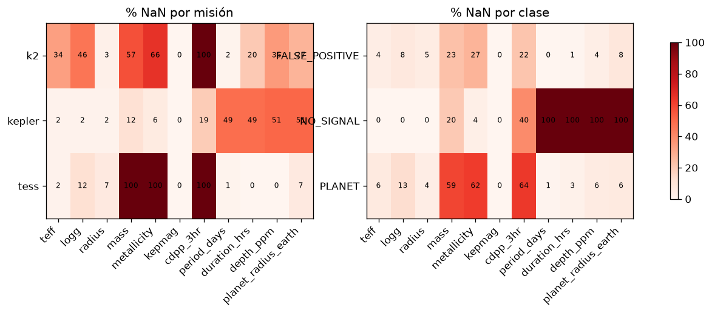

*Figura 2. Valores faltantes por misión: en TESS faltan columnas enteras.*

**Hipótesis.** Que falte un valor es la misión disfrazada, y la misión ya delata la clase.

**Prueba.** Se entrenaron modelos que no ven ningún valor físico:

| Modelo (vetting: planeta frente a FP) | Macro-F1 |
|---|---|
| Dummy (clase más frecuente) | 0,384 |
| Solo «qué columnas faltan» | 0,687 |
| Solo «de qué misión viene» | 0,687 |

**Conclusión.** Los valores faltantes son la misión disfrazada. El listón real que un modelo debe superar es 0,687, no 0,384. En un telescopio nuevo el patrón de faltantes sería otro y el modelo fallaría sin avisar. Por eso **se decide no usar nada del catálogo, solo la curva**: se eliminan las columnas que filtran la etiqueta (`label_source`, `confidence_score`, `disposition_disputed`, `fp_flag_*`…), los identificadores de la estrella y los atajos (`mission`, `cadence`, número de planetas, longitudes de las curvas…).

El problema no desaparece del todo con la curva: un clasificador consigue adivinar la misión a partir de las propias vistas plegadas. Por eso hace falta el protocolo LOMO de la sección 3.

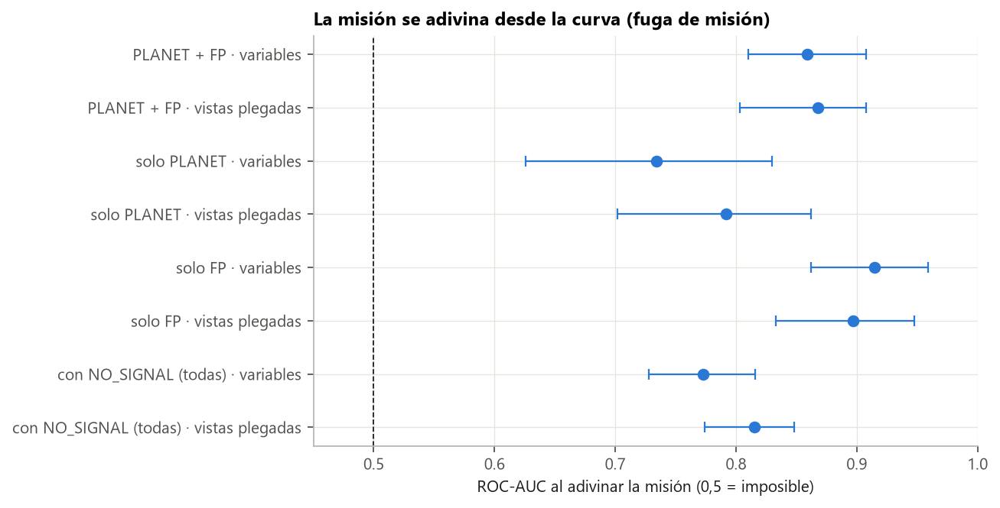

*Figura 3. Clasificador que intenta adivinar la misión con las vistas propias (IC 95 %). Motivó la ablación de la profundidad y la evaluación LOMO.*

### 2.6 Qué variables separan y el efecto Simpson

La **profundidad** es el ejemplo más claro: con todas las misiones juntas no separa (AUC 0,50), pero dentro de cada misión sí, y con **signos opuestos**: en Kepler y K2 los FP son más profundos (AUC 0,07 en K2), y en TESS al revés (0,59). Es un **efecto Simpson**: una relación que aparece al juntar grupos y desaparece, o se invierte, dentro de cada grupo. Consecuencia práctica: nunca mezclar misiones al analizar.

La **magnitud** también engaña: parece útil, pero solo porque las estrellas de TESS son más brillantes.

Las variables que se comportan igual en las tres misiones —y que por tanto tienen sentido físico y deberían ser portables— son la relación duración/periodo, la forma de entrada y salida del tránsito, la temperatura de la estrella y el periodo.

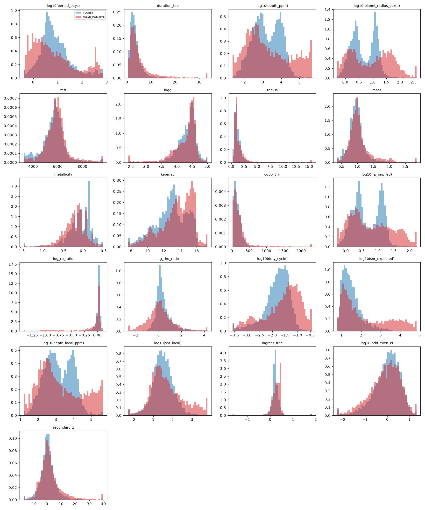

*Figura 4. Distribución de las variables en planetas y FP, por misión.*

### 2.7 Reglas físicas clásicas

| Regla | Lógica física | Precisión |
|---|---|---|
| Profundidad > 2 % → FP | Un planeta rara vez tapa tanto | 0,75 |
| Radio implícito $R_\star\sqrt{\delta}$ > 22 R⊕ → FP | Ningún planeta supera ~2 radios de Júpiter | 0,86 |
| Densidad estelar desde el tránsito (Seager y Mallén-Ornelas) | La densidad deducida del tránsito debe coincidir con la de la estrella | 0,94, pero detecta solo ~1 de cada 10 FP |
| Forma U frente a V | Las binarias rasantes dan fondo en V | detecta el 36 % de los FP |

El patrón es siempre el mismo: **precisión alta, cobertura baja**. Las reglas descartan lo obvio y dejan la mayoría sin resolver, lo que motiva el Machine Learning.

Los tests de diferencia par/impar y de eclipse secundario no estaban calibrados con las vistas del dataset (no estaban centradas y el ruido rojo inflaba los z). Con el plegado propio el secundario se arregla; el par/impar se resolvió más tarde (sección 15).

### 2.8 La forma de la curva y la PCA

En media, los FP tienen el fondo más en V y los planetas más en U, pero ninguna componente de la PCA separa por sí sola (AUC 0,56–0,62). La diferencia existe, pero es **sutil y no lineal**: eso apunta a una red convolucional, que detecta patrones locales (pendiente de entrada, fondo en V) en cualquier posición de la curva.

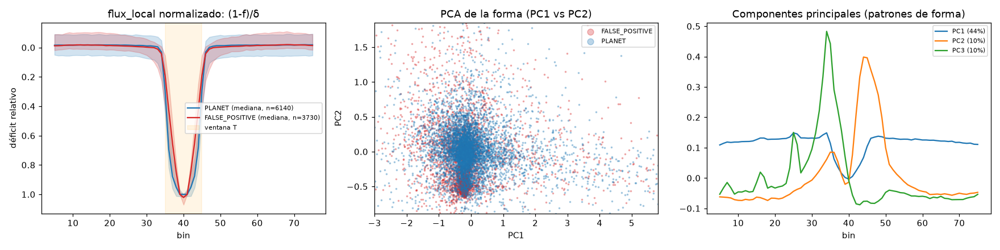

*Figura 5. Forma media de cada clase y componentes principales de las curvas.*

### 2.9 Decisiones que salen de aquí

| Decisión | Motivo | Dónde se aplica |
|---|---|---|
| El listón real es 0,687, no 0,384 | Atajo de faltantes/misión | Comparación de modelos (sección 6) |
| Métricas siempre por misión | Efecto Simpson | Protocolo (sección 3) |
| Solo la curva como entrada | El catálogo delata la misión | Todos los modelos |
| Limpiar los planetas imposibles | Etiquetas o radios erróneos | Etiquetas (sección 4) |

Si el modelo puede reconocer la misión, hay que evaluarlo en misiones que no ha visto: ese es el protocolo de la sección siguiente.

**Limitaciones.** Esta exploración usó las vistas del dataset original; algunas conclusiones (par/impar, secundario) cambiaron con el plegado propio.

---

## 3. Cómo se evalúa el modelo: protocolo LOMO y métricas

> **Idea central:** la pregunta del proyecto es si el modelo funciona en un telescopio que no ha visto nunca. Para medirlo sin engañarse se diseñó un protocolo en el que la misión evaluada no participa en ninguna decisión, con métricas que tratan igual a todas las clases y a todas las misiones.

### 3.1 La pregunta de portabilidad

Partir los datos al azar no responde a la pregunta. Si el modelo ve TESS al entrenar, su nota en TESS no dice nada sobre PLATO o un telescopio terrestre. Una partición al azar es un examen con preguntas del mismo libro que se ha estudiado; LOMO es un examen sobre un libro que no se ha leído.

Además es muy fácil hacer trampa sin darse cuenta: si un hiperparámetro, un umbral o una normalización se eligen mirando la misión que se va a evaluar, esa misión ya se está usando para entrenar.

### 3.2 El protocolo LOMO anidado

Se adopta *leave-one-mission-out* (LOMO) anidado:

- **Bucle externo:** cada misión se deja fuera por turno. Se excluye de **todo** (normalización, modelo, hiperparámetros, umbral) y se evalúa una sola vez.
- **Bucle interno:** con las otras dos misiones, se entrena en A y se valida en B, y al revés; se elige la configuración con mejor PR-AUC media. Así se premia lo que se transfiere entre telescopios.

Por ejemplo, excluyendo TESS: se entrena en Kepler y se valida en K2, se entrena en K2 y se valida en Kepler, se elige la mejor configuración y solo entonces se evalúa en TESS.

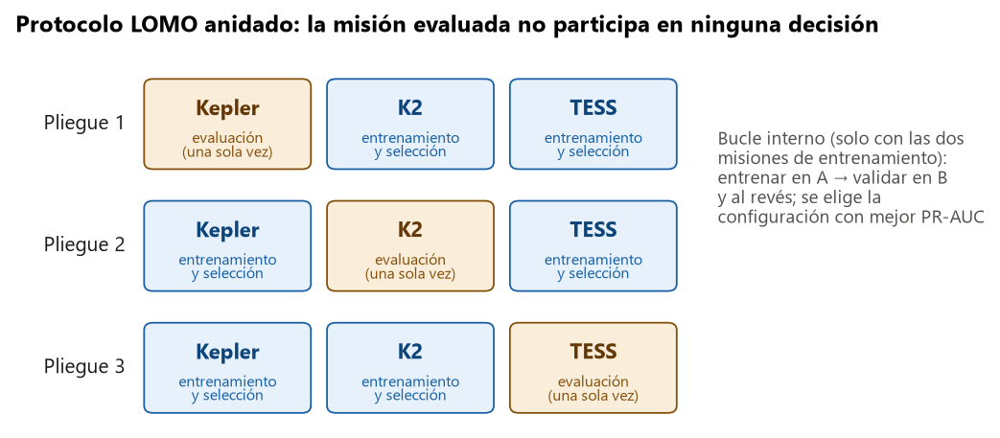

*Figura 6. Cada pliegue deja fuera una misión, elige el modelo solo con las otras dos y la evalúa una única vez.*

Como referencia se entrena también el modelo **dentro de misión** (que sí ve el telescopio evaluado). La **brecha** entre ambos es la cifra que mide la portabilidad.

| Misión excluida | Estrellas para ajustar | Estrellas para evaluar |
|---|---|---|
| Kepler | 3 280 | 9 935 |
| K2 | 12 566 | 650 |
| TESS | 10 579 | 2 634 |

### 3.3 Estrellas compartidas

TESS volvió a observar campos de Kepler y K2: la misma estrella puede aparecer en dos misiones, y el modelo podría «reconocerla». Las estrellas se cruzan por coordenadas (< 2″) y se quitan del entrenamiento cuando su otra misión es la evaluada. La unidad de todo el protocolo es la **estrella**, no la señal.

### 3.4 Métricas

- **Principal: macro-F1 de 3 clases por misión.** Es la media del F1 de cada clase con el mismo peso, así que no basta con acertar la clase mayoritaria. Como resumen se usa la **media de las misiones**: si se juntaran las estrellas, Kepler pesaría más que las otras dos juntas.
- **Secundaria: PR-AUC.** Mide lo bien que el modelo ordena, sin depender de un umbral.
- **Incertidumbre: IC 95 % por bootstrap sobre estrellas.** Se remuestrea por estrellas y no por señales porque las señales de una misma estrella no son independientes.
- **Listón:** el dummy da un macro-F1 de 0,22 y una PR-AUC de 1/3 (la prevalencia).

### 3.5 El umbral en un telescopio nuevo

La proporción de FP cambia mucho entre misiones (Kepler 0,71, K2 0,41, TESS 0,59). Un umbral ajustado con un 71 % de FP aplicado donde hay un 41 % queda sesgado. Por eso no se fija umbral en la misión excluida: para la portabilidad se usan PR-AUC y ROC-AUC, que miden la capacidad de ordenar, que es lo que realmente se transfiere.

### 3.6 Cuándo se mira el test

Una sola vez, al final. Cada mirada al test es una decisión contaminada y la cifra final deja de ser honesta. Las variantes de la fase de portabilidad se evaluaron con train + val de la misión excluida para no gastar su test (decisión registrada el 2026-11-04).

### 3.7 CoRoT

Una cuarta misión, CoRoT, habría sido la prueba más limpia: un telescopio que no participó en ninguna decisión. Quedó bloqueada porque su catálogo no estaba disponible y queda como trabajo futuro.

**Limitaciones.** La clase «sin señal» es ~50 % de cada misión porque se fabricó 1:1: las métricas sirven para comparar modelos, no como rendimiento en una búsqueda real. En K2 y TESS validación es pequeña: diferencias de ~0,03 pueden ser ruido.

---

## 4. Las etiquetas: qué es «planeta» y «falso positivo» en cada misión

> **Idea central:** «planeta» no significaba lo mismo en todas las misiones porque mezclaba confirmados con candidatos. Se recuperaron las disposiciones originales, se separaron las etiquetas en fuertes y débiles y se evaluó solo con las fuertes.

### 4.1 El problema

Un modelo aprende y se evalúa contra sus etiquetas. Si son dudosas, la métrica mezcla errores del modelo con errores de la etiqueta. En el dataset, la clase PLANET juntaba planetas **confirmados** con **candidatos** sin resolver (y un candidato puede acabar siendo un FP):

| Misión | Confirmados | Candidatos |
|---|---|---|
| Kepler | 1 943 | 1 631 (del Robovetter) |
| TESS | 674 | 3 802 |
| K2 | 346 | 899 |

En TESS, la mayoría de los «planetas» eran candidatos. Además, el dataset es una instantánea antigua: algunas disposiciones han cambiado desde entonces.

### 4.2 Recuperación de las disposiciones originales

Cada estrella se cruzó con las tablas del NASA Exoplanet Archive (`toi` para TESS, `k2pandc` para K2 y `cumulative` para los KOIs de Kepler). Si había varios candidatos en la estrella, se eligió el de periodo más cercano. Cada objeto se clasificó en:

- **Fuerte:** confirmado o FP claro.
- **Débil:** candidato.
- **Excluido:** ambiguo o contradictorio.

El proceso es reproducible (script y fecha de descarga): el catálogo es una foto en el tiempo.

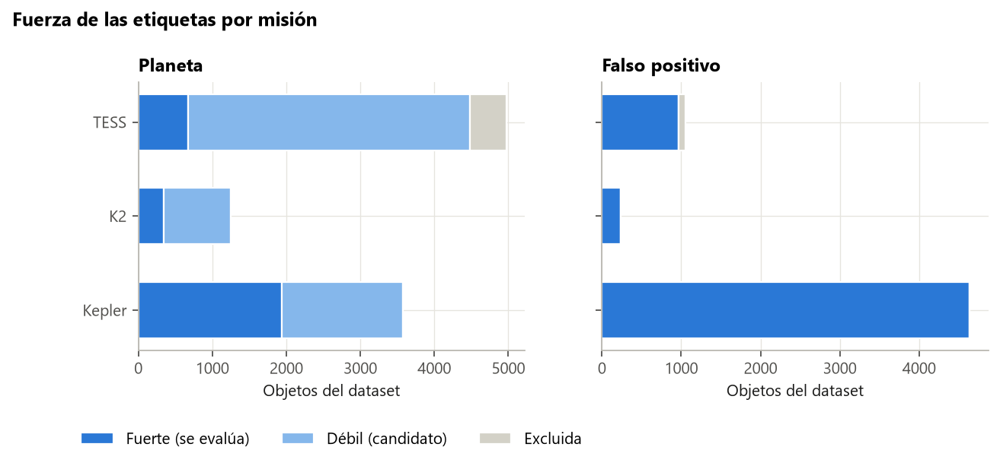

*Figura 7. Solo las etiquetas fuertes (confirmados y FP claros) se usan para evaluar; los candidatos son etiquetas débiles.*

### 4.3 Regla de uso

- **Evaluación:** solo con etiquetas fuertes. Para medir hay que estar seguro de la etiqueta.
- **Entrenamiento:** la variante «fuertes + débiles» estaba prevista pero no se probó (mejora pendiente).
- **Los candidatos de TESS no se usan para entrenar:** son el conjunto de la validación prospectiva (sección 16).

### 4.4 Las disposiciones cambian

58 objetos que el dataset tenía como planetas de TESS hoy son FP o falsas alarmas. Se excluyen en lugar de decidir cuál es la etiqueta correcta. Es **deriva de etiquetas**: el catálogo cambia con el tiempo. En producción, un equipo versionaría el catálogo, lo re-sincronizaría periódicamente y registraría los cambios.

### 4.5 Planetas con radio imposible

Se eliminan los PLANET con radio > 22 R⊕ (~2 radios de Júpiter, el tope de los júpiter más inflados). No es fuga de información: el umbral es físico, se fijó antes y el modelo nunca ve el radio. Solo se aplica a PLANET porque un FP gigante es una binaria, justo lo que hay que rechazar. Afectó a 13 planetas fuertes.

### 4.6 Consecuencias

Al quedarse con las etiquetas fuertes, la proporción de FP sube mucho: Kepler 56 % → 70 %, K2 16 % → 41 %, TESS 17 % → 59 %. FP fuertes: Kepler 4 638, TESS 968, K2 240. El problema se vuelve más difícil y las cifras no son comparables con trabajos que usan todas las etiquetas. El test de K2 se queda en ~60–80 estrellas, con intervalos anchos: no hay que sobreinterpretar diferencias en K2.

**Limitaciones.** Quedarse con las fuertes reduce mucho los datos en K2 y TESS; el filtro de radio también limpia val y test (efecto despreciable, 13 casos); las etiquetas de TESS siguen cambiando.

---

## 5. Los ejemplos «sin señal» y los atajos

> **Idea central:** para enseñar al modelo qué es «aquí no hay tránsito» hubo que fabricar ejemplos con estrellas reales sin candidato. Lo delicado fue evitar que el modelo los distinguiera por cómo se fabricaron (más datos, otra campaña, otro brillo) en lugar de por la ausencia de tránsito.

### 5.1 Por qué hacen falta negativos

Sin ejemplos de «sin señal», el modelo solo sabría decir planeta o FP, nunca «aquí no hay nada». El dataset traía una clase NO_SIGNAL, pero sus curvas plegadas eran ceros: inservibles, y además un atajo trivial.

### 5.2 Qué es un atajo y cómo se mide

Un **atajo** (*shortcut learning*) es una diferencia artificial entre clases que el modelo aprovecha para acertar sin aprender física. Da notas altas en validación y falla en la realidad.

El **test de atajo** consiste en un clasificador que solo ve lo que no debería importar (la curva con el tránsito tapado, o los metadatos del proceso). Si separa las clases (AUC lejos de 0,5), hay atajo. Regla guía: *si puedes adivinar la clase sin mirar el tránsito, algo va mal.*

### 5.3 Cómo se quitó el atajo, paso a paso

Se tomaron estrellas reales sin ningún candidato conocido, se descargaron y plegaron exactamente igual que los positivos, con un periodo y una época prestados de un planeta real. En cada versión se pasó el test de atajo:

| Versión de la construcción | AUC del atajo | Causa descubierta |
|---|---|---|
| Al azar, con todos los sectores | K2 0,90 · TESS 0,83 | Los planetas tienen más sectores: TESS vuelve a observar lo interesante |
| 1 segmento por estrella | TESS 0,70 | — |
| Emparejar cada positivo con una estrella del mismo sector y brillo | TESS 0,51 | — |
| Efeméride prestada de un planeta del mismo sector | K2 0,84 · TESS 0,55 | — |

Un fallo curioso: la campaña 10 de K2 se publicó en dos mitades pero numerada como una, y dejaba a 18 planetas sin pareja. Cada arreglo vino de entender una causa, no de probar cosas al azar.

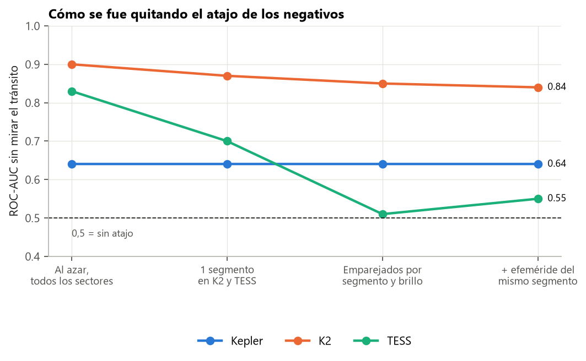

*Figura 8. Capacidad de distinguir los negativos fabricados sin mirar el tránsito, en cada versión de su construcción.*

### 5.4 Exclusión por coordenadas

Algunas «estrellas sin señal» eran candidatos de otra misión con otro número de catálogo: el mismo objeto con nombres distintos, un fallo típico al cruzar catálogos. Se excluyó todo lo que está a menos de 2″ de un candidato.

### 5.5 Lo que queda

Con la muestra completa y el tránsito tapado:

- **Planeta frente a sin señal: 0,60 / 0,59 / 0,55** (Kepler / K2 / TESS). Es un atajo débil y real: el **sesgo de detección**, porque los planetas se descubren más en estrellas tranquilas. Se acepta y se declara.
- **FP frente a sin señal en K2: 0,84.** No es un atajo, es física (eclipses secundarios, variabilidad): el modelo debe aprenderlo.

La distinción entre **atajo** (artefacto del proceso de observación) y **señal física legítima** es la idea más importante de la sección.

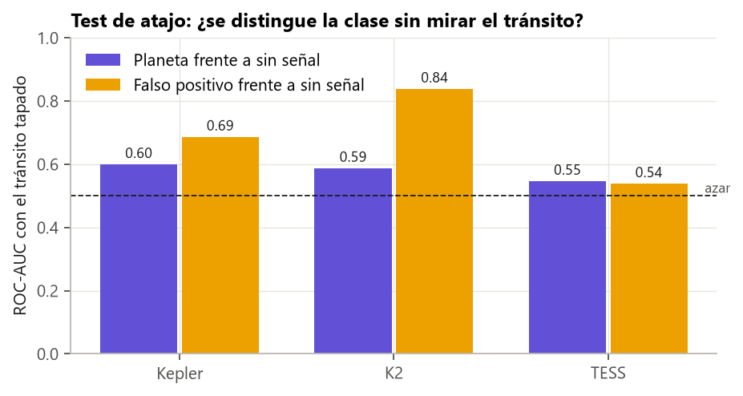

*Figura 9. Boosting sobre la vista global con el 20 % central tapado.*

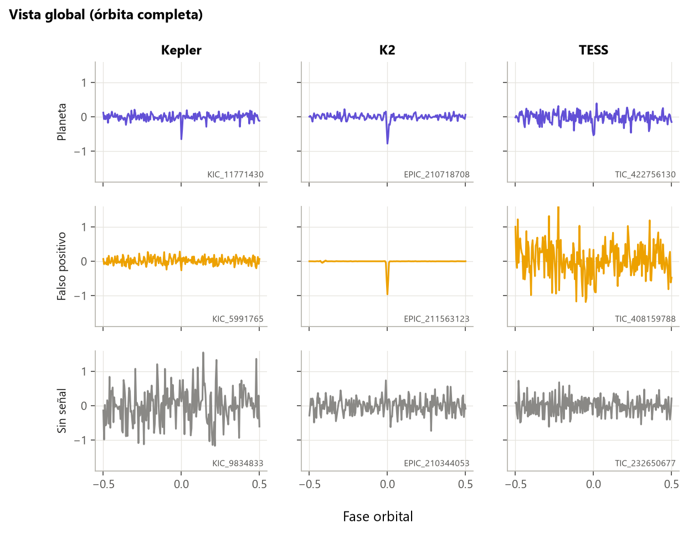

*Figura 10. Vista global de una estrella al azar por misión y clase; la fila inferior muestra estrellas sin señal.*

### 5.6 La regla de diseño

El modelo **nunca recibe metadatos del proceso** (número de puntos, días de datos, cadencia, número de tránsitos), porque en K2 todavía delatan la clase. Cualquier metadato del proceso puede delatar la clase.

### 5.7 Números finales

8 582 negativos (Kepler 6 560, TESS 1 624, K2 398), uno por cada positivo, reproducibles byte a byte (semillas y listas fijas). La proporción 1:1 no refleja la realidad, donde hay muchísimas más estrellas sin señal que planetas (sección 11).

**Limitación descubierta después.** Estos negativos son demasiado fáciles: una estrella tranquila plegada con una efeméride prestada da una curva plana. El ruido real que parece un tránsito es otra cosa (secciones 9 y 11). Mejora propuesta: usar falsas alarmas reales (conjuntos invertido y desordenado de Kepler DR25, FA de TESS).

---

## 6. Modelos dentro de cada misión (fase 2)

> **Idea central:** se probó una escalera de modelos de menos a más complejos. La CNN tipo AstroNet fue la mejor (macro-F1 0,85 con un conjunto de 3 semillas), pero seis familias acabaron entre 0,78 y 0,85: el límite no está en el modelo sino en la información de la curva.

### 6.1 Qué ve cada modelo: el plegado

**Plegar** una curva es superponer todos los tránsitos usando el periodo, para sumar su señal. De la curva plegada se extraen dos «fotos»:

- **Vista global** (201 puntos, fase −0,5 a 0,5): da contexto (eclipse secundario, variabilidad).
- **Vista local** (81 puntos alrededor del tránsito): da la forma del tránsito.

Ambas se normalizan para que la caída valga −1. Se compararon con una entrada alternativa de 5 variables físicas.

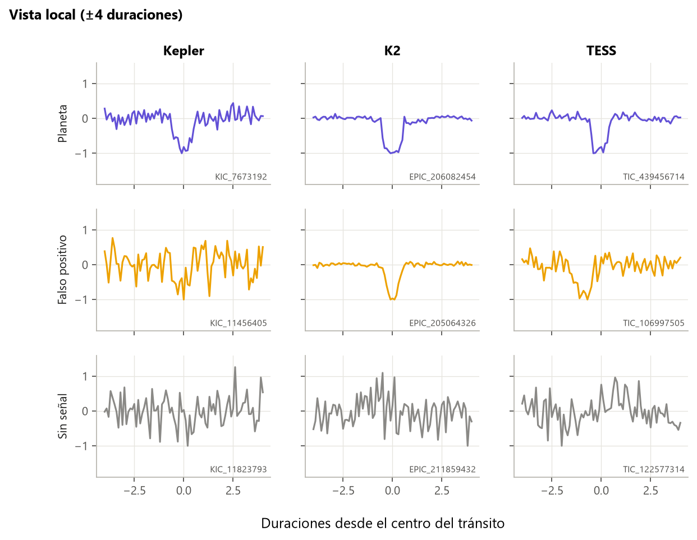

*Figura 11. Vista local de una estrella al azar por misión y clase (normalizada: la caída vale −1).*

Todo se hizo dentro de cada misión y solo en validación.

### 6.2 Modelos clásicos

| Modelo | Entrada | Macro-F1 (val) | Qué enseña |
|---|---|---|---|
| Dummy | — | 0,22 | Listón |
| Regresión logística | 5 variables físicas | 0,66 (muestra A) | — |
| Regresión logística | Vistas | 0,80 (muestra A) | La forma completa contiene más información que 5 números; los coeficientes tienen sentido físico (secundario y par/impar empujan a FP) |
| kNN | Vistas | 0,49 | Maldición de la dimensionalidad: en muchas dimensiones todas las distancias se parecen |
| PCA (~20 comp.) + kNN | Vistas | 0,79 | Reducir dimensión lo arregla |
| Gradient boosting | Vistas | 0,82 | El mejor clásico con muchos datos (Kepler), pero sobreajusta en TESS |
| MLP | Vistas | ≈ logística | La parada temprana lo deja casi lineal |

*La «muestra A» es una muestra inicial más pequeña; el resto de cifras son de la muestra completa. No se deben mezclar.*

### 6.3 La CNN (AstroNet)

Arquitectura de **dos ramas**: una CNN 1D para la vista global y otra para la local, cada una con bloques de convolución y *pooling*; las salidas se unen y pasan por capas densas hasta las tres clases.

Funciona mejor no por tener más parámetros, sino por su **sesgo inductivo**: la convolución aprovecha que los puntos vecinos están relacionados y reutiliza los mismos filtros en toda la curva. Un filtro que detecta una «bajada brusca» sirve en cualquier posición.

**Aumento de datos:** reflejar la curva en el tiempo, porque un tránsito es simétrico.

### 6.4 Resultados con la muestra completa

| Modelo | Macro-F1 (val) |
|---|---|
| CNN | 0,84 (PR-AUC 0,91); conjunto de 3 semillas **0,850** |
| Gradient boosting | 0,82 |
| MOMENT ajustado | 0,815 |
| Resto | 0,78–0,80 |
| Dummy | 0,22 |

Por misión, la CNN da Kepler 0,87, K2 0,87–0,90 y TESS 0,78. **Kepler tenía 6,5 veces más datos y no mejoró**: el límite no es la cantidad de datos, sino la información que contiene la curva.

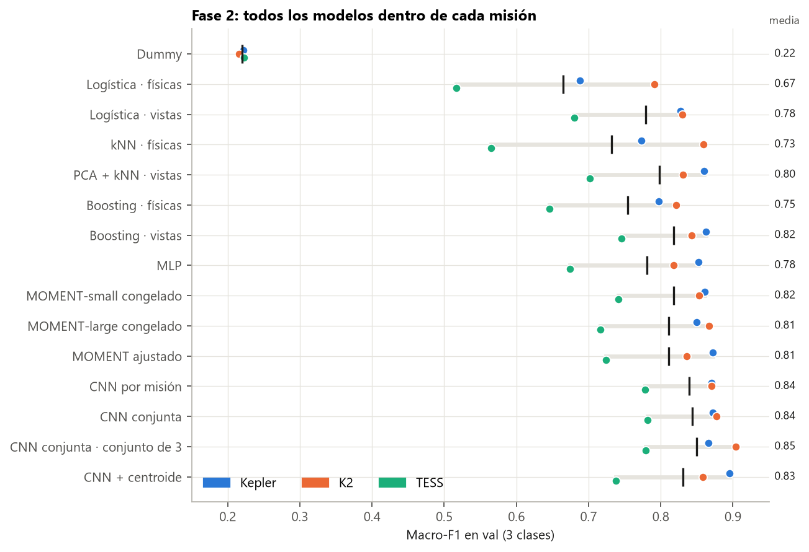

*Figura 12. Macro-F1 en val por misión (puntos) y media (raya). Seis familias se quedan en 0,78–0,85.*

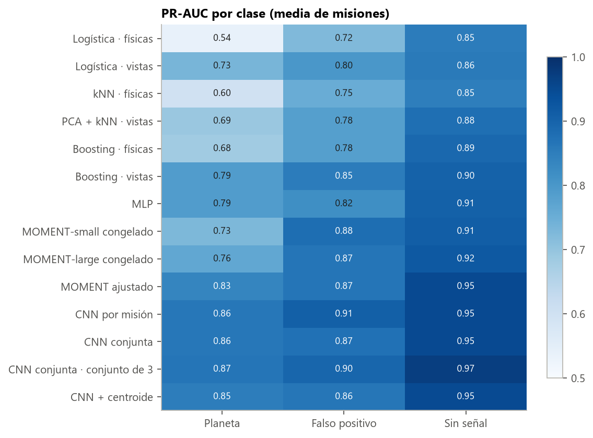

*Figura 13. PR-AUC por clase (media de las tres misiones). «Sin señal» es fácil; planeta frente a FP es lo difícil.*

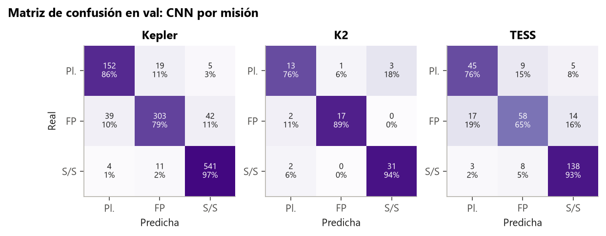

*Figura 14. Matriz de confusión de la CNN por misión (filas = clase real, columnas = predicha). El resto de matrices están en el Anexo A.*

### 6.5 MOMENT

MOMENT es un **modelo fundacional**: un Transformer preentrenado con muchas series temporales de todo tipo. Congelado (solo se entrena una capa encima) ya supera a la logística (0,82), aunque nunca vio un tránsito. Ajustado entero (*fine-tuning*) no supera a la CNN (0,815 frente a 0,839): sobreajusta. Conclusión: **seis familias acaban en 0,81–0,84; es el techo de la información, no del modelo.**

### 6.6 El centroide

El **centroide** es la posición del centro de luz en el detector. Si la caída viene de una estrella vecina, el centroide se desplaza durante el tránsito. Añadido como canal extra:

- **Kepler mejora** (0,865 → 0,893), con píxeles de 4″.
- **K2 y TESS empeoran**: TESS tiene píxeles de 21″ y K2 un apuntado inestable.

El centroide depende del instrumento, así que va contra la portabilidad. La versión portable usa **solo la curva**.

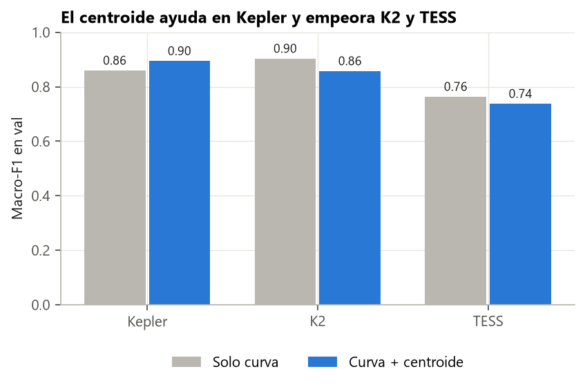

*Figura 15. CNN conjunta con y sin el canal de centroide.*

### 6.7 Errores por tipo de FP en Kepler

| Tipo de FP (Robovetter) | Acierto de la CNN | Con centroide |
|---|---|---|
| Binaria eclipsante | 88 % | — |
| Contaminación | 66 % | 80 % |

Casi la mitad de los FP que pasan por planeta son de **contaminación**: invisibles en la curva. Es el **techo físico** del modelo solo curva. Además, el 22 % de los FP «no parece tránsito» van a «sin señal»: la frontera entre esas etiquetas es difusa.

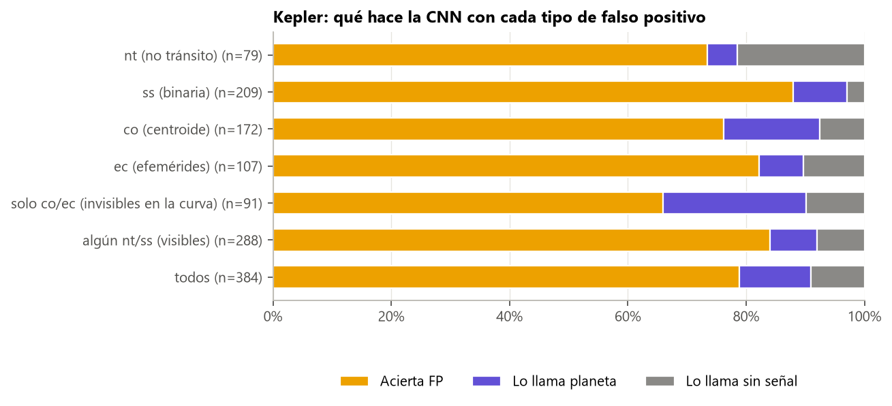

*Figura 16. FP de Kepler en val por motivo del Robovetter.*

### 6.8 Intentos de mejora

Añadir canales par/impar o diagnósticos no mejora. Promediar 3 semillas sí (0,833 → 0,850): reduce la varianza del modelo. Un resultado negativo también es información.

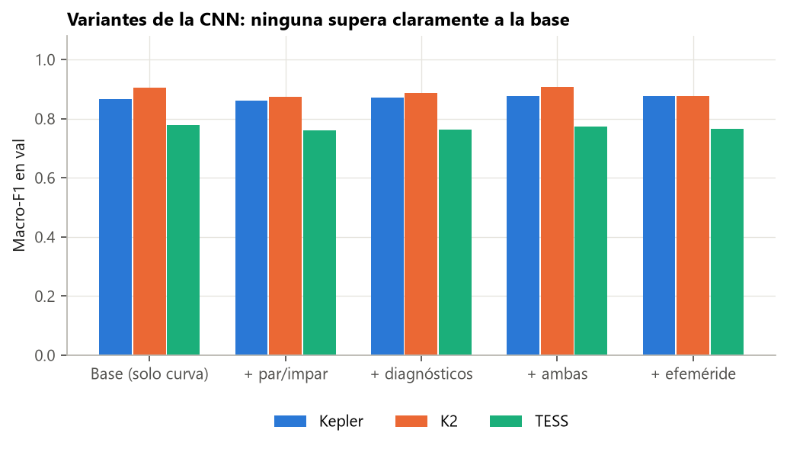

*Figura 17. Variantes de la CNN conjunta; las diferencias están dentro del ruido de val.*

**Limitaciones.** Todo es en validación, con una semilla para elegir la configuración (varía 0,01–0,05 entre semillas). Algunos resultados se calcularon antes de regenerar 1 031 negativos de TESS: las comparaciones finas deben hacerse dentro de la misma tabla. Val es pequeño en K2 y TESS.

---

## 7. Portabilidad entre telescopios (fase 3, LOMO)

> **Idea central:** el modelo solo curva es portable. Sin haber visto el telescopio pierde de media 0,05 de PR-AUC (0,911 → 0,862). TESS es el difícil, y su problema está en los datos (pocos tránsitos y otra población), no en el modelo.

Es el núcleo del proyecto: un clasificador solo es útil para misiones futuras (PLATO, observaciones terrestres) si funciona en un telescopio que no ha visto.

### 7.1 Resultado principal

| Misión evaluada | PR-AUC sin verla (LOMO) | PR-AUC viéndola | Pérdida |
|---|---|---|---|
| Kepler | 0,894 | 0,937 | −0,043 |
| K2 | 0,927 | 0,956 | −0,029 |
| TESS | 0,764 | 0,840 | −0,076 |
| **Media** | **0,862** | **0,911** | **−0,05** |

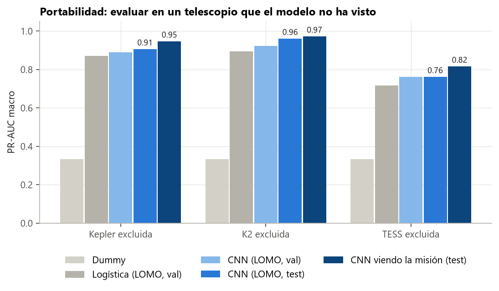

*Figura 18. Entrenar con dos misiones y evaluar en la tercera. La pérdida es pequeña en Kepler y K2; TESS es difícil incluso viéndola.*

### 7.2 Qué se transfiere y qué no

El problema se divide en dos: **detectar que hay señal** y **decidir si es planeta o FP**. Lo primero se transfiere casi perfecto (F1 0,88–0,94); lo que se degrada es planeta frente a FP.

### 7.3 Por qué falla TESS

Tres hipótesis y su evidencia:

1. **¿Es el modelo?** La logística da 0,716 y la CNN 0,764, pero la CNN viendo TESS llega a 0,84: TESS tiene patrones propios que no aparecen en Kepler y K2.
2. **Pocos tránsitos.** Mediana de 5–8 tránsitos en TESS frente a decenas en Kepler. Con ≤ 8 tránsitos, el acierto en FP es ~30 %; con más, 52–61 %.
3. **Otra población.** El 14 % de los planetas de TESS tienen P < 2 días (6–7 % en Kepler y K2, donde los periodos cortos son sobre todo binarias). El modelo aprendió «periodo corto → binaria» y falla en la mitad de esos planetas (40 de 82).

### 7.4 Curva de aprendizaje

Añadiendo una fracción creciente del train de TESS a Kepler + K2, con pocas etiquetas apenas mejora; solo con todas llega a 0,836. Probable causa: 234 estrellas de TESS pesan poco frente a ~10 000 de Kepler y K2. Dar más peso a TESS quedó sin probar.

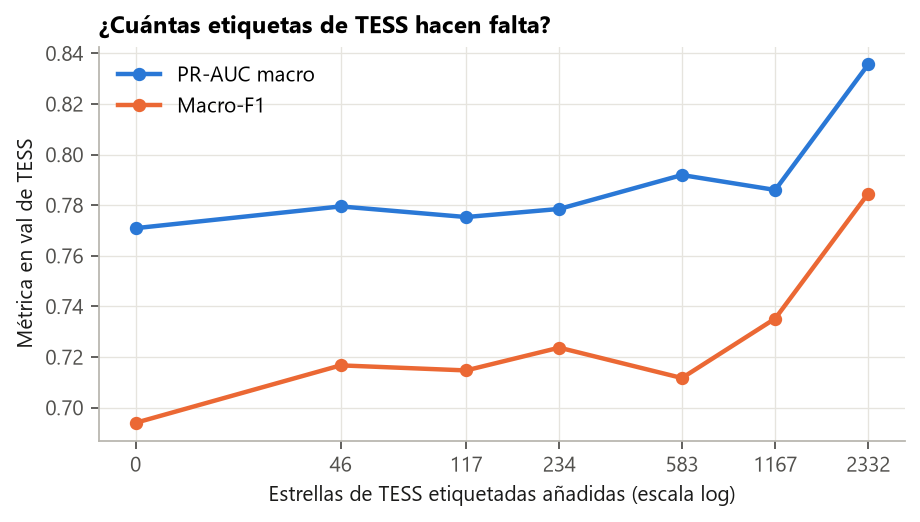

*Figura 19. Kepler + K2 más una fracción del train de TESS.*

### 7.5 Intentos de adaptación a TESS sin sus etiquetas

| Técnica | Hipótesis que prueba | Cambio en PR-AUC | Lectura |
|---|---|---|---|
| AdaBN (recalcular estadísticas de BatchNorm con TESS) | ¿Es un problema de escala? | −0,024 | No |
| Recortar Kepler/K2 a 27 días | ¿Le faltan curvas cortas al entrenar? | −0,011 | Ya las veía |
| Pseudo-etiquetas | ¿Puede aprender de TESS sin etiquetas? | −0,001 | Se autoconfirma en lo fácil |
| **2 sectores de TESS por estrella** | ¿Le falta información por estrella? | **+0,034 [+0,018, +0,048]** | **Sí** |

Lo único que funciona es dar **más información por estrella**, no adaptar el modelo.

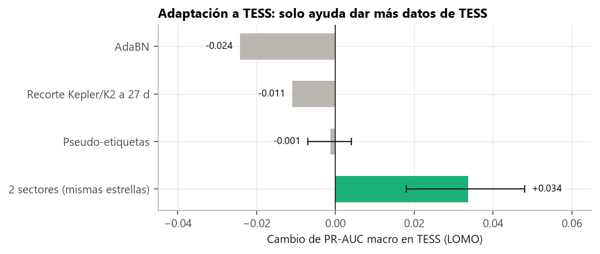

*Figura 20. Intentos de mejorar TESS sin sus etiquetas (IC 95 % bootstrap cuando se midió).*

### 7.6 Decisión 1: quitar la profundidad

Quitar la profundidad cuesta solo −0,003, y es la variable que más delata la misión. El modelo final no la usa.

### 7.7 Decisión 2: la regla de decisión en un telescopio nuevo

- La mezcla de clases cambia entre misiones (*prior shift*). Corregir las probabilidades con la mezcla estimada (EM de Saerens) empeora el macro-F1 en las tres misiones, así que se usa **la clase más probable (argmax)**.
- **Calibración:** en TESS el modelo LOMO es demasiado confiado: cuando dice 0,75, acierta el 60 %.
- Con precisión 0,9, solo recupera el 12 % de los planetas de TESS: **sirve para priorizar, no para confirmar.**

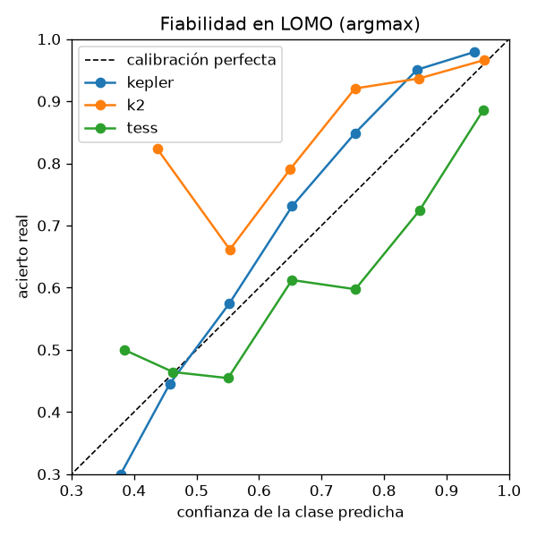

*Figura 21. Diagrama de fiabilidad del modelo LOMO.*

### 7.8 Aviso honesto

Todas estas variantes se midieron sobre el mismo TESS, con riesgo de sobreajustar a la validación. Se mitigó mirando el test una sola vez: dio 0,761, igual que en val (sección 10).

**Limitaciones.** La comparación «viendo» frente a «sin ver» es aproximada (los conjuntos de evaluación no son idénticos). La selección interna es inestable con pliegues pequeños (con Kepler excluido, val de K2 tiene 69 estrellas).

---

## 8. Estado del arte

> **Idea central:** desde 2018 varios grupos clasifican tránsitos con redes neuronales. Todos entrenan y evalúan en el mismo telescopio, y los mejores usan información que este proyecto no usa a propósito. La aportación del proyecto no es superarlos en precisión, sino **medir la portabilidad a telescopios no vistos con un modelo que solo mira la curva**.

### 8.1 Trabajos de referencia

| Trabajo | Misión | Entrada | Resultado publicado | Qué se tomó |
|---|---|---|---|---|
| AstroNet (Shallue y Vanderburg, 2018) | Kepler | Vistas global y local | ROC-AUC 0,988 | La arquitectura de dos ramas |
| AstroNet-K2 (Dattilo et al., 2019) | K2 | Vistas + BLS propio | ROC-AUC 0,988; con precisión 1, recall 0,2 | Promediar semillas; «necesita supervisión humana» |
| AstroNet-Triage/Vetting (Yu et al., 2019) | TESS | Vistas + par/impar + secundario | Vetting AP 0,693 | Comparación más justa |
| ExoMiner (Valizadegan et al., 2022) | Kepler | Vistas, centroide, par/impar, secundario, parámetros estelares | PR-AUC 0,995 | Techo con más información |
| ExoMiner++ (Valizadegan et al., 2025) | TESS | Ídem | PR-AUC 0,976; ~150 000 señales puntuadas | Juntar misiones > ajuste fino; referencia prospectiva |

### 8.2 Por qué no se puede comparar directamente

1. **Prueban en el mismo telescopio** con el que entrenan (infla la cifra frente a LOMO).
2. **Sus negativos son sobre todo señales de no tránsito**, fáciles.
3. **AstroNet parte al azar por señal:** la misma estrella puede estar en entrenamiento y prueba (fuga).
4. **ExoMiner usa información extra** (centroide, parámetros estelares).
5. **Parten de la efeméride de una tubería de detección.**

Comparar métricas sin comparar protocolos es engañoso.

### 8.3 Dónde se sitúa este proyecto

- LOMO en TESS, planeta frente a FP: **PR-AUC 0,704**, parecido al 0,693 de AstroNet-Vetting, que sí vio TESS al entrenar.
- Modelo final en el test de TESS: **0,766**.
- ExoMiner++ es el techo: la diferencia hasta 0,976 es lo que aporta la información que no se usa.

### 8.4 La laguna que cubre

No se encontró ninguna evaluación entre tres telescopios como esta. Hay indicios aislados (EXOVEIL usa Kepler en TESS; *Depth-Blind by Design* analiza un modelo de Kepler congelado en TESS). La búsqueda no fue exhaustiva.

**Contribución en una frase:** una medida honesta de cuánto se pierde al llevar un clasificador de tránsitos solo curva a un telescopio que no ha visto.

### 8.5 Lecciones aplicadas

- Promediar varias semillas (AstroNet-K2, ExoMiner++) → modelo final con 5 semillas.
- Juntar misiones funciona mejor que ajustar fino (ExoMiner++) → modelo final con las tres misiones.
- Un modelo solo curva prioriza, no confirma (AstroNet-K2) → uso como herramienta de priorización.

### 8.6 Trabajos recientes (2025–2026), por tendencia

- **Nuevas arquitecturas:** PANOPTICON (U-Net para PLATO), Salinas et al. (Transformer en TESS), Hernández-Carnerero et al. (atención para el vetting).
- **Aprendizaje sin etiquetas:** FALCO, Astromer 2.
- **Incertidumbre:** EXOVEIL (predicción conforme).
- **Vetting y datos sintéticos:** LEO-Vetter, Chaushev et al. (binarias inyectadas).
- **LLM:** AstroMMBench (los LLM leen mal las curvas).

**Limitaciones.** Algunas cifras de los artículos salen de resúmenes de tablas; conviene comprobarlas en los PDF.

---

## 9. Encontrar el tránsito sin catálogo (BLS)

> **Idea central:** en un telescopio nuevo no hay catálogo, así que el periodo y la época hay que encontrarlos en la propia curva. Se implementó BLS: acierta el periodo en ~2 de cada 3 casos, pero con su efeméride el modelo cae de ~0,86 a ~0,50, sobre todo porque el ruido plegado en su mejor pico parece un tránsito. Esto llevó a definir el modelo como **clasificador de señales ya detectadas**.

### 9.1 Qué es BLS

*Box Least Squares* prueba miles de periodos, busca para cada uno la caída en forma de caja que mejor encaja y construye un **periodograma**. La **SDE** (*Signal Detection Efficiency*) mide cuánto sobresale el mejor pico respecto al resto.

Implementación: aplanado a ciegas, búsqueda por bandas de periodo, rejilla gruesa más refinado y periodograma aplanado. Dos problemas de ingeniería resueltos por el camino: dos trimestres de Kepler separados por años daban millones de periodos (rejilla gruesa + refinado), y sin aplanar el periodograma BLS elegía siempre el periodo más corto. Coste: ~3,5 s por estrella en TESS y ~15 s en Kepler.

### 9.2 ¿Acierta el periodo?

- 65–69 % en Kepler y TESS.
- Los FP dan más **alias de ½** (el periodo a la mitad), porque una binaria con dos eclipses parecidos parece tener el doble de tránsitos.
- En K2, los planetas solo el 31 %, por los artefactos del telescopio cada ~6 h.
- La SDE sí separa señal de ruido (ROC-AUC 0,82–0,87).

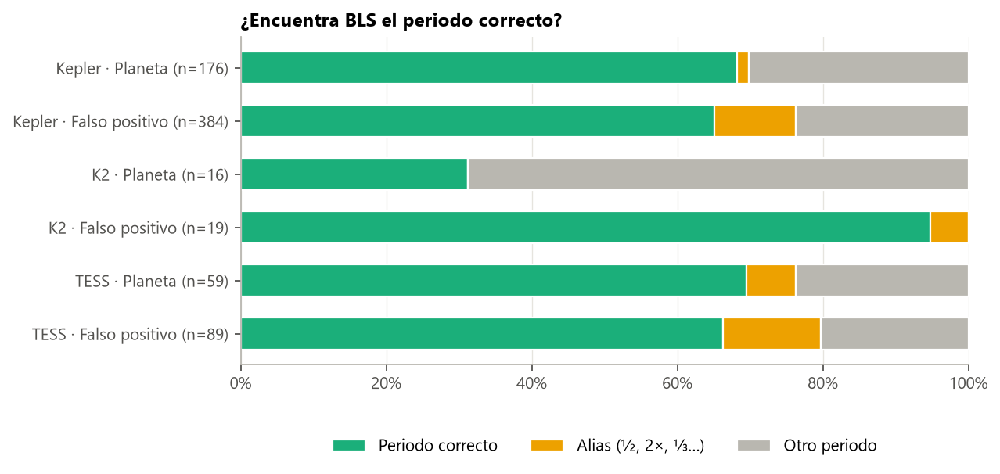

*Figura 22. Periodo de BLS frente al del catálogo en val.*

### 9.3 El golpe

Misma red, mismas estrellas; solo cambia de dónde viene la efeméride:

| Misión | Macro-F1 con catálogo | Macro-F1 con BLS |
|---|---|---|
| Kepler | ~0,86 | 0,50 |
| K2 | — | 0,45 |
| TESS | — | 0,44 |

Casi todo viene de «sin señal»: en Kepler, su acierto baja del 97 % al 26 %.

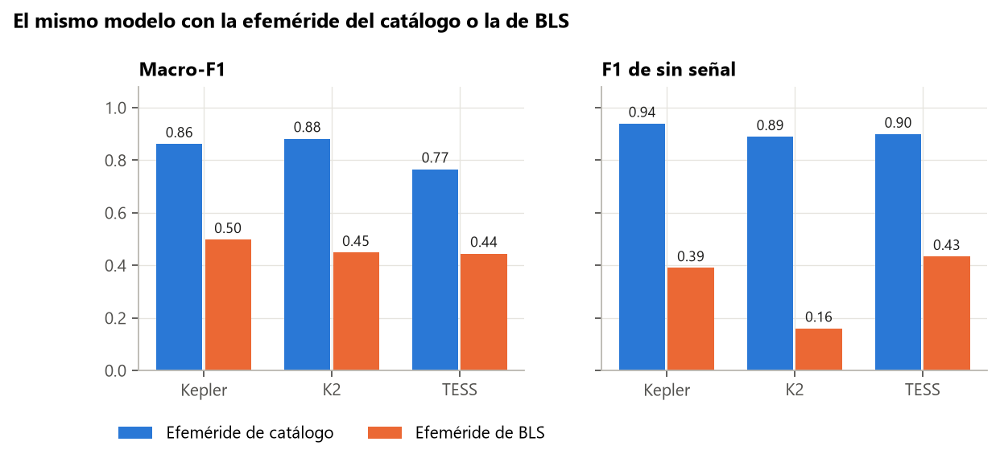

*Figura 23. Con la efeméride de BLS, los NO_SIGNAL plegados en un pico de ruido parecen tránsitos.*

### 9.4 Por qué pasa

En el entrenamiento, los «sin señal» se plegaban con una efeméride al azar y daban una curva plana. Plegados en el mejor pico de ruido de BLS, parecen un tránsito débil que el modelo nunca había visto. El buen resultado anterior en «sin señal» era optimista. Lección general: **los datos de entrenamiento deben parecerse a cómo se usará el modelo** (en la industria, *train/serve skew*).

Cuando BLS acierta el periodo, el modelo funciona igual o mejor con los planetas (92 % → 96 %): el problema no es la red, sino la entrada.

### 9.5 La decisión

| Opción | A favor | En contra |
|---|---|---|
| **A. Clasificador de señales ya detectadas** | Igual que AstroNet y ExoMiner; el modelo ya funciona | No busca por sí solo |
| B. De principio a fin, reentrenando con BLS | Sistema completo | Depende de BLS y de negativos realistas |
| C. Umbral de SDE delante | Simple | No arregla el ruido que supera el umbral |

Se elige **A**. Consecuencia: «sin señal» pasa a significar «la efeméride dada no corresponde a un tránsito real».

---

## 10. El modelo final y su evaluación en test

> **Idea central:** la receta del modelo final se fijó y se guardó en git antes de mirar el test, y después se evaluó una sola vez. Resultado: macro-F1 de 0,886 en Kepler, 0,928 en K2 y 0,720 en TESS. En LOMO el test dio lo mismo que validación: lo medido antes no estaba inflado.

### 10.1 Por qué se fija la receta antes

El test solo es una medida honesta si no influye en ninguna decisión. Si se mira, se cambia algo y se vuelve a mirar, deja de valer. Como en un **preregistro**, la receta completa se escribió y se commiteó (commit `05a737a`) antes de ver el test.

### 10.2 La receta

| Elemento | Motivo | Sección |
|---|---|---|
| CNN de dos ramas tipo AstroNet | La mejor de la fase 2 | 6 |
| Solo las vistas, sin profundidad | Aportaba +0,003 y delata la misión | 7.6 |
| Kepler + K2 + TESS juntos | Juntar misiones funciona mejor que ajustar fino | 8.5 |
| TESS con 1 sector | Receta fijada antes de la fase 6 | 7, 14 |
| Base 16 y dropout 0,5 | Elegidos en val | 6 |
| 5 semillas, probabilidades promediadas | Reduce varianza (como ExoMiner++ y AstroNet-K2) | 6.8, 8.5 |
| Clase más probable como decisión | Corregir la mezcla de clases empeoraba | 7.7 |
| Alcance: señales ya detectadas | Lo visto con BLS | 9 |

Se entrenó con train + val y se evaluó de dos maneras: el modelo final en el test de cada misión, y la misma receta en LOMO en el test de cada misión excluida.

### 10.3 Resultado por telescopio

| Misión | Macro-F1 test [IC 95 %] | PR-AUC test | Macro-F1 val |
|---|---|---|---|
| Kepler | **0,886** [0,867–0,906] | 0,947 | 0,87 |
| K2 | **0,928** [0,858–0,983] | 0,972 | 0,87–0,90 |
| TESS | **0,720** [0,661–0,772] | 0,816 | 0,779 |
| Media | **0,845** | — | — |

Kepler y K2 suben respecto a val (más datos y 5 semillas); TESS baja un poco, dentro del IC. K2 solo tiene 81 estrellas de test: no hay que sacar conclusiones finas.

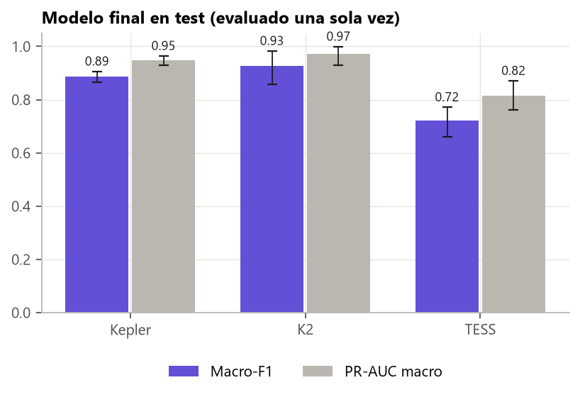

*Figura 24. CNN solo curva sin profundidad, conjunto de 5 semillas. IC 95 % bootstrap por estrella.*

### 10.4 Matriz de confusión

«Sin señal» va muy bien (F1 0,92–0,96). El problema difícil es planeta frente a FP, y el fallo dominante es **en TESS, 34 de 89 FP predichos como planeta**.

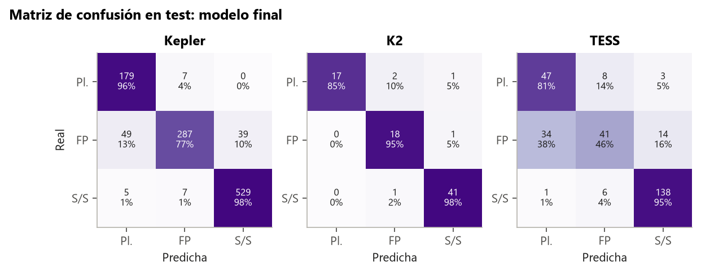

*Figura 25. Modelo final en test, por misión.*

### 10.5 LOMO en test

PR-AUC **0,906 (Kepler), 0,961 (K2), 0,761 (TESS)**, igual que en val. La fase de portabilidad no estaba inflada. Coste de no ver la misión: Kepler 0,947 → 0,906, K2 0,972 → 0,961, TESS 0,816 → 0,761.

### 10.6 La métrica que importa para candidatos

En un candidato ya hay una señal, así que la pregunta útil es planeta frente a FP. En el test de TESS: **ROC-AUC 0,803 y PR-AUC 0,766**. Con un 90 % de precisión recupera el 34 % de los planetas. Para un astrónomo con poco tiempo de telescopio, eso es una lista corta y fiable: **el modelo prioriza, no confirma**.

**Limitaciones.** K2 tiene pocas estrellas en test. La métrica de 3 clases incluye negativos fabricados 1:1; la cifra útil para candidatos es planeta frente a FP.

---

## 11. Análisis de errores, negativos difíciles y triaje

> **Idea central:** en Kepler, los FP que se escapan son sobre todo de contaminación (invisible en la curva). En TESS se escapan binarias, que sí se ven: ahí hay margen. El ruido realista engaña al modelo; entrenar con negativos difíciles lo hace más robusto en búsqueda a costa de algo de rendimiento con catálogo. El triaje sin efeméride llega al 47 % de recall con un 1 % de falsas alarmas, limitado por BLS.

Todo en validación (el test ya estaba gastado), con la receta final entrenada solo con train.

### 11.1 Tipos de falso positivo

- **Binaria:** visible en la curva.
- **Contaminación:** binaria de fondo, centroide desplazado o coincidencia de efemérides. La señal es real pero viene de otra estrella: invisible en una curva sola.
- **No tránsito.**

### 11.2 Kepler y TESS

| | Kepler | TESS |
|---|---|---|
| Binarias acertadas | 88 % | — |
| Binarias que pasan por planeta | 9 % | **31 %** (margen de mejora) |
| Contaminación acertada | 60 % (29 % → planeta) | — |

En Kepler, la mitad de los FP que pasan por planeta son de contaminación: el **techo físico**. En TESS se escapan binarias, que sí se ven; el modelo no recibe vistas par/impar locales ni del secundario, que es como lo hacen AstroNet-Vetting y ExoMiner. En test es peor: el 38 % de los FP de TESS pasan por planeta. Los FP «no tránsito» que van a «sin señal» reflejan una frontera difusa de las etiquetas.

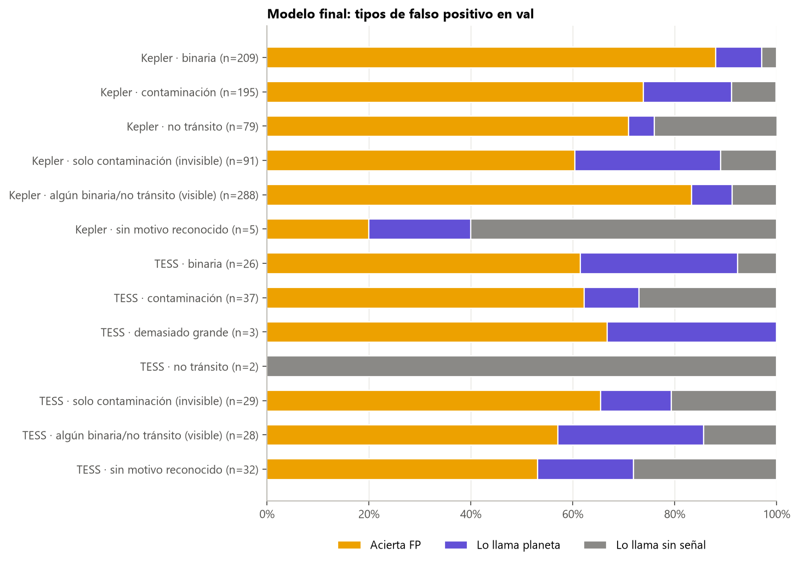

*Figura 26. Kepler: motivos del Robovetter; TESS: comentarios de ExoFOP (etiquetas ruidosas).*

### 11.3 Prevalencias realistas

Con los negativos fáciles, solo el 1–3 % de los «sin señal» pasan por planeta. Pero en el cielo hay muchas más estrellas sin señal que planetas: con 100 «sin señal» por planeta, eso son 1–3 falsos por cada planeta real, y más de la mitad de los «planetas» serían falsos. Con ruido realista (picos de BLS), entre el 20 % y el 43 % pasan por planeta. **La precisión depende de la prevalencia**: un buen resultado en un conjunto equilibrado puede ser malo en el cielo real.

### 11.4 Negativos difíciles

Se añadió al entrenamiento ruido plegado en su pico de BLS como «sin señal»:

- **Gana robustez:** en Kepler, el ruido clasificado como FP baja del 69 % al 3 %; con BLS, el macro-F1 sube ~0,2.
- **Pierde con catálogo:** −0,03 / −0,04.

**Decisión:** ningún modelo es el mejor en todo. El modelo base se usa para señales con efeméride (TOIs); el de negativos difíciles, solo para búsqueda.

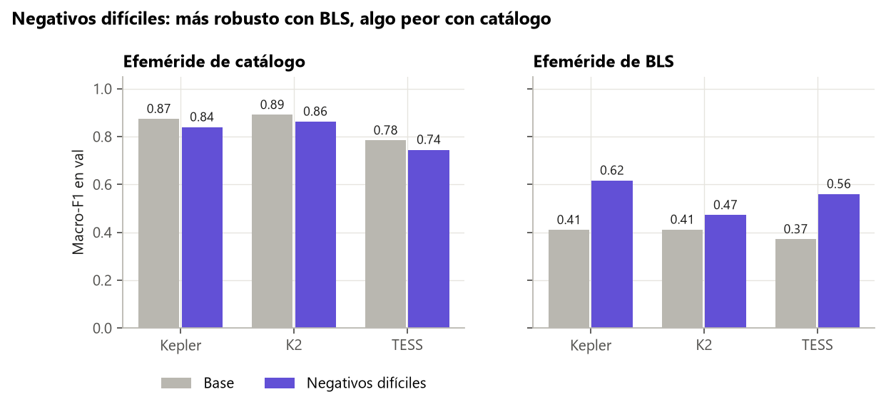

*Figura 27. Catálogo frente a BLS con y sin negativos difíciles.*

### 11.5 Triaje sin efeméride

Métrica: **recall de candidatos dejando pasar solo el 1 % del ruido**, porque en el cielo el ruido es mayoría.

| Método | Recall con 1 % de falsas alarmas |
|---|---|
| SDE de BLS sola | 0,26 |
| CNN con negativos difíciles | 0,31 |
| SDE + CNN | 0,47 |

**El límite es BLS:** si encuentra el periodo correcto (68 %), el recall es 0,65; si no, 0,11. Usar los 3 mejores picos no ayuda (0,474 → 0,470). Esto motiva el detector sin BLS de la sección 12.

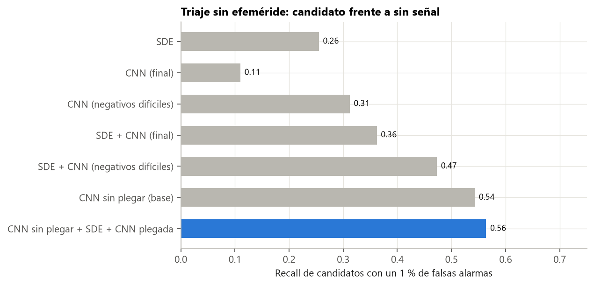

*Figura 28. Triaje en val, todas las misiones (las barras inferiores corresponden a la sección 12).*

**Limitaciones.** Las etiquetas de motivo de TESS son ruidosas (un tercio solo dice «TFOP FP»); hay pocos FP de TESS por tipo (26–32); las precisiones con prevalencias realistas son una aproximación.

---

## 12. Un detector sin BLS

> **Idea central:** para no depender de BLS se entrenó una red que mira la curva entera, sin plegar, con tránsitos sintéticos inyectados. Sola supera a BLS + CNN (0,52 frente a 0,47) y combinada llega a 0,56. Detecta ~90 % de los tránsitos claros (SNR > 30), pero tocó techo y la línea se cerró.

### 12.1 Cómo funciona

- **Entrada:** curvas sin plegar, aplanadas a ciegas y agrupadas en bloques de 30 min (hasta 9 216 bloques ≈ 192 días); el brillo en unidades del ruido de la estrella, más un canal que marca los huecos.
- **Red:** CNN 1D de 7 bloques con agregación global.
- **Inyección de tránsitos sintéticos:** en cada época, cada curva sin señal recibe un tránsito trapezoidal con periodo, duración y SNR al azar (entre 5 y 50) y pasa a ser «candidato». Da etiquetas gratis, permite ver miles de tránsitos y controlar la SNR. Riesgo: las inyecciones simples no imitan a los FP reales.

### 12.2 Resultados

| Método (5 semillas) | Recall con 1 % de falsas alarmas |
|---|---|
| BLS + CNN plegada | 0,473 |
| Red sin plegar sola | **0,525** |
| Las tres puntuaciones juntas | **0,564** |

Combinar ayuda porque la red mira cosas distintas que BLS y sus errores no coinciden.

### 12.3 Sensibilidad por SNR

~90 % de detección con SNR > 30; 44 % con SNR 10–15. Es la **curva de completitud**, la figura estándar en búsqueda de planetas.

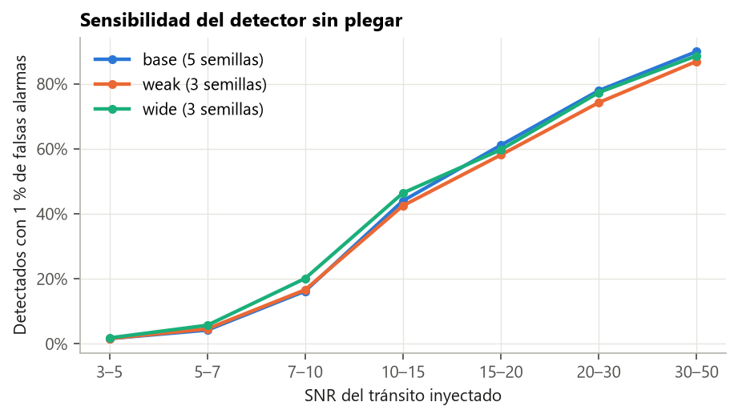

*Figura 29. Tránsitos inyectados en curvas sin señal de val.*

**El precio:** con un recall del 95 %, pasan dos tercios del ruido. No sirve como filtro de alto recall.

### 12.4 Variantes y lección metodológica

Inyecciones más débiles, red el doble de ancha y más semillas: ninguna mejora. La primera prueba (0,554) fue una **semilla afortunada**: la media de una semilla es 0,498 ± 0,024. Hay que informar media ± desviación entre semillas, nunca la mejor semilla.

### 12.5 Cierre de la línea

Se alcanzó el techo. La búsqueda ya la hacen las tuberías oficiales y Planet Hunters TESS, y ya existe un Transformer para TESS (Salinas et al. 2025). Cerrar una línea es una decisión válida de coste/beneficio. Si se retoma: un detector por punto (U-Net, como PANOPTICON).

**Limitaciones.** La SNR de los candidatos reales se estimó con la profundidad de la vista local, poco fiable con señales débiles; los tránsitos inyectados son trapezoidales.

---

## 13. Herramientas que ya existen

> **Idea central:** antes de construir una herramienta propia se revisó lo que existía, y casi todo lo planeado ya estaba hecho. Esto obligó a reorganizar el proyecto y definir qué aporta de verdad.

### 13.1 El plan inicial

Una herramienta para aficionados que recomendara qué observar, informara de un candidato con probabilidades y buscara tránsitos en una estrella. Regla fijada de antemano: si existe algo igual, se replantea antes de seguir.

### 13.2 Lo que existe

| Función | Herramienta | Para quién |
|---|---|---|
| Planificar observaciones | Tapir / Swarthmore Transit Finder, servicio del Exoplanet Archive, ExoClock (Ariel), Exoplanet Watch con EXOTIC | Aficionados y profesionales |
| Priorizar candidatos | Prioridades del TFOP en ExoFOP (427 TOIs con prioridad máxima) | Seguimiento profesional y pro-am |
| Clasificar | ExoMiner++ (~147 568 señales), LEO-Vetter, TRICERATOPS | Profesionales |
| Buscar e inspeccionar | SPOC, QLP, Planet Hunters TESS, LATTE | Profesionales y ciencia ciudadana |

Búsqueda realizada con búsquedas web de herramientas para aficionados y profesionales; para cada una se anotó qué hace, para quién y con qué parte del plan coincide.

### 13.3 El dato propio

De ExoFOP: **4 813 TOIs sin resolver**, de los que unos **793 son asequibles para un aficionado** (Tmag < 12 y profundidad > 3 000 ppm, es decir, estrella suficientemente brillante y caída suficientemente grande para un telescopio pequeño).

### 13.4 Veredicto

| Idea | Qué existe | Veredicto |
|---|---|---|
| Recomendar qué observar | Planificadores + prioridades TFOP | Sería solo una integración |
| Informar con probabilidades | ExoMiner++ (PR-AUC ~0,98 frente a 0,70–0,77) | No aporta |
| Buscar tránsitos | SPOC, QLP, Planet Hunters TESS | Otros lo hacen mejor |

### 13.5 Lo que sí aporta el proyecto

1. **Portabilidad demostrada:** un modelo solo curva medido en telescopios no vistos.
2. **Evaluación prospectiva** frente a ExoMiner++ y el TFOP.
3. **Explicación en español para no expertos.**

### 13.6 Decisión

Reorganización en fases 6–9: mejora de TESS, investigación, herramienta explicativa para aficionados y astrónomos, y web, ingeniería y documentación. Se contempla una posible colaboración con DIPS Ojos (Universidad de Oviedo y Sociedad Astronómica Asturiana Omega).

**Limitaciones.** La revisión se hizo con búsquedas web; algunos detalles (como los criterios de ExoClock) no se pudieron verificar.

---

## 14. Intentos de mejorar TESS (fase 6)

> **Idea central:** se probaron tres palancas en TESS. Varios sectores por estrella no dio una mejora detectable (con poca potencia estadística); las etiquetas extra se aparcaron porque creaban un atajo; calibrar con *temperature scaling* sí funcionó. El modelo final queda igual, con temperaturas por misión.

### 14.1 Varios sectores por estrella

- **El atajo:** los planetas tienen una mediana de 7 sectores, los FP 3 y los «sin señal» 2. Solo con ese número se separa planeta de FP con AUC 0,71.
- **La solución:** el mismo número de sectores en cada pareja (positivo y su «sin señal»): 714 parejas, 2–3 sectores y 16–24 tránsitos de mediana. Reentrenamiento con 5 semillas y criterio fijado antes.
- **Resultado:** 0,784 → 0,765 (**−0,019 [−0,059, +0,018]**); el criterio no se cumple.
- **Lectura honesta:** las estrellas que no ganan sectores bajan casi igual que las que ganan, así que es variación entre entrenamientos. Con 134 estrellas que ganan sectores, un efecto de +0,03 era indetectable: **falta de potencia estadística**. Lo correcto sería evaluar el modelo actual con vistas multisector, estrella a estrella (pendiente).

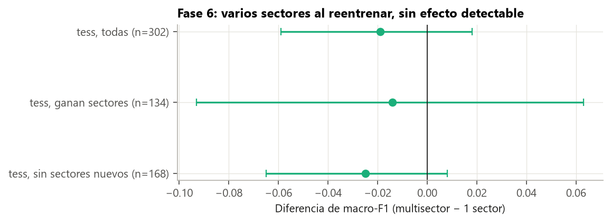

*Figura 30. IC 95 % bootstrap; los intervalos son muy anchos.*

### 14.2 Más etiquetas

De 885 TOIs resueltos nuevos, los que tienen datos de 2 min son casi todos planetas conocidos (~412) y solo 1 FP; los ~280 FP nuevos solo tienen datos de imágenes completas (FFI). Mezclarlos crearía el atajo «imágenes completas → FP». Se aparcó. Idea alternativa: usarlos solo para evaluar, como un cuarto telescopio.

### 14.3 Calibración

Un modelo está **calibrado** si, cuando dice 0,8, acierta el 80 % de las veces. El *temperature scaling* divide las salidas de la red por un número T antes de la softmax: suaviza (T > 1) o agudiza (T < 1) las probabilidades **sin cambiar la clase predicha**, así que no cambia el macro-F1. Se ajustó por misión, fuera de pliegue en val.

| Misión | Temperatura | Lectura |
|---|---|---|
| Kepler | 0,77 | El conjunto era poco confiado (decía 0,86, acertaba 0,90). ECE 0,039 → 0,017 |
| K2 | 0,68 | Poco confiado |
| TESS | 1,07 | Ya casi calibrado: la sobreconfianza de la fase 3 era del modelo LOMO |

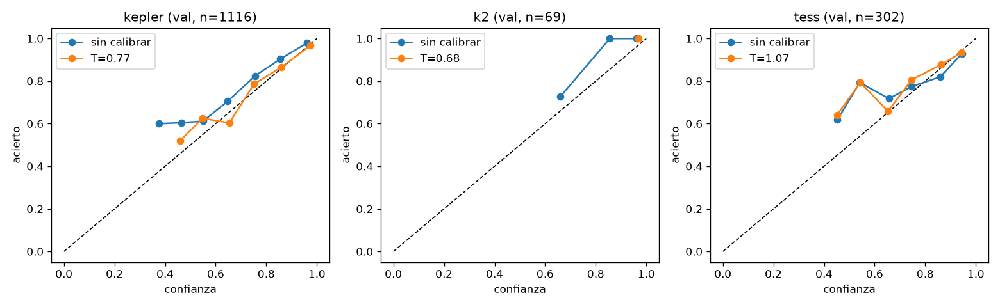

*Figura 31. Diagrama de fiabilidad antes y después de la temperatura.*

### 14.4 Cierre

Fase de resultados mayoritariamente negativos pero informativa: el modelo final se queda igual, con temperaturas por misión.

---

## 15. Tránsitos individuales: ¿se pierde información al plegar?

> **Idea central:** antes de construir un Transformer que mirara cada tránsito por separado, se midió si esa información existe y aporta algo. En TESS no aporta nada a la red (+0,000), así que no se recomienda. Por el camino se obtuvo un test par/impar mucho mejor calibrado y una lista de planetas de Kepler con tránsitos irregulares.

### 15.1 La pregunta

Al plegar, todos los tránsitos se resumen en uno medio y se pierden las diferencias entre ellos: una binaria con el periodo a la mitad (eclipses alternos de distinta profundidad), un tránsito anómalo, una profundidad que cambia. Un Transformer sobre tránsitos individuales costaría semanas; una prueba de viabilidad, menos de un día. Si la prueba barata sale negativa, no se construye el modelo caro.

### 15.2 Cómo se mide cada tránsito

- A cada tránsito se le ajusta la forma media de **los demás** (con la amplitud libre), para que no se compare consigo mismo.
- La primera versión medía la media de los puntos centrales y daba variaciones falsas en las binarias en V con cadencia de 30 min: un buen ejemplo de depuración.
- El **ruido rojo** (variaciones lentas, correlacionadas entre puntos) hace que los tests clásicos exageren los z. Se mide en «tránsitos falsos», en fases sin señal.

### 15.3 Las tres medidas

Diferencia par/impar, dispersión entre tránsitos y tránsito más desviado, normalizadas para **no depender del número de tránsitos** (que sería un atajo conocido). El criterio de mejora se fijó antes de mirar, comparando con predicciones fuera de muestra de la red.

### 15.4 Resultado

- **TESS: +0,000 [−0,005, +0,005]** de ROC-AUC; entre los que la red llama planeta, AUC 0,515 (no separa).
- Kepler y K2: la dispersión separa sola (~0,67), pero la red ya lo sabe.

En TESS, con 6–9 tránsitos de un sector, cada tránsito tiene poca señal, y las binarias que se escapan no son de tránsitos alternos. Siguiente palanca: una vista del secundario y una local de más resolución.

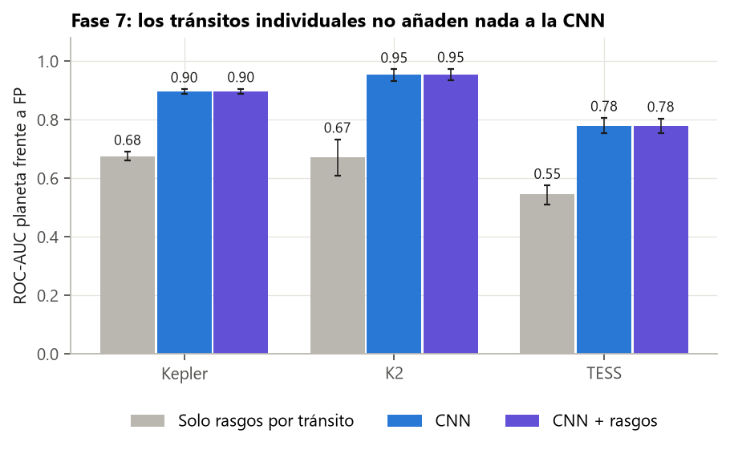

*Figura 32. Predicciones LOMO fuera de muestra frente a |z| par/impar, dispersión y tránsito más desviado.*

### 15.5 Lo que se gana

- **Test par/impar calibrado:** en planetas, P(|z| > 3) baja del 14,5 % al 5 %.
- **El 19 % de los planetas de Kepler** tienen tránsitos más irregulares de lo esperado: candidatos a manchas estelares o TTV (variaciones del momento del tránsito por otros planetas), de interés para DIPS Ojos.
- Corrección colateral: el código no encontraba los archivos de la campaña 10 de K2 (44 estrellas).

En total se analizaron 6 650 estrellas.

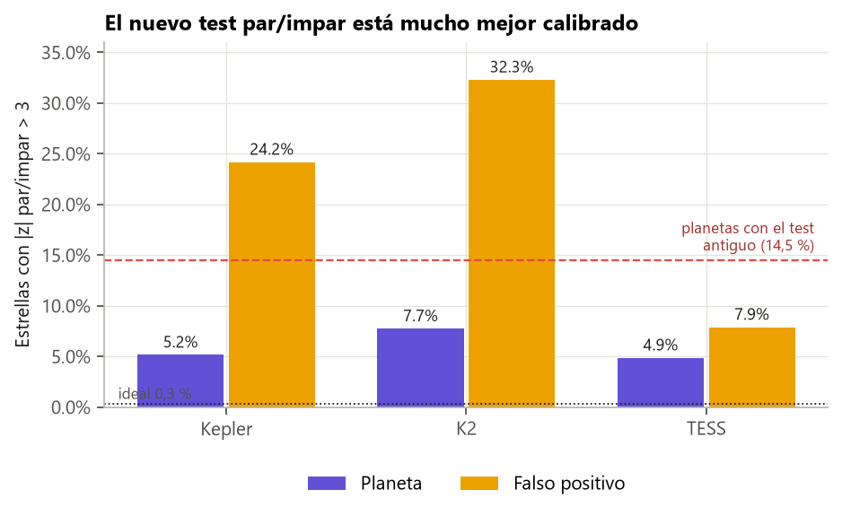

*Figura 33. Fracción de estrellas con diferencia par/impar significativa con el ajuste tránsito a tránsito y ruido rojo.*

**Limitaciones.** Que estos tres rasgos no ganen no demuestra que no exista ninguna información por tránsito, solo que los mecanismos principales no aportan. El test par/impar no llega al 0,3 % teórico (puede ser física real).

---

## 16. Predicciones congeladas (v1) sobre los candidatos abiertos

> **Idea central:** se predijeron los 3 536 candidatos de TESS sin resolver con curva usable, se guardaron con huellas digitales y se publicaron en GitHub (etiqueta `v1`) para compararlas en el futuro con las respuestas reales, ExoMiner++ y el TFOP.

### 16.1 Qué es una validación prospectiva

Toda la evaluación anterior usa casos con respuesta conocida, y siempre queda la duda de si alguna decisión se tomó mirándolas. Una **validación prospectiva** —predecir hoy, comprobar después— elimina esa duda. Es como dejar la quiniela en un sobre cerrado antes del partido.

### 16.2 Qué se predijo

| Paso | TOIs |
|---|---|
| TOIs en estado PC (candidato planetario) | 4 813 |
| Sin periodo | −76 |
| Procesados | 4 737 |
| Sin datos de 2 min | −756 |
| Pocos tránsitos o huecos | −444 |
| **Con curva usable** | **3 536** |

Para cada TOI se descargó 1 sector de 2 min, se plegó igual que al entrenar y se predijo con el modelo final más la temperatura de TESS.

### 16.3 Qué se guardó por candidato

- Las 3 probabilidades.
- **P(planeta | señal)**: la probabilidad de planeta suponiendo que hay señal. Es la cifra útil porque en un candidato ya hay una señal.
- La puntuación de ExoMiner++ (2 007 TOIs).
- Las prioridades del TFOP.

### 16.4 Cómo se demuestra que no se cambió

Hashes **SHA-256** (huellas digitales de archivo) de pesos, temperatura, vistas, ExoFOP, ExoMiner++ y predicciones, recogidos en un manifiesto, más la etiqueta pública `v1`. Una mejora futura se congela como v2.

### 16.5 La deriva de la efeméride

- **Qué es:** el error del periodo se acumula con cada órbita, como un reloj que atrasa. Lejos de la época de referencia, el tránsito puede no estar donde dice el catálogo.
- **Cómo apareció:** al elegir el sector con más tránsitos, el 8 % de los TOIs tenía un error mayor que la duración, y el 54 % de ellos salía «sin señal».
- **Por qué no pasaba al entrenar:** las efemérides de los objetos resueltos están refinadas.
- **Solución:** elegir el sector con menor deriva y marcar como inciertos los que superan 0,25 duraciones. Con deriva baja solo el 4 % sale «sin señal»; con deriva > 1, el 39 %. **326 TOIs (9 %)** quedan marcados como inciertos.
- **Lección:** el fallo estaba en el puente entre el catálogo y los datos, no en el modelo, y solo aparece al usarlo con datos reales.

### 16.6 Resultado

De los **3 210 fiables**: 2 564 planeta, 493 FP y 153 sin señal. Frente a ExoMiner++: coinciden en el 76 %, con una correlación de 0,37, esperable porque ExoMiner++ usa más información. Son predicciones pendientes de validar.

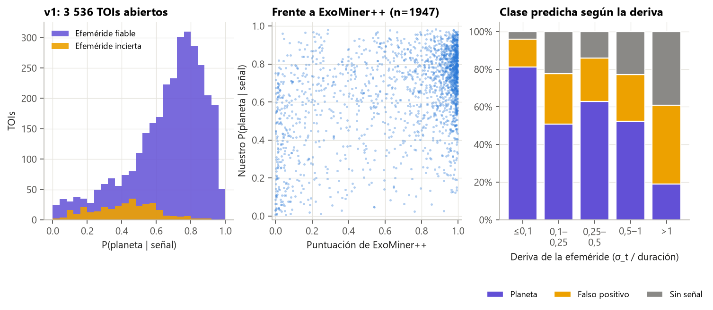

*Figura 34. Predicciones congeladas v1: distribución de P(planeta | señal), comparación con ExoMiner++ y clase predicha según la deriva.*

### 16.7 Qué falta

- Cruzar periódicamente con ExoFOP y calcular las métricas a medida que se resuelvan los TOIs.
- Complementar con una validación **pseudo-prospectiva** por fecha de alerta, que daría un resultado ya.

**Limitaciones.** El corte de 0,25 duraciones se fijó antes de ver los datos, pero entre 0,1 y 0,25 ya se nota algo (22 % «sin señal»). La elección del sector usa la deriva, la única diferencia con la cadena de entrenamiento. Las disposiciones del TFOP tardan meses o años.

---

## 17. Conclusiones, limitaciones y trabajo futuro

### 17.1 Conclusiones

1. **Usar solo la curva es necesario**, no una restricción arbitraria: el catálogo permite acertar por la misión (0,687) sin entender la física.
2. **El límite está en la información, no en el modelo:** seis familias de modelos acaban en 0,78–0,85. Parte de los FP (contaminación) son invisibles en la curva: es un techo físico.
3. **El modelo solo curva es portable:** sin ver el telescopio, PR-AUC 0,906 / 0,961 / 0,761 en test, con una pérdida media de ~0,05 en val. Lo que se transfiere es «hay señal o no»; lo que se degrada es planeta frente a FP.
4. **TESS es difícil por los datos:** pocos tránsitos por estrella y otra población de planetas. Lo único que ayudó fue más información por estrella.
5. **Es un clasificador de señales ya detectadas:** con la efeméride de BLS el rendimiento cae a ~0,5. La búsqueda sin efeméride toca techo en un 56 % de recall con un 1 % de falsas alarmas.
6. **Prioriza, no confirma:** en TESS, con un 90 % de precisión recupera el 34 % de los planetas.
7. **La metodología es tan importante como el modelo:** receta commiteada antes del test, test mirado una vez, LOMO anidado, bootstrap por estrella, tests de atajo en cada paso y predicciones congeladas con hashes.

### 17.2 Limitaciones generales

- La clase «sin señal» es artificial (1:1 y fácil); las métricas de 3 clases no son las de una búsqueda real.
- K2 tiene muy pocas estrellas en val y test.
- Las etiquetas de TESS son ruidosas y cambian con el tiempo.
- Queda un atajo débil de sesgo de detección (0,55–0,60).
- La comparación con el estado del arte es cualitativa: los protocolos no son iguales.

### 17.3 Trabajo futuro

- **TESS:** vista del eclipse secundario y vista local de más resolución; dar más peso a TESS al entrenar; evaluar el modelo actual con vistas multisector estrella a estrella.
- **Datos:** entrenar con etiquetas débiles; negativos con falsas alarmas reales (Kepler DR25 invertido/desordenado, FA de TESS); usar los TOIs resueltos con FFI como cuarto telescopio de evaluación; CoRoT cuando su catálogo esté disponible.
- **Validación prospectiva:** cruce periódico con ExoFOP y validación pseudo-prospectiva por fecha de alerta.
- **Producto:** herramienta explicativa en español para aficionados (fase 8) y web y documentación (fase 9); colaboración con DIPS Ojos.

---

## Anexo A. Matrices de confusión de la fase 2

Filas = clase real, columnas = predicha (Pl. planeta, FP falso positivo, S/S sin señal); recuento y % por fila.

**Regresión logística (vistas)**

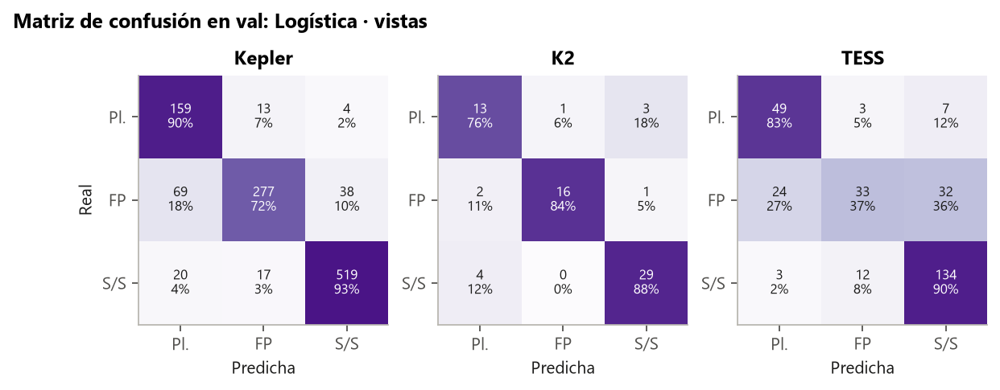

**PCA + kNN (vistas)**

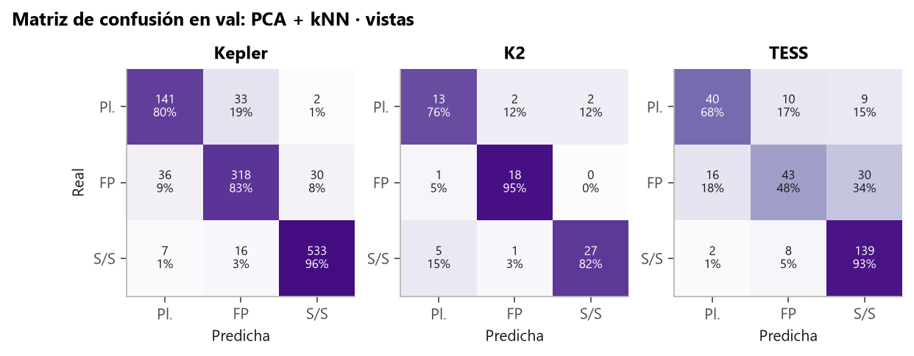

**Gradient boosting (vistas)**

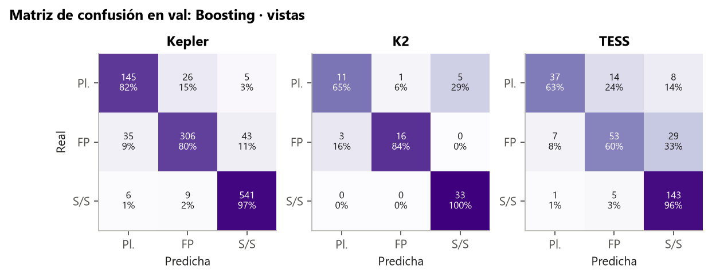

**MLP**

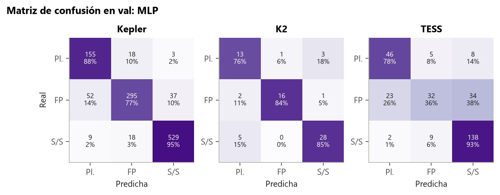

**MOMENT ajustado**

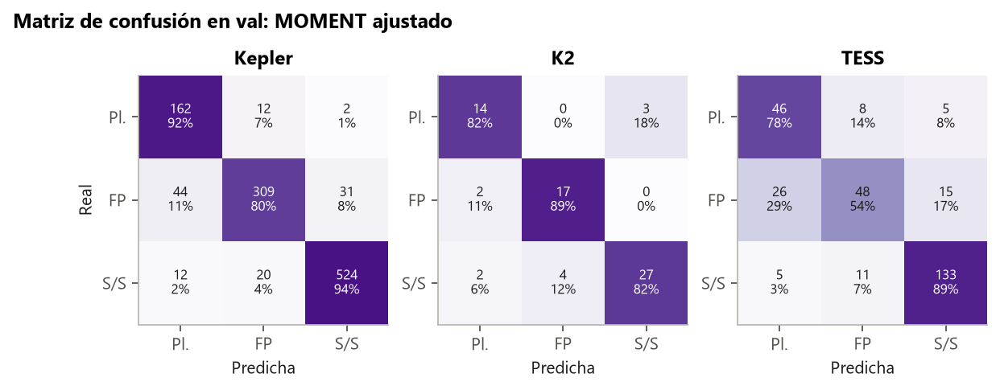

**CNN + centroide**

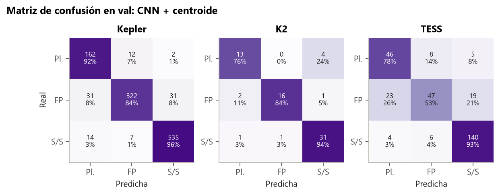

---

## Anexo B. Glosario

| Término | Significado |
|---|---|
| **AdaBN** | Recalcular las estadísticas internas (BatchNorm) de la red con datos del nuevo dominio |
| **Alias del periodo** | Periodo encontrado que es ½ o 2 veces el real |
| **Atajo** | Pista que delata la clase sin tener que ver con la física |
| **AUC (ROC-AUC)** | Probabilidad de que un positivo al azar puntúe más que un negativo al azar; 0,5 = no separa |
| **Bootstrap** | Remuestrear las estrellas muchas veces para estimar la variabilidad de una métrica (IC) |
| **Calibración / ECE** | Si la probabilidad que dice el modelo coincide con su acierto; ECE es el error medio de calibración |
| **Centroide** | Posición del centro de luz en el detector; se desplaza si la señal viene de una estrella vecina |
| **Efecto Simpson** | Relación que aparece al juntar grupos y desaparece o se invierte dentro de cada grupo |
| **Efeméride** | Periodo, época y duración del tránsito |
| **Disposición** | Veredicto oficial: confirmado, candidato, falso positivo o falsa alarma |
| **ExoFOP / TFOP** | Plataforma donde se comparten los candidatos de TESS / programa de seguimiento de TESS |
| **LOMO** | *Leave-one-mission-out*: dejar una misión fuera y evaluar en ella |
| **Macro-F1** | Media del F1 de cada clase con el mismo peso |
| **Negativos difíciles** | Ejemplos negativos que se parecen a positivos (ruido plegado en un pico de BLS) |
| **PR-AUC / AP** | Área bajo la curva precisión–recall; un modelo al azar vale la prevalencia |
| **Prevalencia** | Proporción de una clase en los datos |
| **Robovetter** | Clasificador automático del equipo de Kepler |
| **Ruido rojo** | Ruido con variaciones lentas, correlacionado entre puntos |
| **SDE** | Cuánto sobresale el pico del periodograma de BLS respecto al resto |
| **Sesgo de detección** | Los planetas se encuentran más fácilmente en estrellas tranquilas |
| **SNR** | Relación señal/ruido |
| **TCE** | Señal detectada por la tubería de un telescopio |
| **Temperature scaling** | Dividir las salidas de la red por T para calibrar sin cambiar la clase predicha |
| **TOI** | *TESS Object of Interest*: candidato de TESS |
| **TTV** | Variaciones del momento del tránsito causadas por otros planetas |
| **Vista global / local** | Curva plegada completa (201 puntos) / alrededor del tránsito (81 puntos) |

---

## Anexo C. Reproducibilidad y código

Entornos: Windows (`.venv`, Python 3.12, [`requirements.txt`](../requirements.txt)) para datos, comprobaciones y sklearn; WSL2 Ubuntu 24.04 ([`requirements-wsl.txt`](../requirements-wsl.txt)) para redes neuronales (CPU o GPU AMD con ROCm, entrenando en bf16 con `--amp`). Todo se ejecuta desde la raíz con `PYTHONPATH=src` y semillas fijas. Los pasos de reproducción están en el [`README.md`](../README.md).

| Sección | Código principal |
|---|---|
| 2. EDA | `legacy/eda.py`, `legacy/features.py`, `scripts/checks/recheck_z_features.py` |
| 3. Evaluación | `src/exoplanet/evaluation.py`, `tests/test_evaluation.py` |
| 4. Etiquetas | `src/exoplanet/labels.py`, `scripts/data/fetch_labels.py`, `scripts/checks/label_audit.py`, `tests/test_labels.py` |
| 5. Negativos | `src/exoplanet/negatives.py`, `scripts/data/build_negatives.py`, `scripts/data/build_sample.py --negatives`, `scripts/checks/shortcut_negatives.py` |
| 6. Modelos fase 2 | `scripts/models/{sklearn_models,mlp,cnn,moment_probe,moment_finetune}.py`, `src/exoplanet/{cnn,dataset,training}.py`, `scripts/checks/error_analysis_fp.py` |
| 7. LOMO | `scripts/models/{lomo,learning_curve,adabn,lomo_crop,pseudo_labels,tess_sectors,calibration}.py`, `scripts/checks/tess_errors.py` |
| 9. BLS | `src/exoplanet/bls.py`, `scripts/data/build_bls_views.py`, `scripts/models/eval_bls.py` |
| 10. Modelo final | `scripts/models/final_model.py {select, train, test, val}`; pesos `data/models/final_seed{0..4}.pt` |
| 11. Errores y triaje | `scripts/checks/error_analysis_final.py`, `scripts/models/hard_negatives.py`, `scripts/checks/triage_val.py`, `scripts/data/build_bls_peaks.py` |
| 12. Detector sin BLS | `scripts/data/build_series.py`, `scripts/models/series_cnn.py`, `scripts/checks/series_ensemble.py` |
| 14. Mejora TESS | `scripts/data/build_tess_multisector.py`, `scripts/models/tess_multisector.py`, `scripts/checks/tess_multi_compare.py`, `scripts/models/temperature.py` |
| 15. Tránsitos individuales | `src/exoplanet/features.py` (`transit_features`), `scripts/data/build_transit_feats.py`, `scripts/checks/transit_feats_check.py` |
| 16. TOIs v1 | `scripts/data/build_toi_views.py`, `scripts/models/predict_tois.py`, `scripts/checks/toi_ephemeris_drift.py`; resultados en `results/toi/` |
| Figuras | `scripts/checks/figuras.py` (genera `docs/figuras/` a partir de `results/`) |

---

## Anexo D. Bibliografía

**Datos y catálogos**

- Dataset *exoplanet-transit-detection*: https://huggingface.co/datasets/bingbangboom/exoplanet-transit-detection
- NASA Exoplanet Archive: https://exoplanetarchive.ipac.caltech.edu/
- ExoFOP-TESS: https://exofop.ipac.caltech.edu/tess/
- MAST: https://archive.stsci.edu/ · Lightkurve: https://docs.lightkurve.org/
- Guerrero, N. M. et al. (2021), catálogo de TOIs: https://arxiv.org/abs/2103.12538
- Thompson, S. E. et al. (2018), Kepler DR25 y Robovetter: https://arxiv.org/abs/1710.06758
- Deleuil, M. et al. (2018), catálogo de CoRoT: https://vizier.cds.unistra.fr/viz-bin/VizieR?-source=J/A+A/619/A97

**Física del tránsito**

- Mandel, K. y Agol, E. (2002), forma del tránsito: https://arxiv.org/abs/astro-ph/0210099
- Seager, S. y Mallén-Ornelas, G. (2003), densidad estelar desde el tránsito: https://arxiv.org/abs/astro-ph/0206228
- Kovács, G., Zucker, S. y Mazeh, T. (2002), BLS: https://arxiv.org/abs/astro-ph/0206099
- Pont, F., Zucker, S. y Queloz, D. (2006), ruido rojo: https://arxiv.org/abs/astro-ph/0608597
- Carter, J. A. y Winn, J. N. (2009), ruido correlacionado: https://arxiv.org/abs/0909.0747
- Bryson, S. T. et al. (2013), FP de fondo con el centroide: https://arxiv.org/abs/1303.0052
- Vanderburg, A. y Johnson, J. A. (2014), artefactos de K2: https://arxiv.org/abs/1408.3853
- Holman y Murray (2005); Agol et al. (2005), TTV: Science 307 y MNRAS 359

**Clasificación de tránsitos con ML**

- Shallue, C. J. y Vanderburg, A. (2018), AstroNet: https://arxiv.org/abs/1712.05044
- Dattilo, A. et al. (2019), AstroNet-K2: https://arxiv.org/abs/1903.10507
- Yu, L. et al. (2019), AstroNet-Triage/Vetting: https://arxiv.org/abs/1904.02726
- Ansdell, M. et al. (2018), Exonet: https://arxiv.org/abs/1810.13434
- Valizadegan, H. et al. (2022), ExoMiner: https://arxiv.org/abs/2111.10009
- Valizadegan, H. et al. (2025), ExoMiner++: https://arxiv.org/abs/2502.09790 · catálogo: https://doi.org/10.5281/zenodo.15466293
- PANOPTICON (2025): https://arxiv.org/abs/2409.03466 · FALCO (2025): https://arxiv.org/abs/2504.20290 · Astromer 2 (2025): https://arxiv.org/abs/2502.02717
- LEO-Vetter (2025): https://arxiv.org/abs/2509.10619 · EXOVEIL (2026): https://arxiv.org/abs/2606.02778 · AstroMMBench (2025): https://arxiv.org/abs/2510.00063
- Chaushev, A. et al. (2019): https://arxiv.org/abs/1907.11109 · Salinas et al. (2025), MNRAS 538, 2031 · Hernández-Carnerero et al. (2025), AJ

**Métodos de ML**

- Goswami, M. et al. (2024), MOMENT: https://arxiv.org/abs/2402.03885
- Ioffe y Szegedy (2015), Batch Normalization: https://arxiv.org/abs/1502.03167 · Loshchilov y Hutter (2017), AdamW: https://arxiv.org/abs/1711.05101
- Li, Y. et al. (2016), AdaBN: https://arxiv.org/abs/1603.04779
- Saerens, M. et al. (2002), *Adjusting the outputs of a classifier to new a priori probabilities*, Neural Computation 14(1)
- Lee, D.-H. (2013), *Pseudo-Label*, ICML Workshop
- Guo, C. et al. (2017), *On Calibration of Modern Neural Networks*: https://arxiv.org/abs/1706.04599
- Geirhos, R. et al. (2020), *Shortcut learning in deep neural networks*: https://arxiv.org/abs/2004.07780
- Davis y Goadrich (2006), *The relationship between Precision-Recall and ROC curves*, ICML
- Efron y Tibshirani (1993), *An Introduction to the Bootstrap*, Chapman & Hall
- Beyer, K. et al. (1999), *When is "nearest neighbor" meaningful?*, ICDT

**Herramientas existentes**

- Swarthmore Transit Finder: https://astro.swarthmore.edu/transits/ · ExoClock: https://arxiv.org/abs/2012.07478 · Exoplanet Watch: https://science.nasa.gov/citizen-science/exoplanet-watch/target-lists/
- TFOP: https://heasarc.gsfc.nasa.gov/docs/tess/tfop.html · TRICERATOPS: https://arxiv.org/abs/2002.00691 · LATTE: https://pypi.org/project/tessLATTE/0.1.14
- Planet Hunters TESS: https://www.zooniverse.org/projects/nora-dot-eisner/planet-hunters-tess · DIPS Ojos: https://dipsojos.uniovi.es
