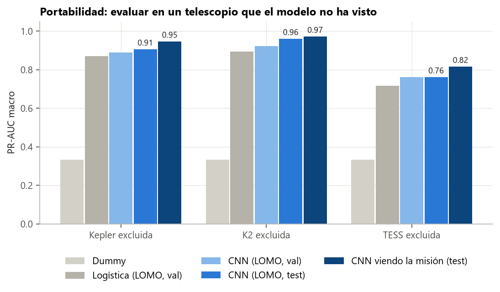
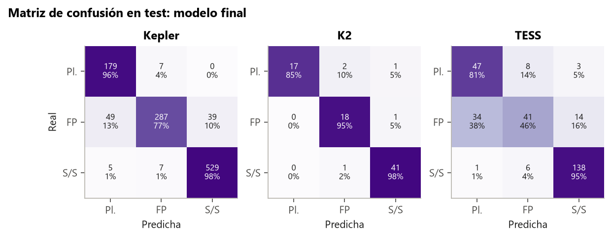
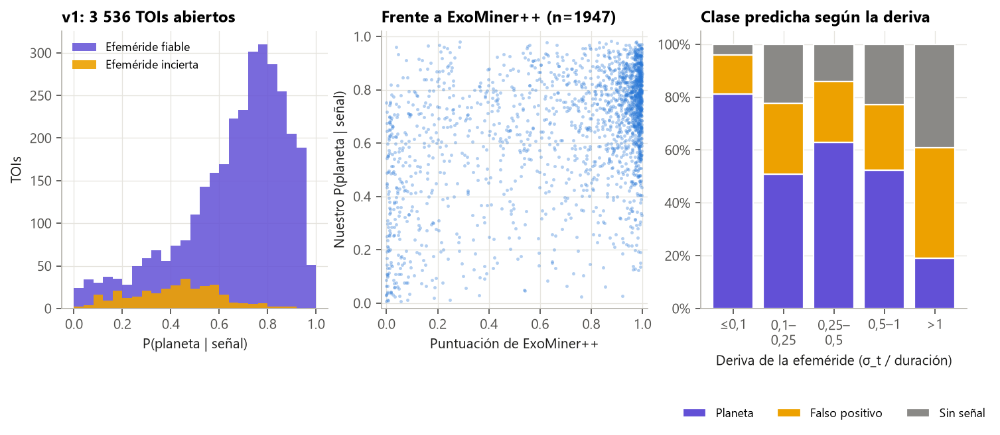

# Clasificación de tránsitos de exoplanetas portable entre telescopios

**exoplanet-ml** · Resumen del proyecto · Documentación completa en [`docs/documentacion.md`](documentacion.md)

## El problema

Cuando un planeta pasa por delante de su estrella, el brillo que recibimos baja un poco durante unas horas: es un **tránsito**, el método con el que se han descubierto ~3/4 de los exoplanetas conocidos. El problema es que muchas otras cosas imitan esa caída: binarias eclipsantes, estrellas vecinas que contaminan el píxel, artefactos del telescopio o variabilidad de la estrella. Los telescopios Kepler, K2 y TESS han generado miles de señales candidatas y hay que decidir cuáles merecen seguimiento.

**Objetivo:** clasificar cada señal en **PLANETA**, **FALSO POSITIVO** o **SIN SEÑAL** usando **solo la curva de luz**, y medir si el modelo **sigue funcionando en un telescopio que no ha visto nunca** (pensando en misiones futuras como PLATO).

## Datos y decisiones clave

- **17 164 estrellas** de Kepler, K2 y TESS descargadas de MAST y plegadas con el mismo código en las tres misiones (~14 700 con vista válida).
- **Solo la curva.** En el análisis exploratorio, un modelo que solo veía *qué columnas del catálogo faltan* llegaba a un macro-F1 de 0,687 frente a 0,384 del dummy: los valores faltantes eran la misión disfrazada. Por eso se descartó todo el catálogo.
- **Etiquetas limpias.** La clase «planeta» mezclaba confirmados y candidatos. Se recuperaron las disposiciones del NASA Exoplanet Archive y se evalúa **solo con etiquetas fuertes** (confirmados y FP claros).
- **Negativos sin atajos.** Los ejemplos «sin señal» se fabricaron 1:1 con estrellas reales sin candidato, emparejadas por sector y brillo. Un test de atajo en cada versión bajó la capacidad de distinguirlos sin mirar el tránsito de 0,83 a 0,55 (AUC).

## Metodología: evaluar en un telescopio no visto

Protocolo **LOMO anidado** (*leave-one-mission-out*): en cada pliegue se deja fuera una misión, se entrena y se eligen los hiperparámetros solo con las otras dos, y la misión excluida se evalúa una única vez. Métricas por misión: **macro-F1** de 3 clases y **PR-AUC**, con IC 95 % por bootstrap sobre estrellas. La receta del modelo final se **commiteó antes de mirar el test**, y el test se usó una sola vez.

| Modelo (validación, dentro de misión) | Macro-F1 |
|---|---|
| Dummy | 0,22 |
| Logística · kNN+PCA · MLP | 0,78–0,80 |
| Gradient boosting | 0,82 |
| MOMENT (Transformer preentrenado) | 0,815 |
| **CNN de dos ramas (AstroNet), 3 semillas** | **0,85** |

Seis familias distintas acaban entre 0,78 y 0,85, y Kepler, con 6,5 veces más datos, no mejora: **el límite está en la información de la curva, no en el modelo**.

## Resultados

**Modelo final:** CNN de dos ramas (vista global y local), sin profundidad (delata la misión), entrenada con las tres misiones y 5 semillas.

| Misión | Macro-F1 test [IC 95 %] | PR-AUC test | PR-AUC sin ver la misión (LOMO, test) |
|---|---|---|---|
| Kepler | 0,886 [0,867–0,906] | 0,947 | 0,906 |
| K2 | 0,928 [0,858–0,983] | 0,972 | 0,961 |
| TESS | 0,720 [0,661–0,772] | 0,816 | 0,761 |

*Portabilidad: sin ver el telescopio se pierde poco en Kepler y K2.*

*Test: el error dominante es FP de TESS predicho como planeta.*

- **El modelo solo curva es portable:** sin haber visto el telescopio pierde de media ~0,05 de PR-AUC, y el test confirmó lo medido en validación (no estaba inflado).
- **Lo que se transfiere** es «hay señal o no» (F1 0,88–0,94); lo difícil es planeta frente a falso positivo.
- **TESS es difícil por los datos, no por el modelo:** pocos tránsitos por estrella (5–8 frente a decenas en Kepler) y más planetas de periodo corto. Lo único que ayudó fue darle más información por estrella (2 sectores: +0,034 de PR-AUC).
- **Techo físico:** en Kepler, la mitad de los FP que pasan por planeta son contaminación de una estrella vecina, invisible en la curva.
- **Prioriza, no confirma:** en TESS, con un 90 % de precisión recupera el 34 % de los planetas.

## Alcance y búsqueda sin catálogo

Sin la efeméride del catálogo hay que encontrar el tránsito con **BLS**: acierta el periodo en ~2 de cada 3 estrellas, pero el macro-F1 cae a ~0,5 porque el ruido plegado en su mejor pico parece un tránsito. Por eso el modelo se define como **clasificador de señales ya detectadas**, como AstroNet y ExoMiner. Para la búsqueda se probó una red sobre la curva sin plegar entrenada con tránsitos inyectados: combinada con BLS recupera el **56 % de los candidatos con un 1 % de falsas alarmas** (~90 % si SNR > 30) y tocó techo.

## Validación prospectiva

Se predijeron los **3 536 candidatos de TESS sin resolver** con curva usable y se congelaron con hashes SHA-256 y la etiqueta `v1` en GitHub, junto a las puntuaciones de ExoMiner++ y las prioridades del TFOP. Cuando se resuelvan se comprobará el acierto real, sin posibilidad de haber ajustado nada. Por el camino apareció la **deriva de la efeméride** (el error del periodo se acumula con el tiempo): se elige el sector con menor deriva y 326 TOIs quedan marcados como inciertos. De los 3 210 fiables: 2 564 planeta, 493 FP y 153 sin señal; coincidencia con ExoMiner++ del 76 %.

## Aportación, limitaciones y siguientes pasos

- **Aportación:** no superar a ExoMiner++ (PR-AUC 0,976 con mucha más información), sino **medir con rigor cuánto se pierde al llevar un clasificador solo curva a un telescopio no visto**, una evaluación entre tres telescopios que no se encontró publicada; más una validación prospectiva y una explicación en español para no expertos.
- **Limitaciones:** la clase «sin señal» es artificial (1:1 y fácil); K2 tiene pocas estrellas de test; las etiquetas de TESS son ruidosas y cambian; queda un atajo débil de sesgo de detección (0,55–0,60).
- **Siguientes pasos:** vista del eclipse secundario y vista local de más resolución para TESS; cruce periódico de las predicciones v1 con ExoFOP; herramienta explicativa para aficionados y web del proyecto.
