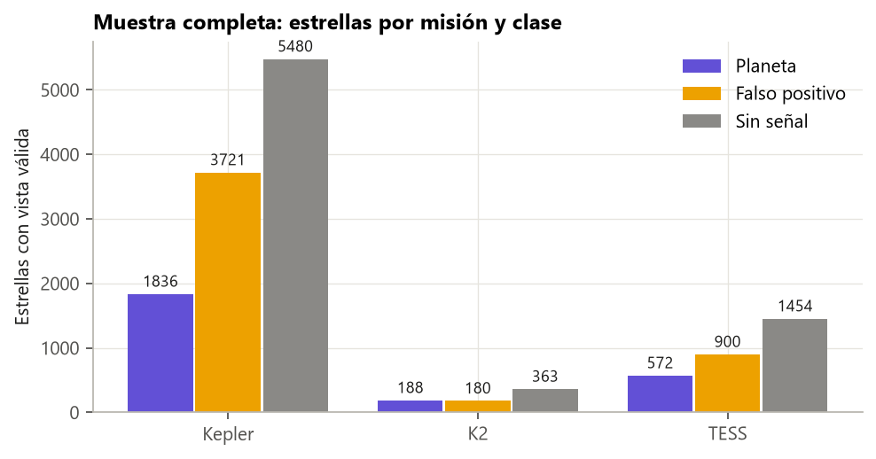
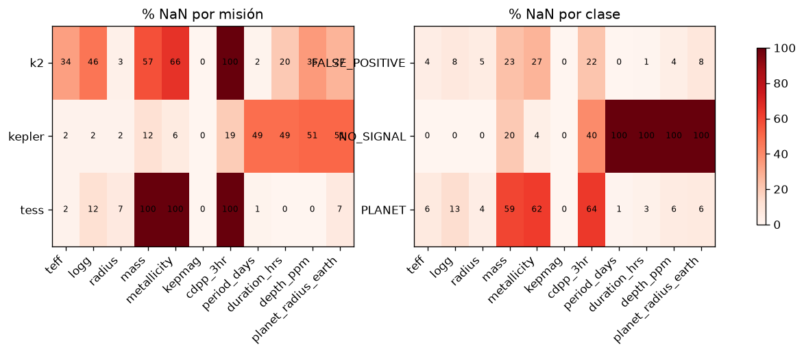
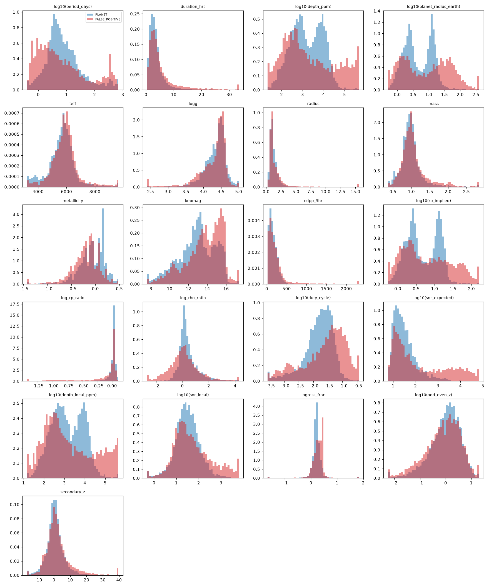
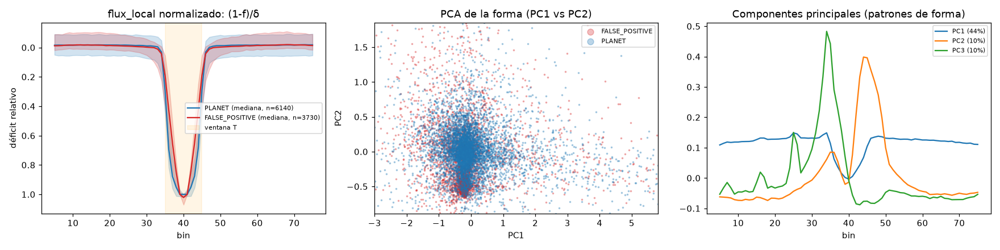
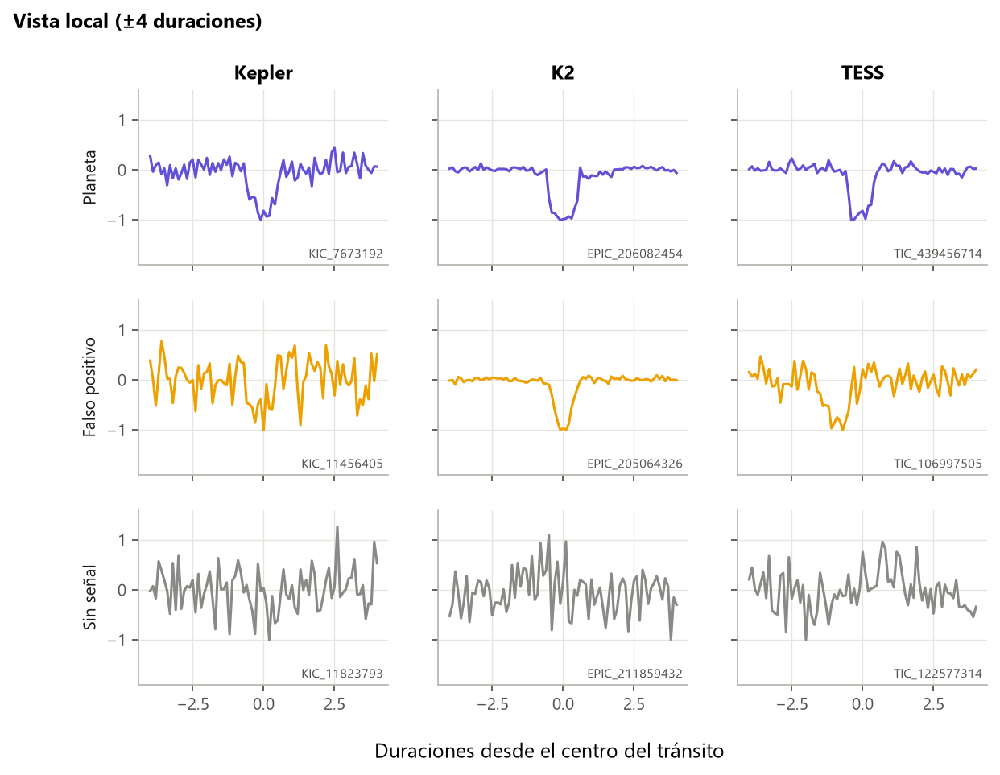
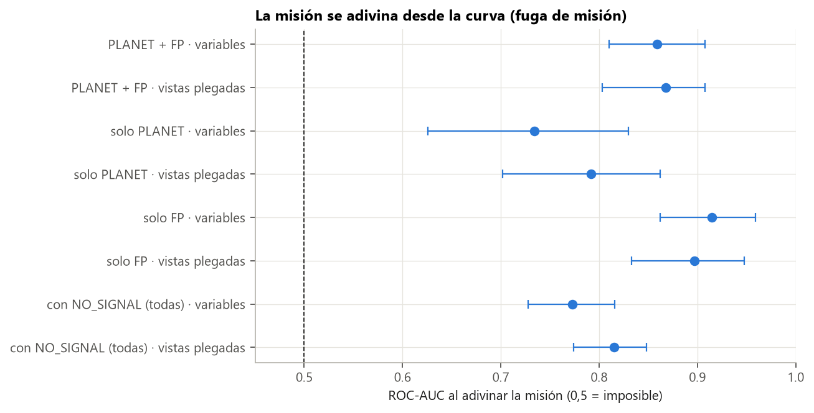

# Guía para redactar: análisis exploratorio de los datos

**Idea central de la sección:** antes de entrenar, exploraste los datos y descubriste que se podía «acertar» sin mirar la curva, solo con qué columnas faltan o de qué misión viene la estrella. Esto justifica la decisión más importante del proyecto: usar solo la curva de luz.

## Introducción: por qué y cómo

**Por qué se hizo.** Un modelo solo es tan bueno como los datos con los que aprende. El dataset de partida mezcla tres telescopios muy distintos, con etiquetas de distinto origen y muchas columnas del catálogo de la estrella. Antes de entrenar nada había que responder tres preguntas:
- ¿Están bien los datos o hay errores que el modelo aprendería como si fueran ciertos?
- ¿Hay pistas falsas (atajos) que permitan acertar sin entender la física?
- ¿Qué información distingue de verdad un planeta de un falso positivo, y se comporta igual en las tres misiones?

Sin este paso, cualquier resultado posterior podría ser un espejismo: un modelo con buena nota que en realidad solo ha aprendido de qué telescopio viene cada estrella.

**Cómo se hizo.**
- Solo con la parte de entrenamiento, para no contaminar la evaluación.
- Primero se revisó la calidad (valores imposibles, columnas vacías).
- Después se midió, variable a variable y misión a misión, cuánto separa planetas de falsos positivos, usando el AUC (independiente de umbrales y escalas).
- Se entrenaron modelos «tramposos» que solo ven qué columnas faltan o la misión, para cuantificar los atajos.
- Por último se probaron las reglas físicas clásicas de los astrónomos y una PCA de la forma de las curvas, para ver si la diferencia entre clases es simple o compleja.

**Qué se buscaba conseguir.** Fijar un listón honesto que el modelo tuviera que superar y decidir qué información podía usar el modelo. Esa decisión (solo la curva) condiciona todo el proyecto.

## Qué contar, en orden

1. **De dónde vienen los datos.**
   - Dataset de Hugging Face *exoplanet-transit-detection*: señales de Kepler, K2 y TESS etiquetadas como planeta, falso positivo o sin señal.
   - Menciona la regla que seguiste: solo exploraste train (18 853 estrellas), val solo para los tests de atajo y el test no se tocó. Muestra rigor desde el principio.

2. **Cómo mediste si una variable separa planetas de falsos positivos.**
   - Explica el AUC de Mann-Whitney con una frase sencilla (ver «Conceptos» abajo).
   - Explica por qué todo se mira por misión: son telescopios distintos y mezclarlos engaña (efecto Simpson, que aparece en el punto 5).

3. **Problemas de calidad que encontraste.**
   - Pocos errores de catálogo (duraciones ≤ 0, profundidades > 100 %).
   - El llamativo: 28 «planetas» con radio > 100 radios terrestres. Júpiter mide ~11, así que es imposible: etiqueta mala o radio estelar mal medido. Enlaza con la limpieza de la sección de etiquetas (umbral de 22).
   - El artefacto de los bordes de las vistas del dataset: se llevaba el 67 % de la varianza en la PCA. Más tarde desapareció con tu propio plegado.

4. **El hallazgo principal: el atajo de los valores faltantes.** Es el punto fuerte de la sección; dale espacio.
   - En TESS siempre faltan la masa, la metalicidad y el ruido; en K2, el ruido. La masa falta más en planetas (59 %) que en FP (23 %).
   - Experimento: modelos que no ven ningún valor físico.
     - Solo «qué columnas faltan»: macro-F1 0,687 en *vetting*.
     - Solo «de qué misión viene»: también 0,687.
     - Dummy: 0,384.
   - **Conclusión a transmitir:** los valores faltantes son la misión disfrazada.
   - **Consecuencia:**
     - el listón real es 0,687, no 0,384;
     - se decide no usar nada del catálogo, solo la curva.

5. **Qué variables separan y el efecto Simpson.**
   - Ejemplo estrella, la profundidad: con todo junto no separa (AUC 0,50); dentro de cada misión sí, pero con signos opuestos (en Kepler y K2 los FP son más profundos, en TESS al revés).
   - La magnitud también engaña: parece útil, pero es porque las estrellas de TESS son más brillantes.
   - Variables que se comportan igual en las tres misiones: duración/periodo, forma de entrada y salida, temperatura y periodo.

6. **Reglas físicas clásicas** (opcional, pero queda bien porque conecta con la astronomía).
   - Regla del 2 % de profundidad: precisión 0,75.
   - Mejor el radio implícito R★·√δ > 22 R⊕: precisión 0,86.
   - La más precisa, la densidad estelar desde el tránsito (Seager y Mallén-Ornelas): precisión 0,94, pero detecta solo ~1 de cada 10 FP.
   - La forma U frente a V detecta el 36 % de los FP.
   - Cuenta el problema de los tests par/impar y secundario: no estaban calibrados (las vistas del dataset no estaban centradas, más el ruido rojo). Con el plegado propio, el secundario se arregla y el par/impar no; se resolvió en la sección de tránsitos individuales.

7. **La forma de la curva y la PCA.**
   - Los FP tienen el fondo más en V y los planetas más en U, pero ninguna componente separa sola (AUC 0,56–0,62).
   - Mensaje: la diferencia existe, pero es sutil y no lineal. Eso justifica pasar a redes convolucionales (puente con la sección de modelos).

8. **Cierre: qué decisiones salen de aquí.**
   - Listón real de 0,687.
   - Métricas siempre por misión.
   - Solo la curva como entrada.
   - Limpiar los planetas imposibles.

## Conceptos que conviene explicar al lector

- **AUC:** probabilidad de que un planeta al azar tenga un valor mayor que un FP al azar. 0,5 significa que no separa, y cuanto más lejos de 0,5, mejor.
- **Macro-F1:** media del F1 de cada clase, todas con el mismo peso; no basta con acertar la clase más numerosa.
- **Atajo:** una pista que delata la clase sin tener que ver con la física.
- **Efecto Simpson:** una relación que aparece al juntar grupos y desaparece, o se invierte, dentro de cada grupo.
- **Ruido rojo:** ruido con variaciones lentas, no independiente punto a punto; hace que los tests estadísticos clásicos exageren.

## Datos clave para citar

18 853 estrellas en train · 28 planetas con radio imposible · atajo de faltantes 0,687 frente a dummy 0,384 · profundidad AUC 0,50 global frente a 0,07 (K2) y 0,59 (TESS) · regla de densidad con precisión 0,94.

## Figuras

**Composición de la muestra** (para el punto 1; cuántas estrellas hay de cada clase y misión):

**Valores faltantes por misión** (para el punto 4; se ve que en TESS faltan columnas enteras):

**Distribución de las variables en planetas y FP** (para el punto 5; sirve para enseñar el efecto Simpson de la profundidad):

**Forma media de las curvas y PCA** (para el punto 7; U frente a V):

**Cómo se ven las curvas plegadas** (útil para que el lector entienda qué es una vista local antes de hablar de formas):

**La misión se adivina desde la curva** (enlaza el atajo de la misión con lo que se hizo después):

## Limitaciones que mencionar

- Esta exploración usó las vistas del dataset original; algunas conclusiones (par/impar, secundario) cambiaron con el plegado propio.
- Los z de par/impar y secundario no son significancias fiables con las vistas del dataset.

## Código

`legacy/eda.py` y `legacy/features.py`; la revisión con el plegado propio está en `scripts/checks/recheck_z_features.py`.

## Fuentes

- Dataset: https://huggingface.co/datasets/bingbangboom/exoplanet-transit-detection
- Seager, S. y Mallén-Ornelas, G. (2003), densidad estelar desde el tránsito: https://arxiv.org/abs/astro-ph/0206228
- Mandel, K. y Agol, E. (2002), forma del tránsito: https://arxiv.org/abs/astro-ph/0210099
- Thompson, S. E. et al. (2018), catálogo DR25 de Kepler y Robovetter: https://arxiv.org/abs/1710.06758
