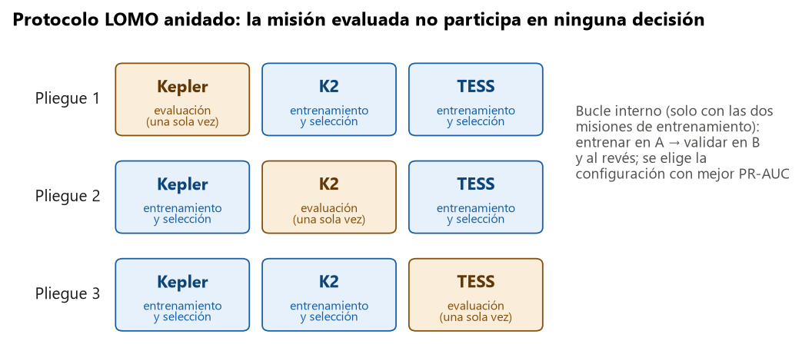
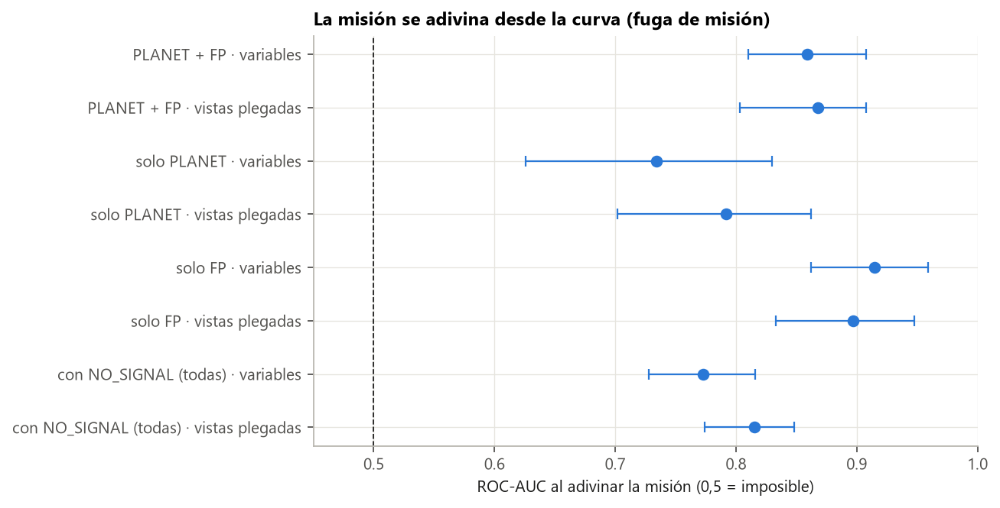

# Guía para redactar: cómo se evalúa el modelo (protocolo LOMO y métricas)

**Idea central de la sección:** la pregunta del proyecto es si el modelo funciona en un telescopio que no ha visto nunca. Para medirlo sin engañarte diseñaste un protocolo en el que la misión evaluada no participa en ninguna decisión, y elegiste métricas que tratan igual a todas las clases y a todas las misiones.

## Introducción: por qué y cómo

**Por qué se hizo.**
- Dividir los datos al azar en entrenamiento y prueba no responde a la pregunta del proyecto. Si el modelo ve TESS al entrenar, su nota en TESS no dice nada sobre PLATO o un telescopio terrestre.
- Además, es muy fácil «hacer trampa» sin darse cuenta: si eliges un hiperparámetro, un umbral o una normalización mirando la misión que vas a evaluar, ya la estás usando para entrenar.
- Hacía falta un procedimiento fijado de antemano que lo impidiera.

**Cómo se hizo.**
- Se adoptó *leave-one-mission-out* (LOMO) anidado:
  - **bucle externo:** una misión fuera cada vez;
  - **bucle interno:** se elige el modelo solo con las otras dos.
- La unidad es la estrella, y las estrellas observadas por dos misiones se detectan por coordenadas.
- Se fijaron por escrito la métrica principal, la secundaria, la regla de decisión y cómo calcular la incertidumbre.

**Qué se buscaba conseguir.** Una cifra de portabilidad honesta y comparable entre misiones, y una referencia (el modelo que sí ve la misión) para medir cuánto se pierde al cambiar de telescopio.

## Qué contar, en orden

1. **La pregunta de portabilidad.** Por qué no sirve partir al azar (los dos motivos de arriba).
2. **El protocolo LOMO anidado,** apoyándote en el esquema de abajo.
   - Bucle externo: para cada misión, se excluye de todo (normalización, modelo, hiperparámetros, umbral) y se evalúa una sola vez.
   - Bucle interno: entrenar en A y validar en B, y al revés; se elige la configuración con mejor PR-AUC media. Recalca que así se premia lo que se transfiere entre telescopios.
   - La referencia dentro de misión, para medir la brecha.
3. **Detalle de las estrellas compartidas.** TESS volvió a observar campos de Kepler y K2. Se cruzaron por coordenadas (< 2″) y se quitan del entrenamiento cuando su otra misión es la evaluada.
4. **Las métricas.**
   - Macro-F1 de 3 clases por misión, y como resumen la media de las misiones. Explica por qué la media de misiones: si se juntaran las estrellas, Kepler pesaría más que las otras dos juntas.
   - PR-AUC como secundaria (ordena sin umbral).
   - IC 95 % por bootstrap sobre estrellas.
   - Listón: el dummy da un macro-F1 de 0,22 y una PR-AUC de 1/3.
5. **El umbral en un telescopio nuevo.** La proporción de FP cambia mucho (Kepler 0,71, K2 0,41, TESS 0,59), así que no se fija umbral en la misión excluida: se usan PR-AUC y ROC-AUC.
6. **Cuándo se mira el test.** Una sola vez, al final. Las variantes de la fase de portabilidad se evaluaron con train + val de la misión excluida para no gastar su test (decisión del 2026-11-04).
7. **CoRoT,** como cuarta misión que habría sido la prueba más limpia, bloqueada porque su catálogo no estaba disponible.

## Conceptos que conviene explicar al lector

- **LOMO:** dejar una misión fuera y evaluar en ella.
- **Validación anidada:** un bucle de selección dentro de otro de evaluación, para que la selección no vea los datos de evaluación.
- **Macro-F1 / PR-AUC:** la primera mide aciertos con un umbral; la segunda, lo bien que ordena el modelo sin umbral.
- **Bootstrap:** remuestrear las estrellas muchas veces para ver cuánto varía la métrica, lo que da el intervalo de confianza.
- **Prevalencia:** proporción de cada clase. En PR-AUC, el valor de un modelo al azar es la prevalencia.

## Datos clave para citar

Tamaños del LOMO:
- Kepler excluida: 3 280 estrellas para ajustar y 9 935 para evaluar.
- K2 excluida: 12 566 y 650.
- TESS excluida: 10 579 y 2 634.

Proporción de FP: Kepler 0,71, K2 0,41, TESS 0,59. Dummy: macro-F1 0,22.

## Figuras

**Esquema del protocolo** (la figura central de la sección):

**Por qué la misión es un problema** (si quieres justificar el protocolo con datos: la misión se adivina desde la curva):

## Limitaciones que mencionar

- La clase «sin señal» es ~50 % de cada misión porque se fabricó 1:1. Las métricas sirven para comparar modelos, no como rendimiento en una búsqueda real.
- En K2 y TESS, val es pequeño: diferencias de ~0,03 pueden ser ruido.

## Código

`src/exoplanet/evaluation.py` (`nested_folds`, `shared_stars`, `point_metrics` y `evaluate_by_mission`) y `tests/test_evaluation.py`.

## Fuentes

- Davis, J. y Goadrich, M. (2006), *The relationship between Precision-Recall and ROC curves*, ICML.
- scikit-learn, `average_precision_score`: https://scikit-learn.org/stable/modules/generated/sklearn.metrics.average_precision_score.html
- Efron, B. y Tibshirani, R. (1993), *An Introduction to the Bootstrap*, Chapman & Hall.
- Deleuil, M. et al. (2018), catálogo de CoRoT en VizieR: https://vizier.cds.unistra.fr/viz-bin/VizieR?-source=J/A+A/619/A97
