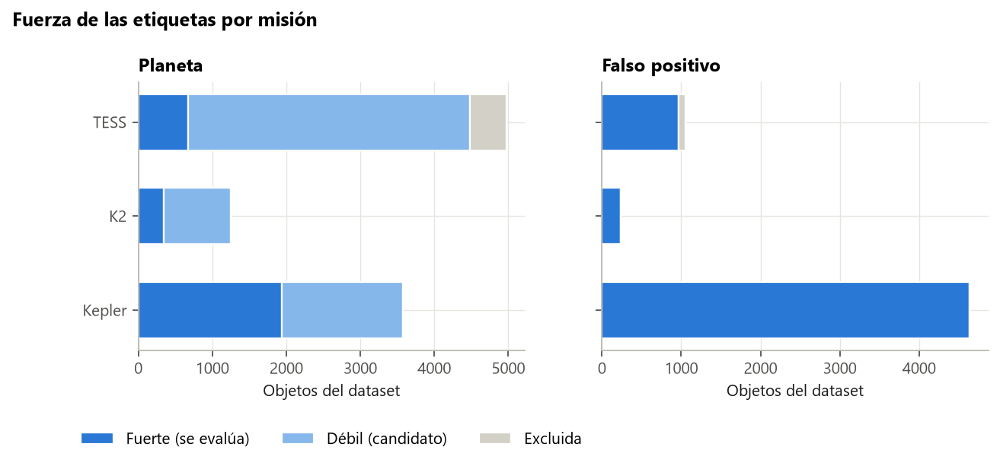

# Guía para redactar: las etiquetas (qué es «planeta» y «falso positivo» en cada misión)

**Idea central de la sección:** «planeta» no significaba lo mismo en todas las misiones, porque mezclaba confirmados con candidatos. Recuperaste las disposiciones originales, separaste las etiquetas en fuertes y débiles, y evaluaste solo con las fuertes para que la nota del modelo no se contaminara con errores de etiquetado.

## Introducción: por qué y cómo

**Por qué se hizo.**
- Un modelo aprende y se evalúa contra sus etiquetas. Si las etiquetas son dudosas, la métrica mezcla errores del modelo con errores de la etiqueta.
- En el dataset, la clase PLANET juntaba planetas confirmados con candidatos sin resolver, y el criterio cambiaba de una misión a otra.
- Además, el dataset es una instantánea antigua: algunas disposiciones han cambiado desde entonces.

**Cómo se hizo.**
- Cada estrella se cruzó con las tablas originales del NASA Exoplanet Archive (TOIs de TESS, candidatos de K2 y KOIs de Kepler). Si había varios candidatos en la estrella, se eligió el de periodo más cercano.
- Cada objeto se clasificó en **fuerte** (confirmado o FP claro), **débil** (candidato) o **excluido** (ambiguo o contradictorio).
- Se limpiaron los «planetas» con un radio físicamente imposible.

**Qué se buscaba conseguir.** Una evaluación limpia y comparable entre misiones, y saber qué datos de entrenamiento extra (las débiles) se podrían aprovechar.

## Qué contar, en orden

1. **El problema:** PLANET mezcla confirmados y candidatos. Ejemplos:
   - Kepler: 1 943 confirmados y 1 631 candidatos del Robovetter.
   - TESS: 674 confirmados y 3 802 candidatos.
   - K2: 346 confirmados y 899 candidatos.
2. **Cómo se recuperaron las disposiciones originales** (el cruce con el Exoplanet Archive).
3. **La regla de uso:**
   - evaluación solo con etiquetas fuertes;
   - entrenamiento: la variante «fuertes + débiles» estaba prevista pero no se probó (menciónalo como mejora pendiente);
   - los candidatos de TESS no deben usarse para entrenar, porque son el conjunto de la validación prospectiva.
4. **Las disposiciones cambian:** 58 objetos que el dataset tenía como planetas de TESS hoy son FP o falsas alarmas. Se excluyen en lugar de decidir cuál es la correcta. Es un buen ejemplo de etiquetas vivas.
5. **Planetas con radio imposible:**
   - Se eliminan los PLANET con radio > 22 radios terrestres (~2 radios de Júpiter, el tope de los júpiter más inflados).
   - Explica por qué no hay fuga de información: el umbral es físico, se fijó antes y el modelo nunca ve el radio.
   - Explica por qué solo se aplica a PLANET: un FP gigante es una binaria, justo lo que hay que rechazar.
   - Afectó solo a 13 planetas fuertes.
6. **Consecuencias:**
   - La proporción de FP sube mucho al quedarse con las fuertes: Kepler 56 % → 70 %, K2 16 % → 41 %, TESS 17 % → 59 %.
   - El test de K2 se queda en 62 estrellas, con intervalos anchos.

## Conceptos que conviene explicar al lector

- **Disposición:** el veredicto oficial sobre un candidato: confirmado, candidato, falso positivo o falsa alarma.
- **Robovetter:** el clasificador automático del equipo de Kepler.
- **TFOP:** el grupo de seguimiento de TESS que resuelve sus candidatos.
- **Ruido de etiqueta:** etiquetas incorrectas que confunden tanto al entrenar como al evaluar.

## Datos clave para citar

- Confirmados / candidatos: Kepler 1 943 / 1 631; TESS 674 / 3 802; K2 346 / 899.
- FP fuertes: Kepler 4 638; TESS 968; K2 240.
- 58 conflictos en TESS; 13 planetas fuertes eliminados por radio.

## Figuras

**Fuerza de las etiquetas por misión** (la figura de la sección: se ve que en TESS casi todos los «planetas» son candidatos):

## Limitaciones que mencionar

- Quedarse con las fuertes reduce mucho los datos, sobre todo en K2 y TESS.
- El filtro de radio depende de la etiqueta, así que también limpia val y test (con un efecto despreciable: 13 casos).
- Las etiquetas de TESS siguen cambiando con el tiempo.

## Código

`src/exoplanet/labels.py`, `scripts/data/fetch_labels.py` y `scripts/checks/label_audit.py`; tests en `tests/test_labels.py`.

## Fuentes

- NASA Exoplanet Archive (tablas `toi`, `k2pandc` y `cumulative`): https://exoplanetarchive.ipac.caltech.edu/
- ExoFOP-TESS (disposiciones del TFOP): https://exofop.ipac.caltech.edu/tess/
- Thompson, S. E. et al. (2018), Robovetter y catálogo DR25 de Kepler: https://arxiv.org/abs/1710.06758
- Guerrero, N. M. et al. (2021), catálogo de TOIs de TESS: https://arxiv.org/abs/2103.12538
