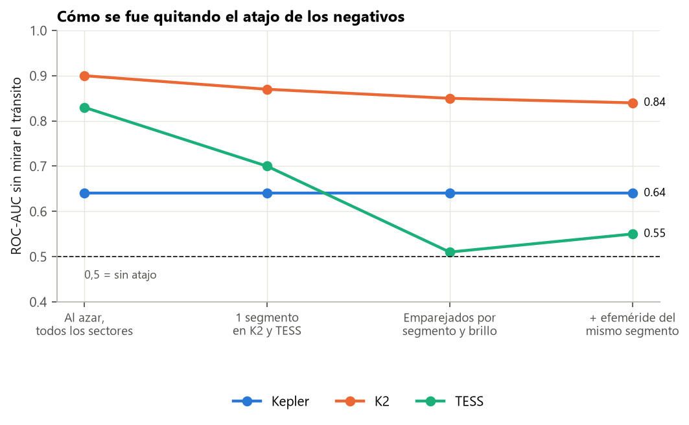
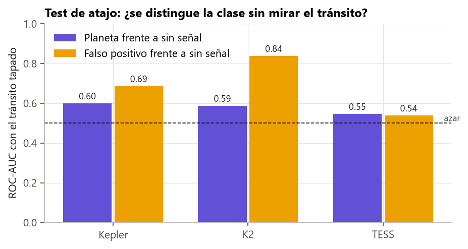
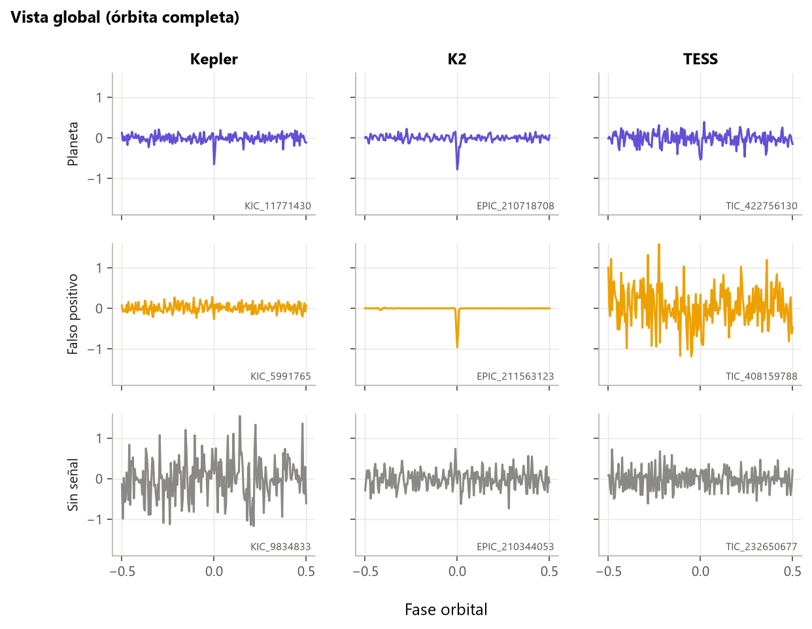

# Guía para redactar: los ejemplos «sin señal» y los atajos

**Idea central de la sección:** para enseñar al modelo qué es «aquí no hay tránsito» tuviste que fabricar ejemplos con estrellas reales sin candidato. Lo delicado fue evitar que el modelo distinguiera esos ejemplos por cómo se fabricaron (más datos, otra campaña, otro brillo) en lugar de por la ausencia de tránsito. Lo controlaste midiendo los atajos paso a paso.

## Introducción: por qué y cómo

**Por qué se hizo.**
- El dataset traía una clase NO_SIGNAL, pero sus curvas plegadas eran ceros: inservibles.
- Sin ejemplos reales de «sin señal», el modelo no puede aprender esa clase.
- El riesgo al fabricarlos es crear un **atajo**: una diferencia artificial entre clases que el modelo aprovecha para acertar sin aprender física. Un atajo da notas altas en validación y falla en la realidad.

**Cómo se hizo.**
- Se tomaron estrellas reales sin ningún candidato conocido. Se descargaron y plegaron exactamente igual que los positivos, con un periodo y una época prestados de un planeta real.
- En cada versión se pasó un **test de atajo**: un clasificador que solo ve lo que no debería importar (la curva con el tránsito tapado, o los metadatos del proceso). Si separa las clases, hay atajo.
- Se fue corrigiendo la construcción hasta dejar el atajo en un nivel bajo, explicado y aceptado.

**Qué se buscaba conseguir.** Una clase «sin señal» que el modelo solo pudiera reconocer por la ausencia de tránsito.

## Qué contar, en orden

1. **Por qué hacen falta negativos** y por qué los del dataset no servían.
2. **Qué es un atajo y cómo se mide** (el test de atajo; AUC 0,5 = sin atajo).
3. **La historia de cómo se quitó el atajo,** paso a paso con la figura de evolución. Es una buena historia de depuración:
   - Al azar, con todos los sectores: K2 0,90 y TESS 0,83. Causa: los planetas tienen más sectores, porque TESS vuelve a observar lo interesante.
   - 1 segmento por estrella: TESS 0,70.
   - Emparejar cada positivo con una estrella del mismo sector y brillo: TESS 0,51.
   - Efeméride prestada de un planeta del mismo sector: K2 0,84 y TESS 0,55.
   - El fallo curioso de la campaña 10 de K2: publicada en dos mitades pero numerada como una, dejaba a 18 planetas sin pareja.
4. **La exclusión por coordenadas:** algunas «estrellas sin señal» eran candidatos de otra misión con otro número de catálogo. Se excluyó todo lo que está a menos de 2″ de un candidato.
5. **Lo que queda** (muestra completa, tránsito tapado):
   - Planetas frente a sin señal: 0,60 / 0,59 / 0,55 (Kepler / K2 / TESS). Es un atajo débil y real: el **sesgo de detección**, porque los planetas se descubren más en estrellas tranquilas. Se acepta y se declara.
   - FP frente a sin señal en K2: 0,84. No es atajo, es física (secundarios, variabilidad): el modelo debe aprenderlo.
6. **La regla que sale de aquí:** el modelo nunca recibe metadatos del proceso (número de puntos, días de datos, cadencia, número de tránsitos), porque en K2 todavía delatan la clase.
7. **Números finales:** 8 582 negativos (Kepler 6 560, TESS 1 624 y K2 398), uno por cada positivo. Reproducibles byte a byte.
8. **La limitación descubierta después** (puente con BLS): estos negativos son demasiado fáciles; una estrella tranquila con una efeméride prestada da una curva plana. El ruido real que parece un tránsito es otra cosa.

## Conceptos que conviene explicar al lector

- **Atajo** (*shortcut learning*).
- **Test de atajo:** tapar lo importante y ver si aún se acierta.
- **Sesgo de detección:** los planetas son más fáciles de encontrar en estrellas poco ruidosas.
- **Emparejamiento:** cada negativo comparte sector y brillo con su positivo, para que solo difieran en la señal.

## Datos clave para citar

- Evolución del atajo en TESS: 0,83 → 0,70 → 0,51 → 0,55.
- Atajo final de los planetas: 0,55–0,60.
- 8 582 negativos 1:1.

## Figuras

**Evolución del atajo** (la figura de la sección):

**Atajo final con el tránsito tapado:**

**Cómo se ve una estrella sin señal frente a un planeta** (fila inferior de la galería):

## Limitaciones que mencionar

- Queda un atajo débil para los planetas (sesgo de detección), aceptado.
- Los negativos son «fáciles» frente al ruido real de una búsqueda. Mejora propuesta: usar falsas alarmas reales (los conjuntos invertido y desordenado de Kepler DR25, las FA de TESS).
- No se emparejó por el ruido de la estrella: quitaría el sesgo de detección pero haría los negativos menos realistas.

## Código

`src/exoplanet/negatives.py`, `scripts/data/build_negatives.py`, `scripts/data/build_sample.py --negatives` y `scripts/checks/shortcut_negatives.py`.

## Fuentes

- MAST: https://archive.stsci.edu/
- Lightkurve: https://docs.lightkurve.org/
- Thompson, S. E. et al. (2018), conjuntos invertido y desordenado de DR25: https://arxiv.org/abs/1710.06758
- NASA Exoplanet Archive, datos simulados de Kepler DR25: https://exoplanetarchive.ipac.caltech.edu/docs/KeplerSimulated.html
- Geirhos, R. et al. (2020), *Shortcut learning in deep neural networks*: https://arxiv.org/abs/2004.07780
