# Guía para redactar: los modelos dentro de cada misión (fase 2)

**Idea central de la sección:** probaste una escalera de modelos de menos a más complejos. La red convolucional (AstroNet) fue la mejor, con un macro-F1 de 0,85 usando un conjunto de 3 semillas. Pero seis familias distintas acabaron entre 0,78 y 0,85, así que el límite no está en el modelo sino en la información de la curva. El análisis de errores lo confirma: parte de los falsos positivos son invisibles en la curva (techo físico).

## Introducción: por qué y cómo

**Por qué se hizo.**
- No se debe saltar directamente al modelo más complejo. Una escalera de modelos permite saber si cada paso de complejidad aporta algo real, y da líneas base honestas.
- También había que decidir qué entrada usar: unos pocos números físicos o la forma completa de la curva.

**Cómo se hizo.**
- Dentro de cada misión, solo en validación (el test sin tocar).
- Dos tipos de entrada: 5 variables físicas, o las **vistas plegadas** (global de 201 puntos y local de 81, normalizadas para que la caída valga −1).
- Modelos, en orden: regresión logística → kNN → gradient boosting → MLP → CNN de dos ramas (AstroNet) → MOMENT (un Transformer preentrenado).
- Se añadió el centroide como información extra y se analizaron los errores por tipo de falso positivo.

**Qué se buscaba conseguir.** Elegir el mejor modelo con evidencia, entender dónde está el techo y qué tipo de error queda.

## Qué contar, en orden

1. **Qué ve cada modelo.** Explica el plegado y las dos vistas con la galería (figura abajo).
2. **Modelos clásicos:**
   - Logística: vistas 0,80 frente a físicas 0,66 (muestra A). La forma completa contiene más información que 5 números. Sus coeficientes tienen sentido físico: el secundario y el par/impar empujan a FP.
   - kNN: con las vistas falla (0,49) por la **maldición de la dimensionalidad**; con PCA (~20 componentes) sube a 0,79. Es una buena anécdota para explicar el concepto.
   - Gradient boosting: el mejor de los clásicos con muchos datos (Kepler), pero sobreajusta en TESS.
   - MLP: empata con la logística; la parada temprana lo deja casi lineal.
3. **La CNN:**
   - Arquitectura AstroNet (dos ramas, global y local).
   - Por qué funciona mejor: la convolución aprovecha que los puntos vecinos están relacionados y reutiliza filtros (sesgo inductivo, no más parámetros).
   - Aumento de datos: reflejar la curva en el tiempo, porque un tránsito es simétrico.
4. **Resultados con la muestra completa:**
   - CNN 0,84 (PR-AUC 0,91), boosting 0,82, el resto 0,78–0,80, dummy 0,22.
   - Por misión: Kepler 0,87, K2 0,87, TESS 0,78.
   - **Mensaje clave:** Kepler tenía 6,5 veces más datos y no mejoró, así que el límite no es la cantidad de datos.
5. **MOMENT:**
   - Congelado ya mejora a la logística (0,82), aunque nunca vio un tránsito.
   - Ajustado no supera a la CNN (0,815 frente a 0,839): sobreajusta.
   - Conclusión: seis familias acaban en 0,81–0,84.
6. **El centroide:**
   - Qué es (el centro de luz se mueve si la señal viene de una estrella vecina).
   - Mejora Kepler (0,865 → 0,893) pero empeora K2 y TESS (píxeles grandes, apuntado inestable).
   - Por eso la versión portable usa solo la curva.
7. **Errores por tipo de FP (Kepler):**
   - Binarias: 88 % de acierto. Contaminación: 66 %.
   - Casi la mitad de los FP que pasan por planeta son de contaminación: el **techo físico**. Con el centroide, del 66 % al 80 %.
   - El 22 % de los FP «no parece tránsito» van a «sin señal»: frontera difusa de las etiquetas.
8. **Intentos de mejora:** añadir canales par/impar o diagnósticos no mejora; promediar 3 semillas sí (0,833 → 0,850).

## Conceptos que conviene explicar al lector

- **Vista global y local:** el plegado y sus dos «fotos».
- **Maldición de la dimensionalidad:** en muchas dimensiones todas las distancias se parecen.
- **Convolución y sesgo inductivo.**
- **Sobreajuste y parada temprana.**
- **Modelo preentrenado y *fine-tuning*.**
- **Centroide.**
- **Ensemble de semillas.**

## Datos clave para citar

CNN 0,84 (conjunto de 3 semillas: 0,850; PR-AUC 0,91) · boosting 0,82 · MOMENT 0,815–0,82 · logística 0,78 · dummy 0,22 · centroide en Kepler +0,03 · FP de contaminación: 66 % de acierto.

## Figuras

**Qué ve el modelo** (vistas local y global por clase y misión):

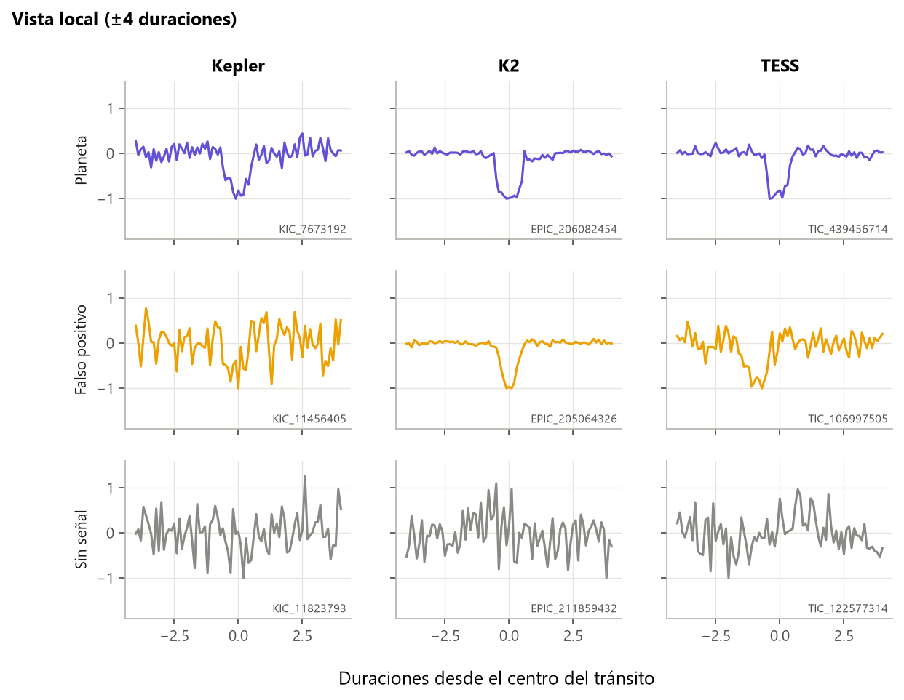

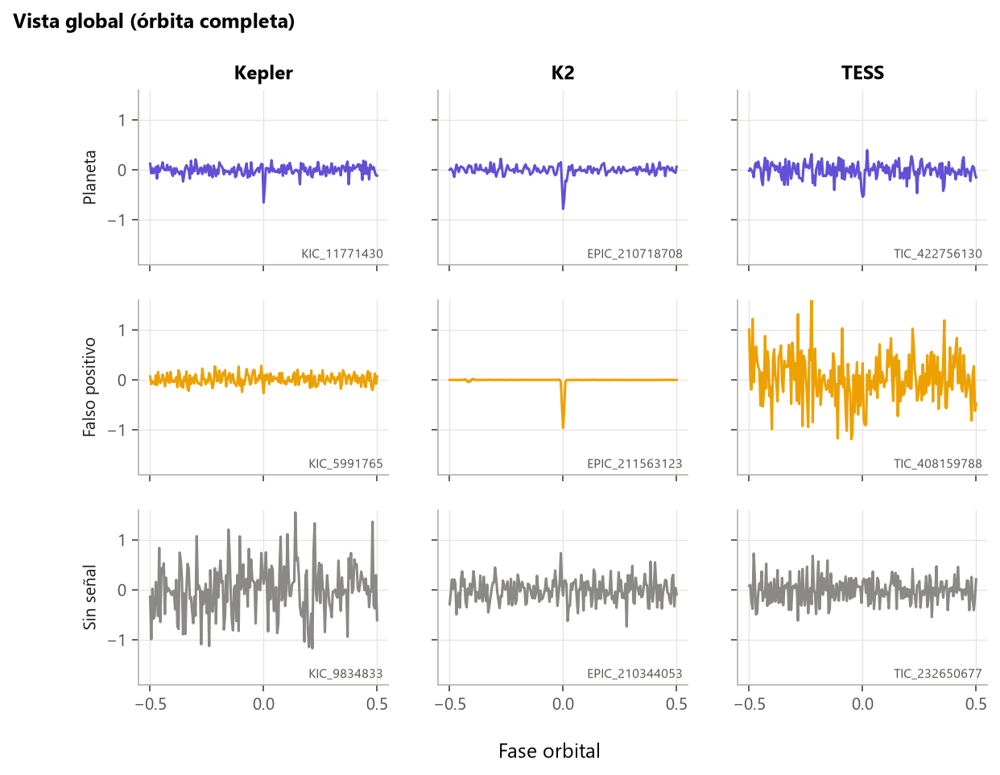

**Comparación de todos los modelos** (la figura principal de la sección):

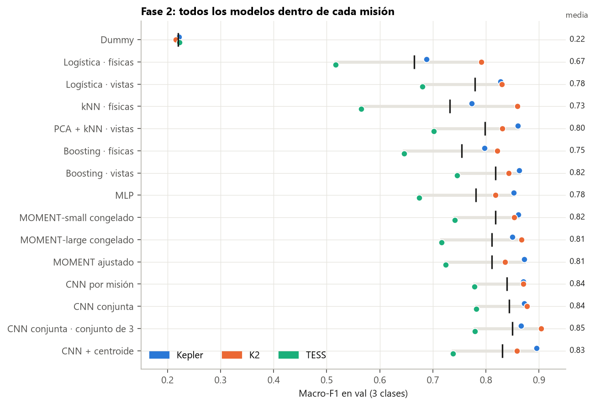

**PR-AUC por clase:** se ve que «sin señal» es fácil y planeta frente a FP es lo difícil:

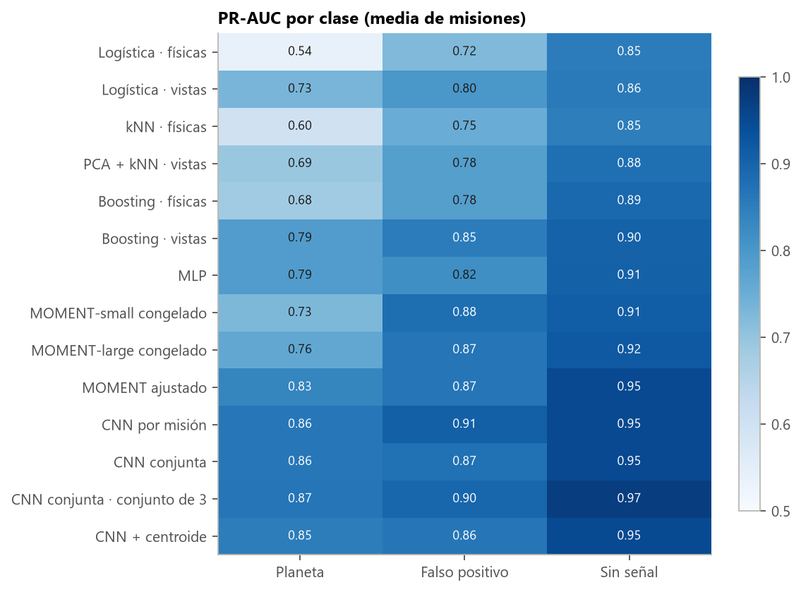

**Matriz de confusión de cada modelo** (elige una o dos para el texto y deja el resto en un anexo):

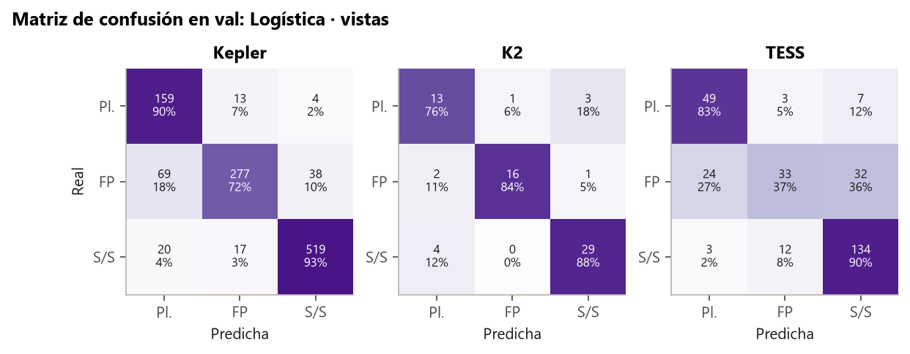

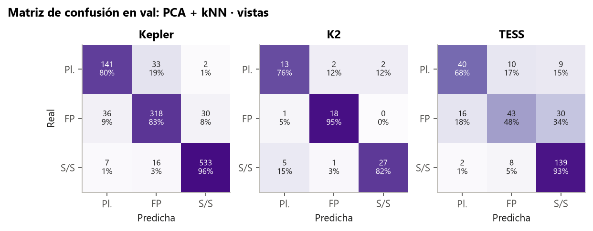

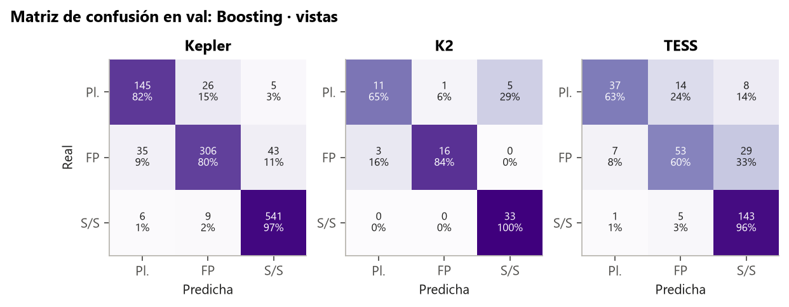

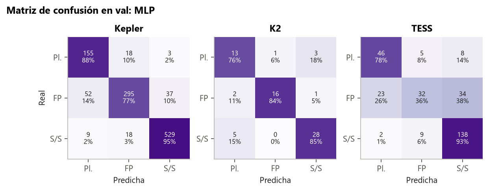

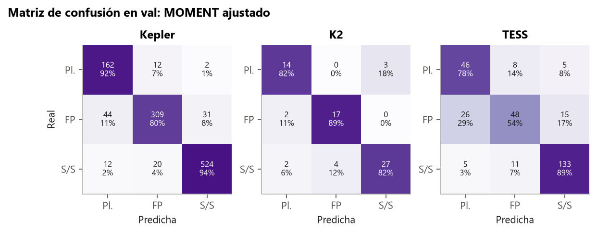

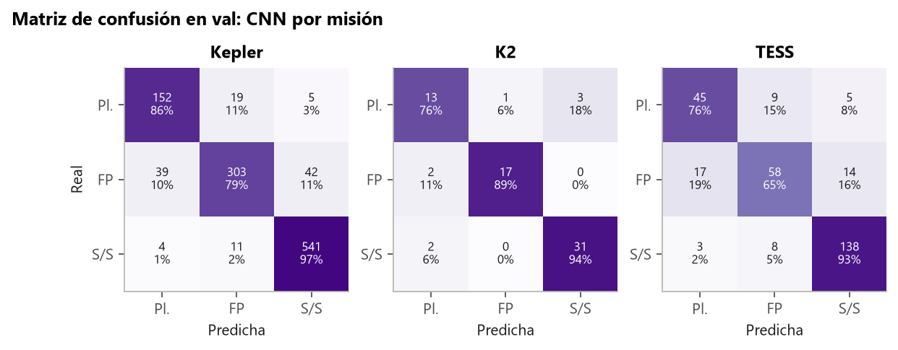

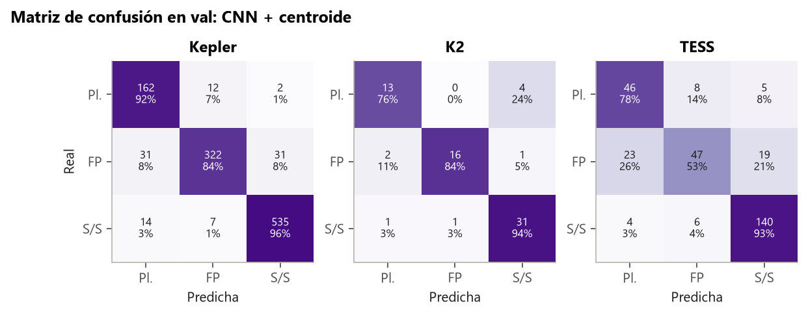

**Efecto del centroide:**

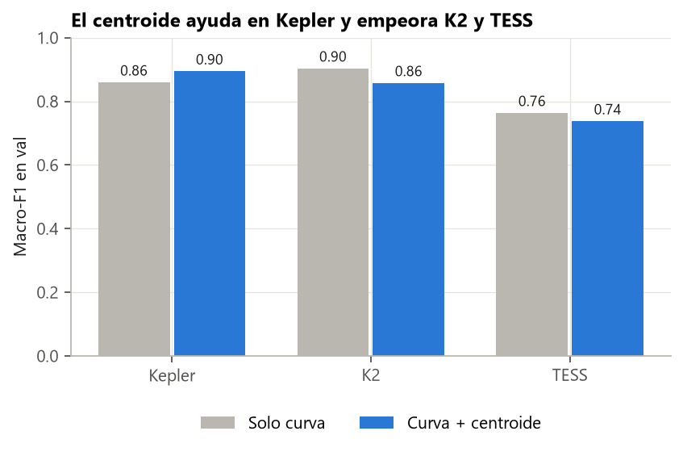

**Variantes de la CNN:**

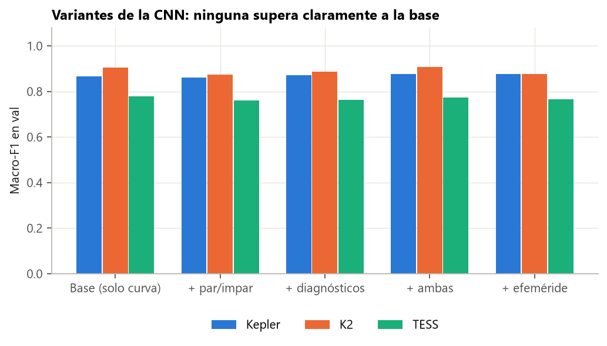

**Errores por tipo de FP en Kepler** (para hablar del techo físico):

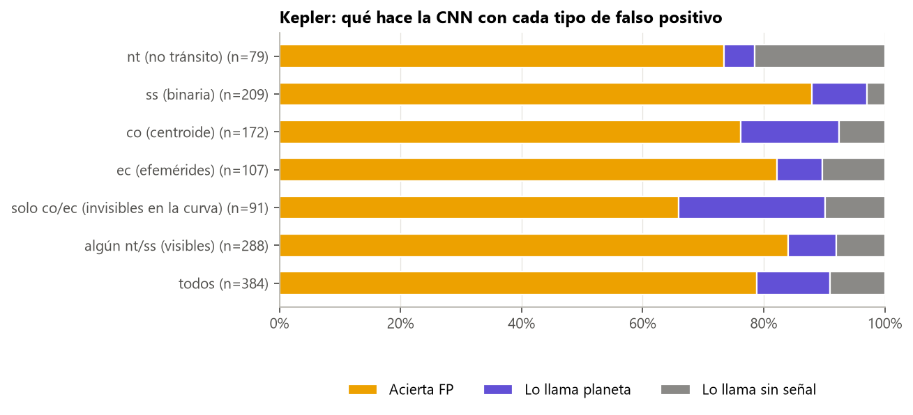

## Limitaciones que mencionar

- Todo es en validación, con una semilla para elegir la configuración (varía 0,01–0,05 entre semillas).
- Algunos resultados se calcularon antes de regenerar 1 031 negativos de TESS; las comparaciones finas hay que hacerlas dentro de la misma tabla.
- Val es pequeño en K2 y TESS: mira siempre el IC.

## Código

`scripts/models/` (`sklearn_models.py`, `mlp.py`, `cnn.py`, `moment_probe.py` y `moment_finetune.py`), `src/exoplanet/cnn.py`, `dataset.py` y `training.py`; `scripts/checks/error_analysis_fp.py`.

## Fuentes

- Shallue, C. J. y Vanderburg, A. (2018), AstroNet: https://arxiv.org/abs/1712.05044
- Goswami, M. et al. (2024), MOMENT: https://arxiv.org/abs/2402.03885
- Ioffe, S. y Szegedy, C. (2015), Batch Normalization: https://arxiv.org/abs/1502.03167
- Loshchilov, I. y Hutter, F. (2017), AdamW: https://arxiv.org/abs/1711.05101
- Beyer, K. et al. (1999), *When is "nearest neighbor" meaningful?*, ICDT.
- Bryson, S. T. et al. (2013), falsos positivos de fondo con el centroide: https://arxiv.org/abs/1303.0052
- Thompson, S. E. et al. (2018), motivos del Robovetter: https://arxiv.org/abs/1710.06758
- scikit-learn, `HistGradientBoostingClassifier`: https://scikit-learn.org/stable/modules/generated/sklearn.ensemble.HistGradientBoostingClassifier.html
