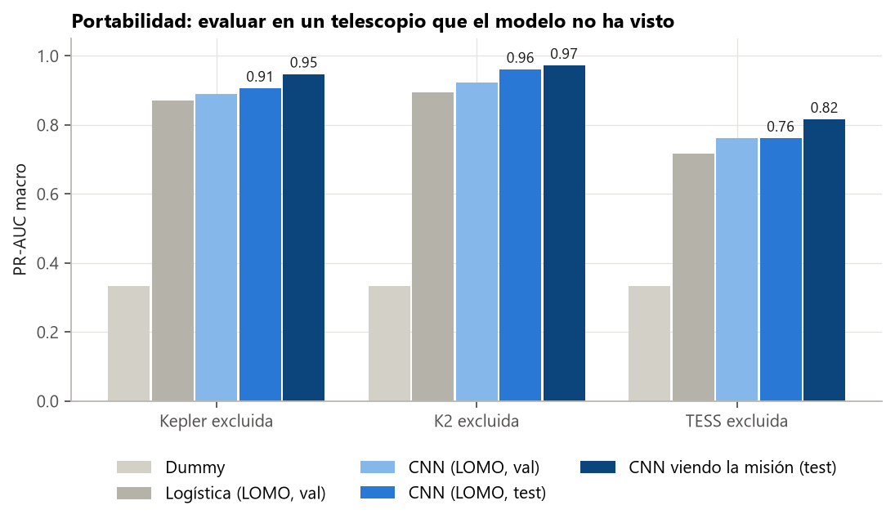
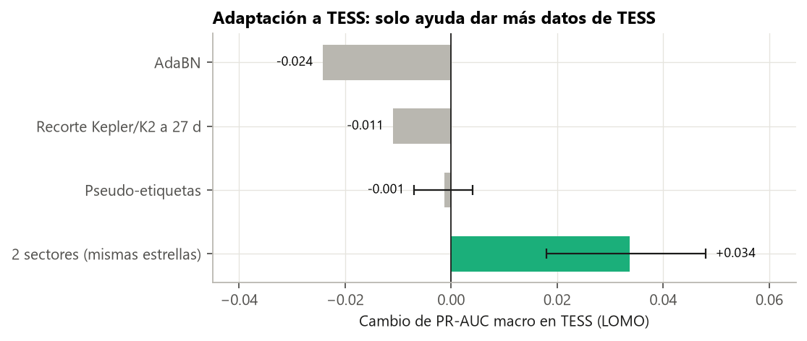
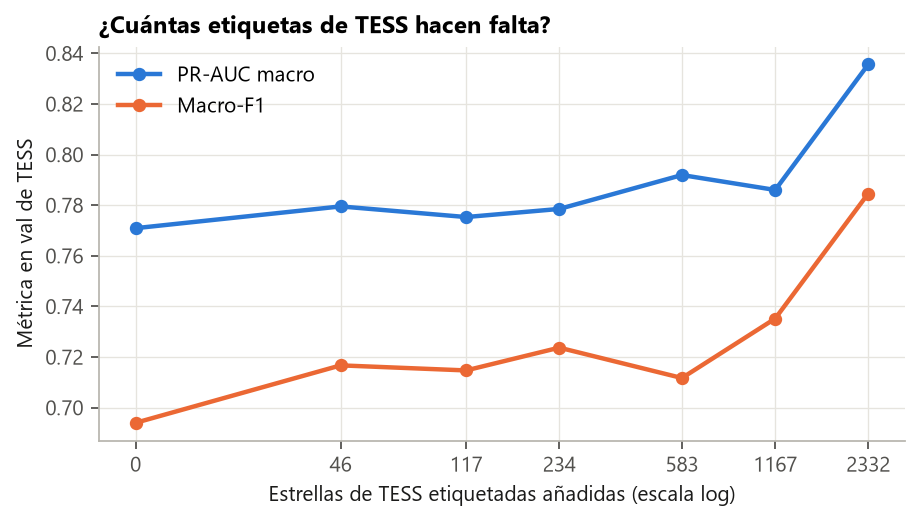
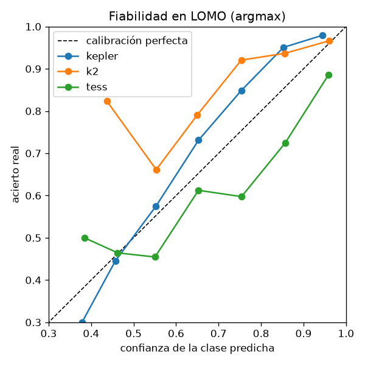

# Guía para redactar: portabilidad entre telescopios (fase 3, LOMO)

**Idea central de la sección:** el modelo solo curva es portable. Sin haber visto el telescopio pierde de media 0,05 de PR-AUC (0,911 → 0,862). TESS es el difícil, y su problema está en los datos (pocos tránsitos y otra población), no en el modelo. Lo único que mejoró TESS fue darle más datos de TESS.

## Introducción: por qué y cómo

**Por qué se hizo.**
- Es el núcleo del proyecto: un clasificador solo es útil para misiones futuras (PLATO, observaciones terrestres) si funciona en un telescopio que no ha visto.
- Nadie había publicado una evaluación así entre tres telescopios (ver la sección del estado del arte).

**Cómo se hizo.**
- Con el protocolo LOMO de la sección de evaluación: entrenar con dos misiones, elegir con ellas y evaluar en la tercera.
- Después, diagnosticar por qué falla TESS y probar formas de mejorarlo sin etiquetas: AdaBN, recortar curvas, pseudo-etiquetas y dos sectores.
- Por último, dos decisiones de diseño: quitar la profundidad y elegir la regla de decisión en un telescopio nuevo.

**Qué se buscaba conseguir.** Medir la portabilidad, entender sus límites y fijar la receta del modelo final.

## Qué contar, en orden

1. **Resultado principal** (tabla o figura):
   - PR-AUC sin ver la misión: Kepler 0,894, K2 0,927, TESS 0,764 (media 0,862).
   - Viéndola: 0,937, 0,956 y 0,840 (media 0,911).
   - Pérdida media −0,05.
2. **Qué se transfiere y qué no:** «hay señal o no» se transfiere casi perfecto (F1 de 0,88–0,94); lo que se degrada es planeta frente a FP.
3. **Por qué falla TESS:**
   - **¿Es el modelo?** La logística da 0,716 y la CNN 0,764, pero la CNN viendo TESS llega a 0,84: TESS tiene patrones propios.
   - **Pocos tránsitos:** mediana de 5–8 en TESS frente a decenas en Kepler. Con ≤ 8 tránsitos, el acierto en FP es ~30 %; con más, 52–61 %.
   - **Otra población:** el 14 % de los planetas de TESS tienen P < 2 d (6–7 % en Kepler y K2, donde los periodos cortos son sobre todo binarias). El modelo aprendió «periodo corto → binaria» y falla en la mitad de esos planetas (40 de 82).
4. **Curva de aprendizaje:** con pocas etiquetas de TESS apenas mejora; solo con todas llega a 0,836. Probable causa: 234 estrellas de TESS frente a ~10 000 de Kepler y K2. Dar más peso a TESS quedó sin probar.
5. **Intentos de adaptación** (usa la figura):
   - AdaBN −0,024: no es un problema de escala.
   - Recortar Kepler/K2 a 27 d −0,011: ya veía curvas con pocos tránsitos.
   - Pseudo-etiquetas −0,001: se autoconfirma en lo fácil.
   - **2 sectores +0,034 [+0,018, +0,048]:** a TESS le falta información por estrella.
6. **Decisión 1, quitar la profundidad:** el cambio es de solo −0,003 y es la variable que más delata la misión, así que el modelo final no la usa.
7. **Decisión 2, la regla en un telescopio nuevo:**
   - Corregir las probabilidades con la mezcla de clases estimada (EM de Saerens) empeora el macro-F1 en las tres misiones, así que se usa la clase más probable.
   - En TESS el modelo es demasiado confiado: cuando dice 0,75, acierta el 60 %.
   - Con precisión 0,9 solo recupera el 12 % de los planetas de TESS: sirve para priorizar, no para confirmar.
8. **Aviso honesto:** todas estas variantes se midieron sobre el mismo TESS. La cifra final se midió en test una sola vez (0,761, igual que en val).

## Conceptos que conviene explicar al lector

- **Cambio de dominio / portabilidad.**
- **AdaBN:** recalcular las estadísticas internas de la red con datos del nuevo dominio.
- **Pseudo-etiquetas:** el modelo etiqueta datos nuevos y se reentrena con ellos.
- **Curva de aprendizaje.**
- **Cambio de la mezcla de clases** (*prior shift*) y **calibración** (si la probabilidad que dice el modelo coincide con su acierto).

## Datos clave para citar

LOMO 0,894 / 0,927 / 0,764 · pérdida −0,05 · FP de TESS acertados 42 % · 2 sectores +0,034 · sin profundidad −0,003 · en TESS, recall del 12 % con precisión 0,9.

## Figuras

**Portabilidad** (figura principal):

**Intentos de adaptar TESS:**

**Curva de aprendizaje de TESS:**

**Calibración en LOMO** (para enseñar que en TESS el modelo es demasiado confiado):

## Limitaciones que mencionar

- La comparación entre «viendo» y «sin ver» la misión es aproximada (los conjuntos de evaluación no son idénticos).
- La selección interna es inestable cuando los pliegues internos son pequeños (con Kepler excluido, val de K2 tiene 69 estrellas).
- Las variantes de adaptación se evaluaron sobre el mismo TESS.

## Código

`scripts/models/` (`lomo.py`, `learning_curve.py`, `adabn.py`, `lomo_crop.py`, `pseudo_labels.py`, `tess_sectors.py` y `calibration.py`) y `scripts/checks/tess_errors.py`.

## Fuentes

- Li, Y. et al. (2016), AdaBN: https://arxiv.org/abs/1603.04779
- Saerens, M. et al. (2002), *Adjusting the outputs of a classifier to new a priori probabilities*, Neural Computation 14(1).
- Lee, D.-H. (2013), *Pseudo-Label*, ICML Workshop.
- Guo, C. et al. (2017), calibración de redes neuronales: https://arxiv.org/abs/1706.04599
- Valizadegan, H. et al. (2025), ExoMiner++ (juntar misiones frente a ajuste fino): https://arxiv.org/abs/2502.09790
