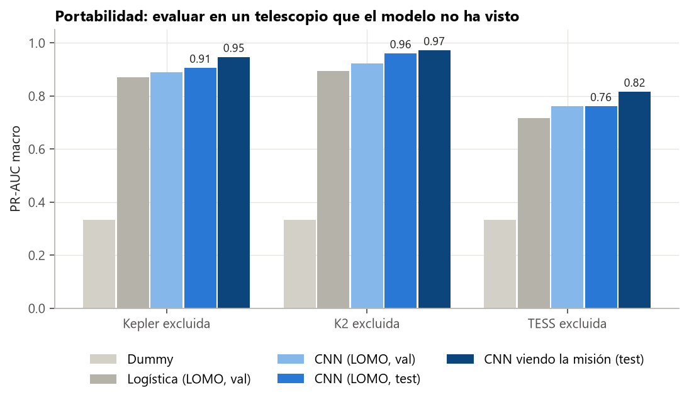

# Guía para redactar: el estado del arte

**Idea central de la sección:** desde 2018 varios grupos clasifican tránsitos con redes neuronales (AstroNet, AstroNet-K2, AstroNet-Vetting, ExoMiner y ExoMiner++). Todos entrenan y evalúan en el mismo telescopio, y los mejores usan información que tú no usas a propósito. Tu aportación no es superarlos en precisión, sino medir la portabilidad a telescopios no vistos con un modelo que solo mira la curva.

## Introducción: por qué y cómo

**Por qué se hizo.**
- Para situar el trabajo: saber qué existe, qué cifras se publican, qué se puede comparar y qué no, y qué lecciones aplicar.
- Sin esta sección, el lector no sabe si un 0,76 es bueno o malo.

**Cómo se hizo.**
- Se leyeron los artículos principales (AstroNet y sus versiones para K2 y TESS, ExoMiner y ExoMiner++).
- Se extrajeron sus datos, su protocolo, sus entradas y sus resultados.
- Se calcularon tus resultados en el mismo formato.
- Durante la auditoría se añadieron trabajos de 2025–2026.

**Qué se buscaba conseguir.** Una comparación honesta, que diga en qué sí y en qué no son comparables las cifras.

## Qué contar, en orden

1. **Los trabajos de referencia** (una tabla o un párrafo por trabajo):
   - **AstroNet (2018):** CNN de dos vistas en Kepler, ROC-AUC 0,988. Tu red es esta.
   - **AstroNet-K2 (2019):** ROC-AUC 0,988; con precisión 1, recall de solo 0,2, así que «necesita supervisión humana».
   - **AstroNet-Triage/Vetting (2019):** TESS; el *vetting* (planeta frente a binaria) da AP 0,693.
   - **ExoMiner (2022):** PR-AUC 0,995 en Kepler, con centroide, par/impar, secundario y parámetros estelares.
   - **ExoMiner++ (2025):** PR-AUC 0,976 en TESS; publica puntuaciones para ~150 000 señales.
2. **Por qué no se puede comparar directamente.** Son los cinco motivos que debes explicar:
   - ellos prueban en el mismo telescopio con el que entrenan;
   - sus negativos son sobre todo señales de no tránsito, que son fáciles;
   - AstroNet parte al azar por señal (la misma estrella puede estar en entrenamiento y en prueba);
   - ExoMiner usa información extra;
   - ellos parten de la efeméride de una tubería de detección.
3. **Dónde te sitúas:**
   - LOMO en TESS, planeta frente a FP: PR-AUC 0,704, parecido al 0,693 de AstroNet-Vetting, que sí vio TESS.
   - Con el modelo final, en el test de TESS: 0,766.
   - ExoMiner++ como techo: la diferencia hasta 0,976 es lo que aporta la información que no usas.
4. **La laguna que cubres:** no encontraste una evaluación entre tres telescopios como la tuya. Hay indicios aislados (EXOVEIL usa Kepler en TESS; «Depth-Blind by Design» analiza un modelo de Kepler congelado en TESS). Di que la búsqueda no fue exhaustiva.
5. **Lecciones aplicadas:**
   - promediar varias semillas;
   - juntar misiones mejor que ajustar fino;
   - un modelo solo curva prioriza, no confirma.
6. **Trabajos recientes (2025–2026):**
   - PANOPTICON (U-Net para PLATO);
   - Salinas et al. (Transformer en TESS);
   - Hernández-Carnerero et al. (atención para el *vetting*);
   - FALCO y Astromer 2 (aprendizaje sin etiquetas);
   - EXOVEIL (predicción conforme);
   - LEO-Vetter;
   - Chaushev et al. (binarias inyectadas);
   - AstroMMBench (los LLM leen mal las curvas).

## Conceptos que conviene explicar al lector

- **ROC-AUC frente a PR-AUC:** por qué la PR-AUC es más exigente con clases desequilibradas.
- **AP** (precisión media): equivale a la PR-AUC.
- **Partición por señal frente a por estrella:** la fuga de información.
- **TCE:** señal detectada por la tubería de un telescopio.

## Datos clave para citar

AstroNet ROC-AUC 0,988 · AstroNet-Vetting AP 0,693 · ExoMiner PR-AUC 0,995 · ExoMiner++ PR-AUC 0,976 · tu LOMO en TESS 0,704 (planeta frente a FP) · tu modelo final en el test de TESS 0,766.

## Figuras

Esta sección funciona mejor con una **tabla comparativa** que con una gráfica, porque las cifras no son directamente comparables. Si quieres una figura, usa la de portabilidad para recordar tu resultado:

## Limitaciones que mencionar

- Algunas cifras de los artículos salen de resúmenes automáticos de tablas; compruébalas en los PDF antes de citarlas.
- La búsqueda de trabajos sobre transferencia entre telescopios no fue exhaustiva.

## Fuentes

- Shallue y Vanderburg (2018), AstroNet: https://arxiv.org/abs/1712.05044
- Dattilo et al. (2019), AstroNet-K2: https://arxiv.org/abs/1903.10507
- Yu et al. (2019), AstroNet-Triage/Vetting: https://arxiv.org/abs/1904.02726
- Valizadegan et al. (2022), ExoMiner: https://arxiv.org/abs/2111.10009
- Valizadegan et al. (2025), ExoMiner++: https://arxiv.org/abs/2502.09790 ; catálogo: https://doi.org/10.5281/zenodo.15466293
- Ansdell et al. (2018), Exonet: https://arxiv.org/abs/1810.13434
- EXOVEIL (2026): https://arxiv.org/abs/2606.02778
- Srinivasan (2026), *Depth-Blind by Design* (solo el resumen): https://neurips.cc/virtual/2026/164256
- PANOPTICON (2025): https://arxiv.org/abs/2409.03466
- Salinas et al. (2025), MNRAS 538, 2031.
- Hernández-Carnerero et al. (2025), The Astronomical Journal.
- Thomas et al. (2025): https://arxiv.org/abs/2509.04793
- FALCO (2025): https://arxiv.org/abs/2504.20290
- Astromer 2 (2025): https://arxiv.org/abs/2502.02717
- ExoNet (2026): https://arxiv.org/abs/2604.15560
- LEO-Vetter (2025): https://arxiv.org/abs/2509.10619
- Chaushev et al. (2019): https://arxiv.org/abs/1907.11109
- AstroMMBench (2025): https://arxiv.org/abs/2510.00063
