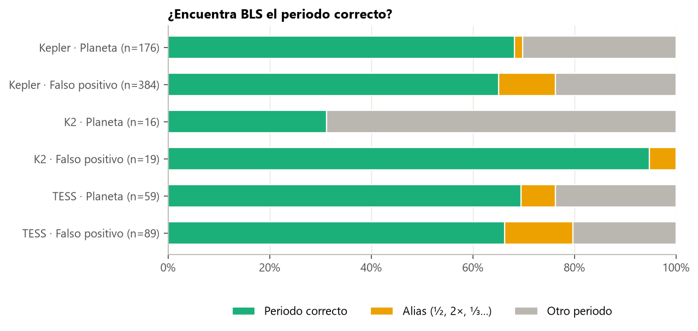
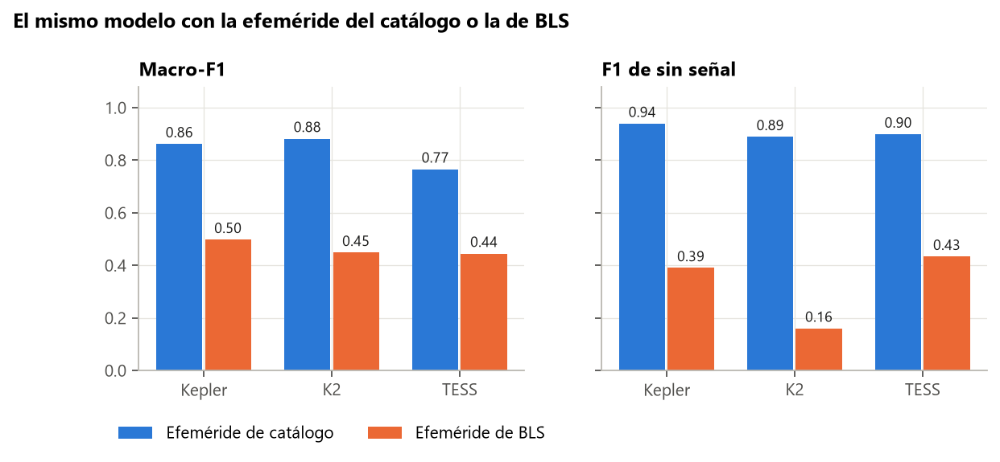

# Guía para redactar: encontrar el tránsito sin catálogo (BLS)

**Idea central de la sección:** en un telescopio nuevo no hay catálogo, así que el periodo y la época hay que encontrarlos en la propia curva. Implementaste BLS: acierta el periodo en ~2 de cada 3 casos, pero con su efeméride el modelo cae de ~0,86 a ~0,50, sobre todo porque el ruido plegado en su mejor pico parece un tránsito. Eso llevó a decidir que el modelo es un clasificador de señales ya detectadas.

## Introducción: por qué y cómo

**Por qué se hizo.**
- Hasta aquí, el modelo recibía la efeméride del catálogo. Para usarlo con datos nuevos (un telescopio futuro, la curva de un aficionado) hay que saber cuánto cuesta encontrarla tú mismo.
- Es la diferencia entre un sistema de principio a fin y uno que solo clasifica señales ya encontradas.

**Cómo se hizo.**
- Se implementó BLS (*Box Least Squares*):
  - aplanado a ciegas;
  - búsqueda por bandas de periodo;
  - rejilla gruesa más refinado;
  - periodograma aplanado.
- Se midió con qué frecuencia BLS recupera el periodo del catálogo.
- Se plegaron todas las estrellas de val con la efeméride de BLS (también las «sin señal», en su mejor pico) y se pasó el mismo modelo.

**Qué se buscaba conseguir.** Decidir el alcance del producto: de principio a fin, o solo clasificar señales detectadas.

## Qué contar, en orden

1. **Qué es BLS:** prueba miles de periodos, busca la caída en forma de caja que mejor encaja y la SDE mide si el pico es significativo.
2. **Problemas prácticos resueltos** (opcional, pero muestra trabajo):
   - dos trimestres de Kepler separados por años daban millones de periodos (se resolvió con una rejilla gruesa y refinado);
   - sin aplanar el periodograma, BLS elegía siempre el periodo más corto.
3. **¿Acierta el periodo?**
   - 65–69 % en Kepler y TESS.
   - Los FP dan más alias de ½ (binarias con dos eclipses parecidos).
   - En K2, los planetas solo el 31 % (artefactos del telescopio cada ~6 h).
   - La SDE sí separa señal de ruido (ROC-AUC de 0,82–0,87).
4. **El golpe:**
   - Macro-F1 de 0,86 → 0,50 en Kepler, 0,45 en K2 y 0,44 en TESS.
   - Casi todo viene de «sin señal»: en Kepler, del 97 % al 26 % de acierto.
5. **Por qué pasa** (explícalo bien, es la lección de la sección): en el entrenamiento, los «sin señal» se plegaban con una efeméride al azar y daban una curva plana. Plegados en el mejor pico de ruido de BLS, parecen un tránsito débil que el modelo nunca había visto. El buen resultado anterior en «sin señal» era optimista.
6. **Cuando BLS acierta el periodo,** el modelo funciona igual o mejor con los planetas (92 % → 96 %).
7. **La decisión:**
   - Opciones: (A) clasificador de señales ya detectadas, (B) de principio a fin reentrenando con BLS, (C) un umbral de SDE delante.
   - Se eligió (A), como AstroNet y ExoMiner.
   - Consecuencia: «sin señal» pasa a significar «la efeméride dada no corresponde a un tránsito real».

## Conceptos que conviene explicar al lector

- **Efeméride:** periodo, época y duración del tránsito.
- **Periodograma.**
- **SDE.**
- **Alias del periodo:** ½ o 2 veces el real.
- **Vetting frente a detección:** clasificar una señal frente a encontrarla.

## Datos clave para citar

BLS acierta el 65–69 % (Kepler y TESS) · macro-F1 0,86 → 0,50 · «sin señal» 97 % → 26 % · coste ~3,5 s por estrella en TESS y ~15 s en Kepler.

## Figuras

**¿Encuentra BLS el periodo?**

**El mismo modelo con catálogo o con BLS** (la figura clave):

## Limitaciones que mencionar

- Solo se probó con el modelo entrenado con negativos «fáciles»; los negativos difíciles se probaron después.
- K2 tiene muy pocas estrellas en val (54).

## Código

`src/exoplanet/bls.py`, `scripts/data/build_bls_views.py` y `scripts/models/eval_bls.py`.

## Fuentes

- Kovács, Zucker y Mazeh (2002), BLS: https://arxiv.org/abs/astro-ph/0206099
- astropy, `BoxLeastSquares`: https://docs.astropy.org/en/stable/timeseries/bls.html
- Vanderburg y Johnson (2014), artefactos de K2: https://arxiv.org/abs/1408.3853
- Dattilo et al. (2019), AstroNet-K2 con un BLS propio: https://arxiv.org/abs/1903.10507
