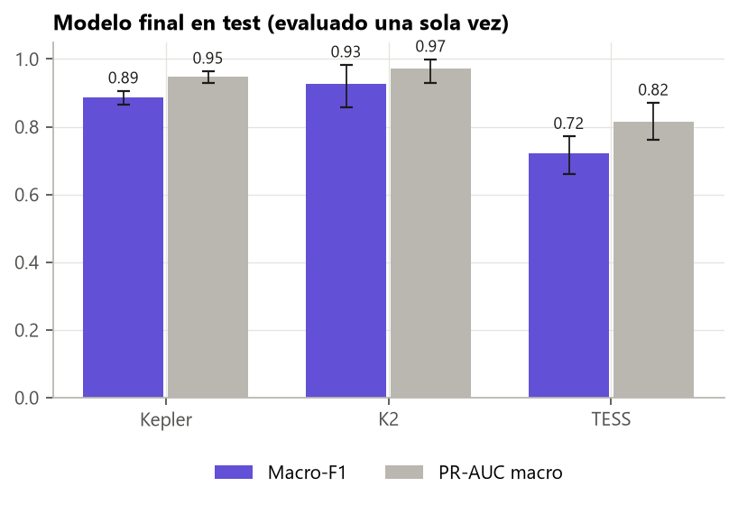
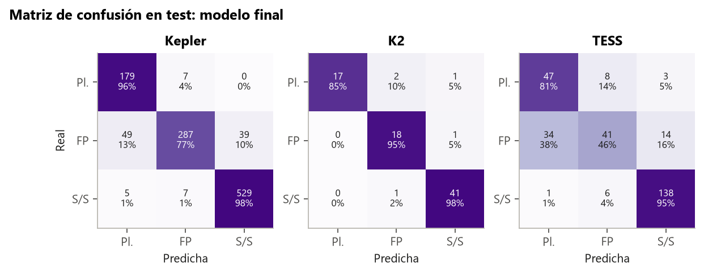
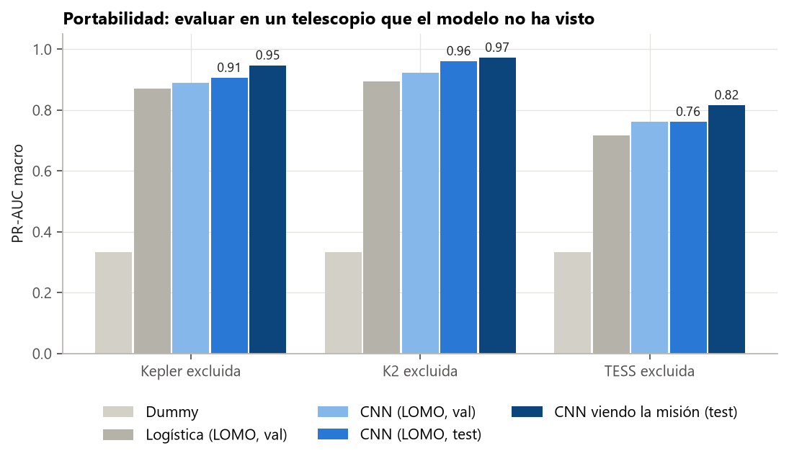

# Guía para redactar: el modelo final y su evaluación en test

**Idea central de la sección:** fijaste la receta del modelo final y la guardaste en git antes de mirar el test, y después evaluaste una sola vez. Resultado: macro-F1 de 0,886 en Kepler, 0,928 en K2 y 0,720 en TESS. En LOMO, el test dio lo mismo que validación, así que lo medido antes no estaba inflado.

## Introducción: por qué y cómo

**Por qué se hizo.**
- El test es la única medida honesta de cómo funcionará el modelo con datos nuevos, pero solo si no influye en ninguna decisión.
- Si se mira, se cambia algo y se vuelve a mirar, deja de valer.
- Por eso había que cerrar la receta antes y gastar el test una sola vez.

**Cómo se hizo.**
- Se escribió y commiteó la receta completa (commit `05a737a`): modelo, entrada, datos, configuración, semillas y regla de decisión.
- Se entrenó con train + val y 5 semillas, promediando las probabilidades.
- Se evaluó de dos maneras:
  1. el modelo final en el test de cada misión;
  2. la misma receta en LOMO, en el test de cada misión excluida.

**Qué se buscaba conseguir.** Las cifras oficiales del proyecto, y comprobar si la fase de portabilidad estaba inflada por haber probado muchas variantes.

## Qué contar, en orden

1. **Por qué se fija la receta antes** (el argumento de arriba). Muestra madurez metodológica.
2. **La receta, y el porqué de cada elemento:**
   - CNN de dos ramas tipo AstroNet (la mejor de la fase 2);
   - solo las vistas, sin profundidad (aportaba +0,003 y delata la misión);
   - Kepler + K2 + TESS juntos (juntar misiones funciona mejor que ajustar fino);
   - TESS con 1 sector;
   - base 16 y dropout 0,5, elegidos en val;
   - 5 semillas promediadas (como ExoMiner++ y AstroNet-K2);
   - la clase más probable como decisión (corregir la mezcla de clases empeoraba);
   - alcance: clasificador de señales ya detectadas (por lo visto con BLS).
3. **Resultado por telescopio:**
   - Kepler 0,886 [0,867–0,906], K2 0,928 [0,858–0,983], TESS 0,720 [0,661–0,772]; media 0,845.
   - Kepler y K2 suben respecto a val (más datos y 5 semillas); TESS baja un poco (0,779 → 0,720), dentro del IC.
   - K2 solo tiene 81 estrellas de test.
4. **La matriz de confusión:**
   - El fallo dominante: en TESS, 34 de 89 FP se predicen como planeta.
   - «Sin señal» va muy bien (F1 0,92–0,96).
   - El problema difícil es planeta frente a FP.
5. **LOMO en test:**
   - PR-AUC 0,906 (Kepler), 0,961 (K2) y 0,761 (TESS), igual que en val.
   - Mensaje: la fase de portabilidad no estaba inflada.
   - Coste de no ver la misión en PR-AUC: Kepler 0,947 → 0,906, K2 0,972 → 0,961, TESS 0,816 → 0,761.
6. **La métrica que importa para candidatos** (puente con la validación prospectiva):
   - Planeta frente a FP en el test de TESS: ROC-AUC 0,803 y PR-AUC 0,766.
   - Con un 90 % de precisión, recupera el 34 % de los planetas.
   - Conclusión: el modelo prioriza, no confirma.

## Conceptos que conviene explicar al lector

- **Conjunto de test reservado.**
- **Ensemble de semillas.**
- **Matriz de confusión.**
- **Intervalo de confianza por bootstrap.**
- **Precisión y recall** a un umbral dado.

## Datos clave para citar

Test 0,886 / 0,928 / 0,720 (media 0,845) · PR-AUC 0,947 / 0,972 / 0,816 · LOMO en test 0,906 / 0,961 / 0,761 · FP de TESS predichos como planeta: 34 de 89 · planeta frente a FP en TESS: PR-AUC 0,766.

## Figuras

**Resultado en test con intervalos:**

**Matriz de confusión en test:**

**Portabilidad (la barra más oscura es este modelo final):**

## Limitaciones que mencionar

- K2 tiene pocas estrellas en test.
- La métrica de 3 clases incluye negativos fabricados 1:1; la cifra útil para candidatos es la de planeta frente a FP.

## Código

`scripts/models/final_model.py {select, train, test, val}`; pesos en `data/models/final_seed0.pt` a `final_seed4.pt`.

## Fuentes

- Shallue y Vanderburg (2018), AstroNet: https://arxiv.org/abs/1712.05044
- Valizadegan et al. (2025), ExoMiner++: https://arxiv.org/abs/2502.09790
- Dattilo et al. (2019), AstroNet-K2: https://arxiv.org/abs/1903.10507
- Efron y Tibshirani (1993), *An Introduction to the Bootstrap*, Chapman & Hall.
