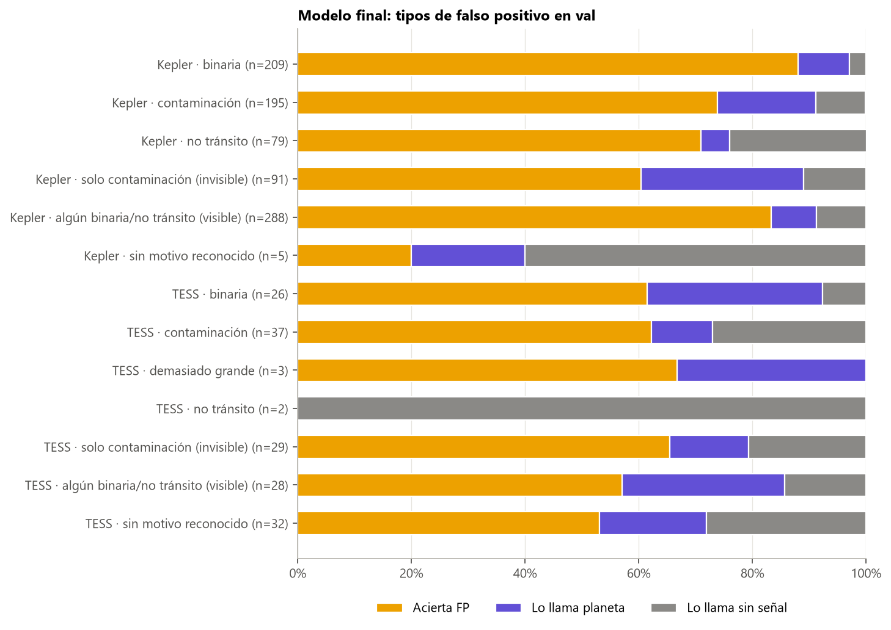
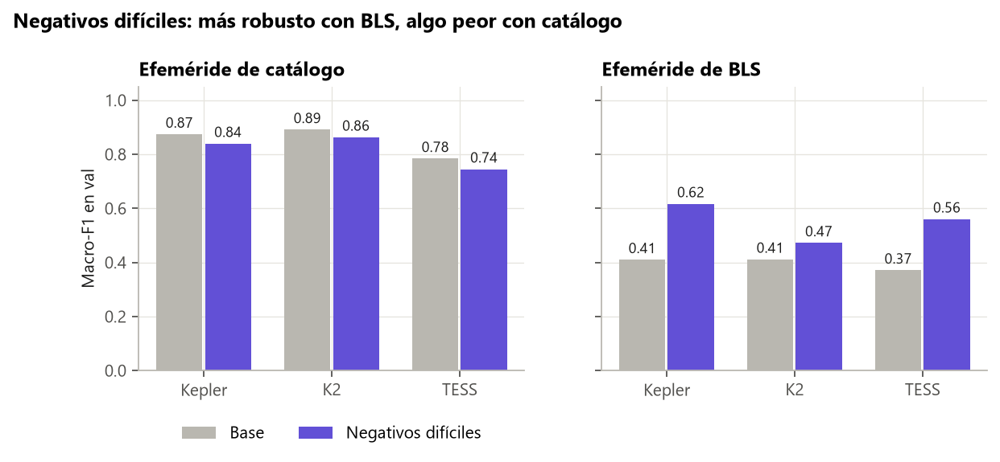
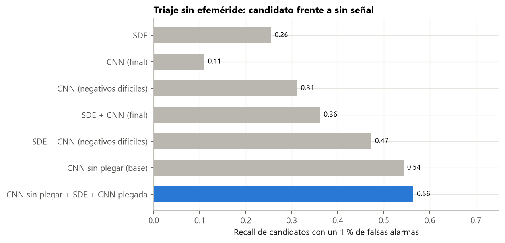

# Guía para redactar: análisis de errores, negativos difíciles y triaje en búsqueda

**Idea central de la sección:** en Kepler, los falsos positivos que se escapan son sobre todo de contaminación de una estrella vecina, invisibles en la curva (techo físico). En TESS se escapan binarias, que sí se ven: ahí hay margen. Además, el ruido realista engaña al modelo. Entrenar con negativos difíciles lo hace más robusto en búsqueda, a costa de algo de rendimiento con catálogo. Y el triaje sin efeméride llega al 47 % de recall con un 1 % de falsas alarmas, limitado por BLS.

## Introducción: por qué y cómo

**Por qué se hizo.**
- Una cifra global no dice qué mejorar. Hay que saber qué tipo de error comete el modelo, si se puede arreglar con la curva o no, y cómo se comporta con negativos realistas.
- También se quería saber si el modelo sirve para buscar sin efeméride, una prioridad que fijaste.

**Cómo se hizo.**
- En validación (el test ya estaba gastado), con la receta final entrenada solo con train.
- Cada FP se clasificó por su motivo: Robovetter en Kepler y comentarios de ExoFOP en TESS.
- Se calculó la precisión de «planeta» suponiendo muchas estrellas sin señal por planeta.
- Experimento de negativos difíciles: se añadió ruido plegado en el pico de BLS como «sin señal».
- Triaje: se combinaron la SDE de BLS y la CNN y se midió el recall con un 1 % de falsas alarmas.

**Qué se buscaba conseguir.** Saber dónde está el margen de mejora y decidir qué modelo usar en cada caso.

## Qué contar, en orden

1. **Tipos de falso positivo:**
   - **Binaria** (visible en la curva).
   - **Contaminación** (invisible): binaria de fondo, centroide desplazado o coincidencia de efemérides.
   - **No tránsito.**
2. **Kepler:**
   - Binarias: 88 % de acierto. Contaminación: 60 %, y el 29 % pasa por planeta.
   - La mitad de los FP que pasan por planeta son de contaminación: el **techo físico**.
3. **TESS:**
   - Las binarias pasan por planeta un 31 % de las veces (9 % en Kepler). **Margen de mejora.**
   - El modelo no recibe vistas par/impar locales ni del secundario, que es como lo hacen AstroNet-Vetting y ExoMiner.
   - En test es peor: el 38 % de los FP pasan por planeta.
4. **«No tránsito» → «sin señal»:** frontera difusa de las etiquetas.
5. **Planeta frente a «sin señal» con prevalencias realistas:**
   - Con los negativos fáciles, solo el 1–3 % de los «sin señal» pasan por planeta. Pero con 100 «sin señal» por planeta, más de la mitad de los «planetas» serían falsos.
   - Con ruido realista (picos de BLS), entre el 20 % y el 43 % pasan por planeta.
6. **Experimento de negativos difíciles:**
   - Gana robustez: en Kepler, el ruido como FP baja del 69 % al 3 %; con BLS, el macro-F1 sube unas 0,2.
   - Pierde con catálogo: −0,03/−0,04.
   - **Decisión:** el modelo base para señales con efeméride (TOIs); el de negativos difíciles solo para búsqueda.
7. **Triaje sin efeméride:**
   - Métrica: recall de candidatos dejando pasar solo el 1 % del ruido. Explica por qué: en el cielo, el ruido es mayoría.
   - SDE sola 0,26; CNN con negativos difíciles 0,31; las dos juntas 0,47.
   - **El límite es BLS:** si encuentra el periodo correcto (68 %), el recall es 0,65; si no, 0,11.
   - Los 3 mejores picos de BLS no ayudan (0,474 → 0,470).
   - Esto lleva al detector sin BLS (siguiente sección).

## Conceptos que conviene explicar al lector

- **Techo físico:** errores imposibles de arreglar con la información disponible.
- **Prevalencia y precisión:** con muchas estrellas sin señal, incluso un error pequeño produce muchos falsos positivos.
- **Negativos difíciles** (*hard negatives*).
- **Triaje.**
- **Recall con falsas alarmas fijas.**

## Datos clave para citar

Contaminación en Kepler: 60 % de acierto, 29 % → planeta · binarias de TESS → planeta 31 % · ruido realista → planeta 20–43 % · negativos difíciles: +0,2 con BLS y −0,03/−0,04 con catálogo · triaje 0,47 con un 1 % de falsas alarmas.

## Figuras

**Tipos de falso positivo en el modelo final:**

**Negativos difíciles: catálogo frente a BLS:**

**Triaje sin efeméride** (las barras superiores son las de esta sección; las de abajo, de la siguiente):

## Limitaciones que mencionar

- Las etiquetas de motivo de TESS son ruidosas (un tercio solo dice «TFOP FP»).
- En val hay pocos FP de TESS por tipo (26–32).
- Las precisiones con prevalencias realistas ignoran los FP; son una aproximación.

## Código

`scripts/checks/error_analysis_final.py`, `scripts/models/hard_negatives.py`, `scripts/checks/triage_val.py` y `scripts/data/build_bls_peaks.py`.

## Fuentes

- Thompson et al. (2018), motivos del Robovetter: https://arxiv.org/abs/1710.06758
- ExoFOP-TESS: https://exofop.ipac.caltech.edu/tess/
- Yu et al. (2019), AstroNet-Vetting: https://arxiv.org/abs/1904.02726
- Valizadegan et al. (2022), ExoMiner: https://arxiv.org/abs/2111.10009
- Kovács et al. (2002), BLS y SDE: https://arxiv.org/abs/astro-ph/0206099
