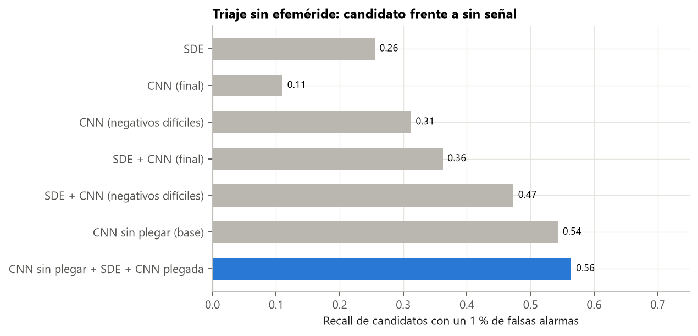
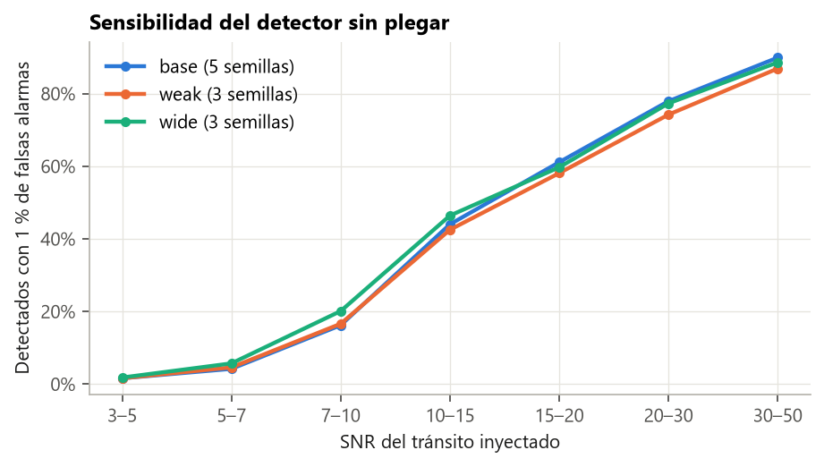

# Guía para redactar: un detector sin BLS (red sobre la curva sin plegar)

**Idea central de la sección:** para no depender de BLS entrenaste una red que mira la curva entera, sin plegar, con tránsitos sintéticos inyectados. Sola supera a BLS + CNN (0,52 frente a 0,47 de recall con un 1 % de falsas alarmas), y combinada llega a 0,56. Detecta ~90 % de los tránsitos claros (SNR > 30), pero tocó techo y la línea se cerró.

## Introducción: por qué y cómo

**Por qué se hizo.**
- El análisis anterior mostró que el cuello de botella de la búsqueda era BLS: en el 25 % de los candidatos no encontraba el periodo.
- Hacía falta un detector distinto que no necesitara plegar.

**Cómo se hizo.**
- Curvas sin plegar, aplanadas a ciegas y agrupadas en bloques de 30 min (hasta 9 216 bloques ≈ 192 días).
- Entrada: el brillo en unidades del ruido de la estrella, más un canal que marca los huecos.
- Red: CNN 1D de 7 bloques con agregación global.
- **Entrenamiento con tránsitos inyectados:** en cada época, cada curva sin señal recibe un tránsito sintético (periodo, duración y SNR al azar entre 5 y 50) y pasa a ser «candidato».
- Se combinó con la SDE y la CNN plegada, y se probaron variantes.

**Qué se buscaba conseguir.** Superar el límite de BLS en el triaje sin efeméride.

## Qué contar, en orden

1. **Por qué un detector sin BLS** (el límite de BLS de la sección anterior).
2. **Cómo funciona** (la entrada y la red), y sobre todo **la inyección de tránsitos sintéticos:** explica que permite ver miles de tránsitos sin necesitar etiquetas nuevas.
3. **Resultados:**
   - Sola, con 5 semillas: 0,525 de recall con un 1 % de falsas alarmas (BLS + CNN: 0,473).
   - Las tres puntuaciones juntas: 0,564.
   - Mira cosas distintas que BLS.
4. **Sensibilidad por SNR:** ~90 % con SNR > 30; menos de la mitad con SNR < 15.
5. **El precio:** con un recall del 95 %, pasan dos tercios del ruido.
6. **Variantes:**
   - Inyecciones más débiles, red el doble de ancha y más semillas: ninguna mejora.
   - **Lección:** la primera prueba (0,554) fue una semilla afortunada; la media de una semilla es 0,50.
7. **Cierre de la línea:**
   - Techo alcanzado.
   - La búsqueda ya la hacen las tuberías oficiales y Planet Hunters TESS, y ya existe un Transformer para TESS (Salinas et al. 2025).
   - Si se retoma: un detector por punto (U-Net, como PANOPTICON).

## Conceptos que conviene explicar al lector

- **Inyección y recuperación:** meter señales falsas conocidas para medir lo que detecta un sistema.
- **SNR** (señal frente a ruido).
- **Variabilidad entre semillas.**
- **U-Net** (para mencionarla como siguiente paso).

## Datos clave para citar

0,525 sola · 0,564 combinada · 90 % con SNR > 30 · 44 % con SNR 10–15 · media de una semilla 0,498 ± 0,024.

## Figuras

**Triaje: comparación de métodos** (las barras inferiores son las de esta sección):

**Sensibilidad por SNR:**

## Limitaciones que mencionar

- La SNR de los candidatos reales se estimó con la profundidad de la vista local, que es poco fiable con señales débiles.
- Los tránsitos inyectados son trapezoidales, más simples que los reales.

## Código

`scripts/data/build_series.py`, `scripts/models/series_cnn.py` y `scripts/checks/series_ensemble.py`; series en `data/sample/series`.

## Fuentes

- PANOPTICON (2025): https://arxiv.org/abs/2409.03466
- Salinas et al. (2025), Transformer en TESS, MNRAS 538, 2031.
- Kovács et al. (2002), BLS: https://arxiv.org/abs/astro-ph/0206099
- Mandel y Agol (2002), forma del tránsito: https://arxiv.org/abs/astro-ph/0210099
- Planet Hunters TESS: https://www.zooniverse.org/projects/nora-dot-eisner/planet-hunters-tess
