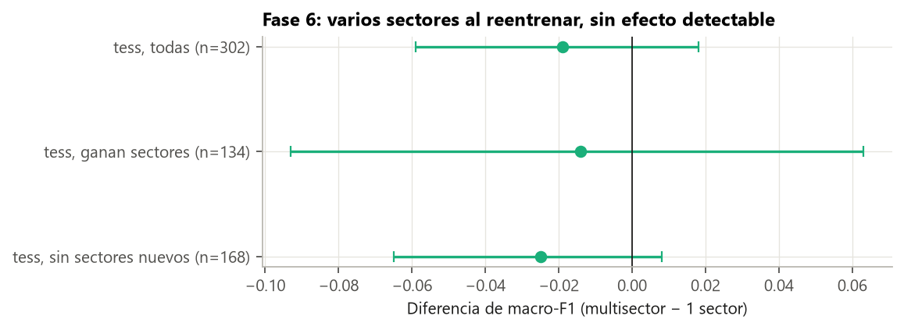
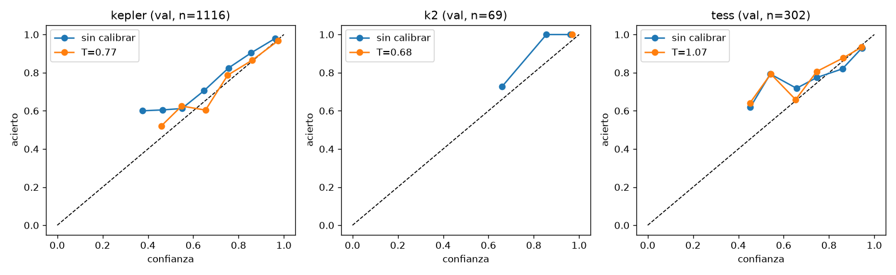

# Guía para redactar: intentos de mejorar TESS (fase 6)

**Idea central de la sección:** probaste tres palancas en TESS. Varios sectores por estrella no dio una mejora detectable, aunque el experimento tenía poca potencia. Las etiquetas extra se aparcaron porque creaban un atajo. Calibrar con *temperature scaling* sí funcionó. El modelo final queda igual, con temperaturas por misión.

## Introducción: por qué y cómo

**Por qué se hizo.**
- TESS era la misión más débil (0,72 en test).
- La fase 3 había mostrado que le falta información por estrella (con 2 sectores mejoraba +0,034).
- Además, en la fase 3 el modelo era demasiado confiado en TESS, y la herramienta futura necesita probabilidades fiables.

**Cómo se hizo.**
- **Varios sectores:** cada pareja (positivo y su «sin señal») con el mismo número de sectores para no abrir un atajo; reentrenamiento con 5 semillas; criterio fijado antes.
- **Más etiquetas:** se revisaron los TOIs resueltos de ExoFOP que no estaban en el dataset.
- **Calibración:** *temperature scaling* por misión, ajustado fuera de pliegue en val.

**Qué se buscaba conseguir.** Subir TESS con datos reales y tener probabilidades bien calibradas.

## Qué contar, en orden

1. **Varios sectores:**
   - **El atajo:** los planetas tienen una mediana de 7 sectores, los FP 3 y los «sin señal» 2. Solo con ese número se separa planeta de FP con un AUC de 0,71. Es muy buen ejemplo de atajo.
   - **La solución:** el mismo número de sectores en cada pareja (714 parejas, 2–3 sectores y 16–24 tránsitos de mediana).
   - **Resultado:** 0,784 → 0,765 (−0,019 [−0,059, +0,018]); el criterio no se cumple.
   - **La lectura honesta:** las estrellas que no ganan sectores bajan casi igual que las que ganan, así que es variación entre entrenamientos. Con 134 estrellas, un efecto de +0,03 era indetectable: **falta de potencia estadística**. La forma correcta sería evaluar el modelo actual con las vistas multisector, estrella a estrella.
2. **Más etiquetas:**
   - De 885 TOIs resueltos nuevos, con datos de 2 min casi todos son planetas conocidos (unos 412) y solo hay 1 FP; los ~280 FP nuevos solo tienen datos de imágenes completas.
   - Mezclarlos crearía el atajo «imágenes completas → FP». Se aparcó.
   - Idea alternativa: usarlos solo para evaluar, como un cuarto telescopio.
3. **Calibración:**
   - Explica qué es estar calibrado y qué hace la temperatura (un número que suaviza o agudiza sin cambiar la clase predicha).
   - El conjunto de 5 semillas era poco confiado en Kepler y K2 (decía 0,86 y acertaba 0,90). El ECE de Kepler pasó de 0,039 a 0,017.
   - TESS ya estaba casi calibrado (T = 1,07): la sobreconfianza de la fase 3 era del modelo LOMO.
4. **Cierre:** el modelo final se queda igual, con temperaturas.

## Conceptos que conviene explicar al lector

- **Atajo** (otra vez, con el ejemplo de los sectores).
- **Potencia estadística:** si un experimento puede detectar el efecto buscado con ese tamaño de muestra.
- **Calibración, ECE y *temperature scaling*.**

## Datos clave para citar

Atajo de sectores AUC 0,71 · multisector −0,019 [−0,059, +0,018] · 134 estrellas que ganan sectores · temperaturas: Kepler 0,77, K2 0,68, TESS 1,07 · ECE de Kepler 0,039 → 0,017.

## Figuras

**Multisector, sin efecto detectable** (fíjate en lo anchos que son los intervalos):

**Calibración antes y después de la temperatura:**

## Limitaciones que mencionar

- El experimento multisector no tenía potencia para decidir.
- Las temperaturas se ajustaron con el modelo entrenado solo con train y se aplican al final (train + val).

## Código

`scripts/data/build_tess_multisector.py`, `scripts/models/tess_multisector.py`, `scripts/checks/tess_multi_compare.py` y `scripts/models/temperature.py`.

## Fuentes

- Guo et al. (2017), *On Calibration of Modern Neural Networks*: https://arxiv.org/abs/1706.04599
- ExoFOP-TESS: https://exofop.ipac.caltech.edu/tess/
- QLP: https://archive.stsci.edu/hlsp/qlp
- Productos de TESS: https://heasarc.gsfc.nasa.gov/docs/tess/data-products.html
