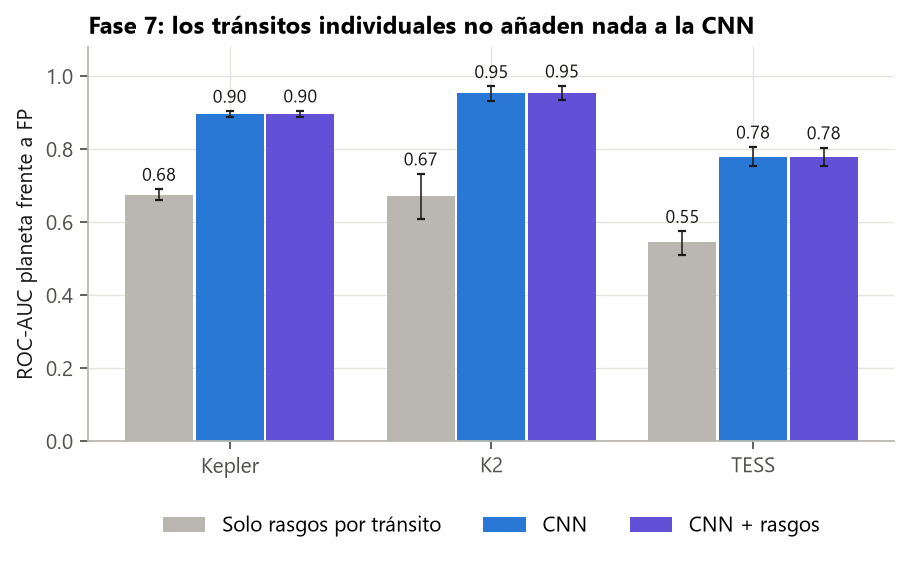
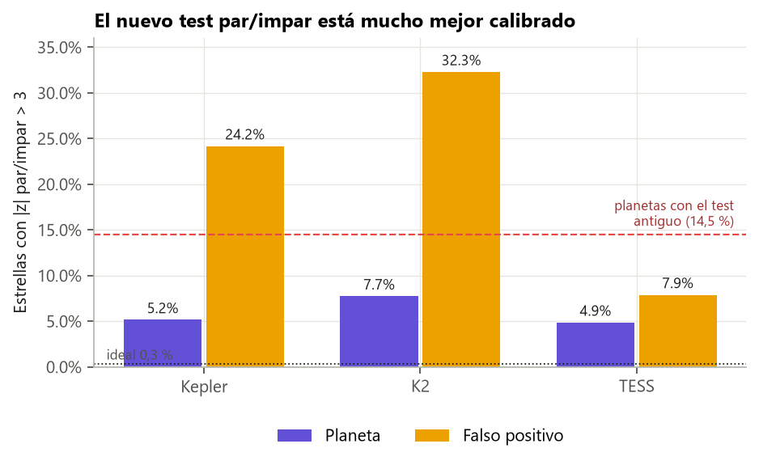

# Guía para redactar: tránsitos individuales (¿se pierde información al plegar?)

**Idea central de la sección:** antes de construir un Transformer que mirara cada tránsito por separado, mediste si esa información existe y aporta algo. En TESS no aporta nada a la red (+0,000), así que no se recomienda el Transformer de tránsitos para TESS. Por el camino conseguiste un test par/impar mucho mejor calibrado, y una lista de planetas de Kepler con tránsitos irregulares (interesante para DIPS Ojos).

## Introducción: por qué y cómo

**Por qué se hizo.**
- Al plegar, todos los tránsitos se resumen en uno medio, y se pierden las diferencias entre ellos (eclipses alternos, un tránsito raro, profundidades que cambian).
- Un Transformer sobre tránsitos individuales era una apuesta cara (varias semanas). Lo sensato era comprobar primero, con una prueba barata (menos de un día), si había algo que ganar.

**Cómo se hizo.**
- A cada tránsito se le ajusta la forma media de **los demás**, con la amplitud libre.
- El ruido rojo se mide en «tránsitos falsos», en fases sin señal.
- Se calculan tres medidas que no dependen del número de tránsitos: diferencia par/impar, dispersión entre tránsitos y tránsito más desviado.
- Se comparan con la red usando predicciones fuera de muestra, con un criterio fijado antes de mirar.

**Qué se buscaba conseguir.** Decidir, con datos, si merecía la pena construir el Transformer.

## Qué contar, en orden

1. **La pregunta:** ¿qué información borra el plegado? Pon ejemplos: binaria con periodo a la mitad, tránsito anómalo, profundidad variable.
2. **Por qué probar barato antes de construir:** buena práctica, que cuesta un día frente a semanas.
3. **Cómo se mide cada tránsito:**
   - Explica por qué se usa la forma de los demás: para que el tránsito no se compare consigo mismo.
   - Cuenta el fallo de la primera versión: medir la media de los puntos centrales daba variaciones falsas en las binarias en V con cadencia de 30 min. Es un buen ejemplo de depuración.
4. **El ruido rojo y los «tránsitos falsos»:** qué es el ruido rojo y por qué los tests clásicos exageran.
5. **Las tres medidas, y por qué no deben depender del número de tránsitos** (es un atajo conocido).
6. **El criterio fijado antes de mirar.**
7. **Resultado:**
   - TESS: +0,000 [−0,005, +0,005]; entre los que la red llama planeta, AUC 0,515.
   - Kepler y K2: la dispersión separa sola (~0,67), pero la red ya lo sabe.
8. **Interpretación:**
   - En TESS, con 6–9 tránsitos de un sector, cada tránsito tiene poca señal.
   - Las binarias que se escapan no son de tránsitos alternos.
   - Siguiente palanca: una vista del secundario y una local de más resolución.
9. **Lo que se gana:**
   - Test par/impar calibrado: en planetas, P(|z| > 3) baja del 14,5 % al 5 %.
   - El 19 % de los planetas de Kepler tienen tránsitos más irregulares de lo esperado: candidatos a manchas o TTV, que conecta con DIPS Ojos.
10. **Corrección colateral:** el código no encontraba los archivos de la campaña 10 de K2 (44 estrellas).

## Conceptos que conviene explicar al lector

- **Plegado y tránsito medio.**
- **Ruido rojo.**
- **TTV** (variaciones del momento del tránsito por otros planetas).
- **Prueba de viabilidad antes de construir.**
- **Predicciones fuera de muestra.**

## Datos clave para citar

6 650 estrellas analizadas · ganancia en TESS +0,000 · AUC 0,515 entre los que la red llama planeta · par/impar en planetas 14,5 % → 5 % · 19 % de planetas de Kepler con dispersión > 3.

## Figuras

**Resultado: los rasgos por tránsito no añaden nada a la red:**

**El nuevo test par/impar, mejor calibrado:**

## Limitaciones que mencionar

- Que estos tres rasgos no ganen no demuestra que no exista *ninguna* información por tránsito; solo que los mecanismos principales no aportan.
- El test par/impar no llega al 0,3 % teórico (puede ser física real).

## Código

`src/exoplanet/features.py` (función `transit_features`, con 3 tests), `scripts/data/build_transit_feats.py` y `scripts/checks/transit_feats_check.py`.

## Fuentes

- Pont, Zucker y Queloz (2006), ruido rojo en tránsitos: https://arxiv.org/abs/astro-ph/0608597
- Carter y Winn (2009), ruido correlacionado: https://arxiv.org/abs/0909.0747
- Holman y Murray (2005) y Agol et al. (2005), TTV: Science 307 y MNRAS 359.
- Thompson et al. (2018), test par/impar del Robovetter: https://arxiv.org/abs/1710.06758
- DIPS Ojos: https://dipsojos.uniovi.es
