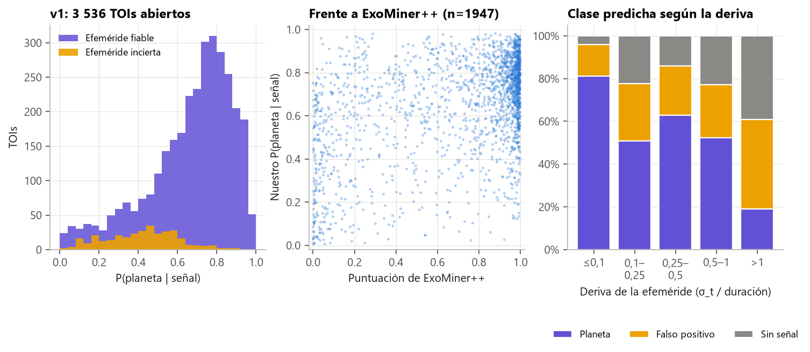

# Guía para redactar: predicciones congeladas (v1) sobre los candidatos abiertos

**Idea central de la sección:** predijiste los 3 536 candidatos de TESS sin resolver que tenían una curva usable. Guardaste las predicciones con huellas digitales y las publicaste en GitHub (etiqueta `v1`) para compararlas en el futuro con las respuestas reales, junto a ExoMiner++ y el TFOP. Por el camino descubriste y resolviste el problema de la deriva de la efeméride.

## Introducción: por qué y cómo

**Por qué se hizo.**
- Toda la evaluación anterior usa casos con respuesta conocida, y siempre queda la duda de si alguna decisión se tomó mirándolas.
- Una **validación prospectiva** (predecir hoy, comprobar después) elimina esa duda y es la prueba más convincente posible.
- Además, permite comparar a ciegas con ExoMiner++ y con las prioridades del TFOP.

**Cómo se hizo.**
- Se descargó 1 sector de 2 min para cada TOI en estado PC y se plegó igual que al entrenar.
- Se predijo con el modelo final más la temperatura de TESS.
- Se guardaron la probabilidad de planeta dado que hay señal, la puntuación de ExoMiner++ y las prioridades del TFOP.
- Se congeló todo con hashes SHA-256 y una etiqueta pública en GitHub.

**Qué se buscaba conseguir.** Arrancar el reloj de la validación prospectiva con un resultado verificable.

## Qué contar, en orden

1. **Qué es una validación prospectiva.** La analogía de la quiniela en un sobre cerrado funciona bien.
2. **Qué se predijo:**
   - 4 813 TOIs en PC; 76 sin periodo; 4 737 procesados; 3 536 con curva usable.
   - 756 sin datos de 2 min y 444 con pocos tránsitos o huecos.
3. **Qué se guardó por candidato:**
   - las 3 probabilidades;
   - **P(planeta | señal)**, y explica por qué es la cifra útil: en un candidato ya hay una señal;
   - ExoMiner++ (2 007 TOIs);
   - las prioridades del TFOP.
4. **Cómo se demuestra que no se cambió:** los hashes SHA-256 de pesos, temperatura, vistas, ExoFOP, ExoMiner++ y predicciones; el manifiesto y la etiqueta `v1`. Una mejora futura se congela como v2.
5. **El problema de la deriva de la efeméride** (la parte más interesante de la sección):
   - Qué es: el error del periodo se acumula con cada órbita, como un reloj que atrasa.
   - Cómo apareció: al elegir el sector con más tránsitos, el 8 % de los TOIs tenía un error mayor que la duración, y el 54 % de ellos salía «sin señal».
   - Por qué no pasaba al entrenar: las efemérides de los objetos resueltos están refinadas.
   - La solución: elegir el sector con menor deriva y marcar como inciertos los que superan 0,25 duraciones.
   - Con deriva baja, solo el 4 % sale «sin señal»; con deriva > 1, el 39 %.
   - 326 TOIs (9 %) quedan marcados como inciertos.
   - Lección: el fallo estaba en el puente entre el catálogo y los datos, no en el modelo, y solo aparece al usar el modelo con datos reales.
6. **Resultado:**
   - De los 3 210 fiables: 2 564 planeta, 493 FP y 153 sin señal.
   - Frente a ExoMiner++: coinciden en el 76 %, con una correlación de 0,37 (esperable, porque ExoMiner++ usa más información).
7. **Qué falta:**
   - Cruzar periódicamente con ExoFOP.
   - Idea complementaria: una validación pseudo-prospectiva por fecha de alerta, que daría un resultado ya.

## Conceptos que conviene explicar al lector

- **TOI y disposición.**
- **Validación prospectiva.**
- **Hash SHA-256:** una huella digital de un archivo.
- **Deriva de la efeméride.**
- **P(planeta | señal):** probabilidad condicionada.

## Datos clave para citar

3 536 TOIs · 3 210 fiables · 326 inciertos · 2 564 / 493 / 153 · coincidencia con ExoMiner++ del 76 % · deriva > 1 → 39 % «sin señal».

## Figuras

**Las predicciones v1:** distribución, comparación con ExoMiner++ y efecto de la deriva (la figura de la sección):

## Limitaciones que mencionar

- El corte de 0,25 duraciones se fijó antes de ver los datos; entre 0,1 y 0,25 ya se nota algo (22 % «sin señal»).
- La elección del sector usa la deriva, que el entrenamiento no necesitaba: es la única diferencia con la cadena de entrenamiento.
- Las disposiciones del TFOP tardan meses o años en llegar.

## Código

`scripts/data/build_toi_views.py`, `scripts/models/predict_tois.py` y `scripts/checks/toi_ephemeris_drift.py`; resultados en `results/toi/`.

## Fuentes

- ExoFOP-TESS: https://exofop.ipac.caltech.edu/tess/
- ExoMiner++: https://arxiv.org/abs/2502.09790 ; catálogo: https://doi.org/10.5281/zenodo.15466293
- TFOP: https://heasarc.gsfc.nasa.gov/docs/tess/tfop.html
- Guerrero et al. (2021), catálogo de TOIs: https://arxiv.org/abs/2103.12538
- MAST, curvas de TESS: https://archive.stsci.edu/missions-and-data/tess
